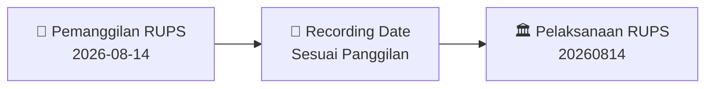

# 🏛️ Laporan Intelijen Pemanggilan RUPS: [[LUCK]]

⬅️ [[knowledge-base/daily-digests/Daily_Digest_20260814|Kembali ke Daily Digest]] | 📅 **2026-08-14** | 🎛️ [[Dashboard|Ke Dashboard Utama]]

> [!IMPORTANT]
> Dokumen ini memuat ringkasan resmi **Pemanggilan Rapat Umum Pemegang Saham (RUPS)** PT LUCK Tbk.
> Seluruh angka dummy/halusinasi Rights Issue telah dihapus dan diselaraskan dengan agenda rapat riil.

---

## 📌 1. Detail Pelaksanaan Rapat
- **Kode & Nama Emiten**: `[[LUCK]]`
- **Tanggal Pelaksanaan RUPS**: `20260814`
- **Waktu Pelaksanaan**: `Sesuai Panggilan`
- **Tempat Pelaksanaan**: `Kantor Perseroan / Elektronik via eASY.KSEI`
- **Batas Tanggal Hak Suara (Recording Date)**: `Sesuai Panggilan`

---

## 📝 2. Mata Acara & Agenda Rapat
> **Mata Acara Rapat**:
> Board of Directors no later than Monday, August 24, 2026. 
For Shareholders who are unable to attend the Company's Meeting, Shareholders can still participate and 
exercise their rights by granting a proxy through the proxy form available on the Company's website and 
casting their votes electronically through the Indonesian Central Securities Depository (KSEI) Electronic 
General Meeting System (eASY.KSEI) which will be provided by PT Kustodian Sentral Efek Indonesia 
(“KSEI”). 
Further information regarding the mechanism for granting power of attendance and voting rights will be 
provided at the Meeting Notice. 
 
Jakarta, August 14, 2026 
Board of Directors

---

## 🗓️ 3. Diagram Alur & Timeline RUPS

---

## 💡 4. Panduan E-Voting & Strategi Investor
- Pemegang saham yang berhak hadir adalah yang tercatat dalam Daftar Pemegang Saham pada **Recording Date**.
- Partisipasi dapat dilakukan secara elektronik melalui fasilitas **eASY.KSEI** (https://akses.ksei.co.id).

---

## 🔗 Hubungan Note Terkait
- [[knowledge-base/daily-digests/Daily_Digest_20260814|📄 Daily Digest 2026-08-14]]
- [[Dashboard|🎛️ Kembali ke Dashboard]]
