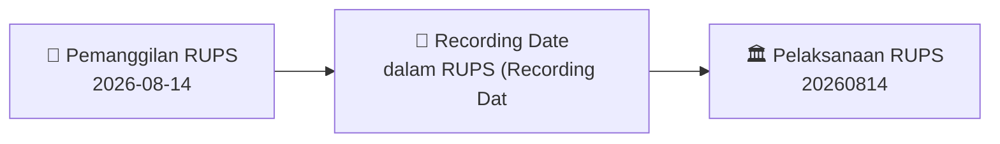

# 🏛️ Laporan Intelijen Pemanggilan RUPS: [[RATU]]

⬅️ [[knowledge-base/daily-digests/Daily_Digest_20260814|Kembali ke Daily Digest]] | 📅 **2026-08-14** | 🎛️ [[Dashboard|Ke Dashboard Utama]]

> [!IMPORTANT]
> Dokumen ini memuat ringkasan resmi **Pemanggilan Rapat Umum Pemegang Saham (RUPS)** PT RATU Tbk.
> Seluruh angka dummy/halusinasi Rights Issue telah dihapus dan diselaraskan dengan agenda rapat riil.

---

## 📌 1. Detail Pelaksanaan Rapat
- **Kode & Nama Emiten**: `[[RATU]]`
- **Tanggal Pelaksanaan RUPS**: `20260814`
- **Waktu Pelaksanaan**: `Waktu :`
- **Tempat Pelaksanaan**: `diumumkan dan sesuai iklan)`
- **Batas Tanggal Hak Suara (Recording Date)**: `dalam RUPS (Recording Date)`

---

## 📝 2. Mata Acara & Agenda Rapat
> **Mata Acara Rapat**:
> No Agenda
Isi Agenda
1
Persetujuan atas rencana PMTHMETD Perseroan
melalui penerbitan saham-saham baru sesuai ketentuan
POJK No. 14/2019
2
Persetujuan atas perubahan Pasal 4 ayat (2) Anggaran
Dasar Perseroan sehubungan dengan penerbitan
saham dalam rangka PMTHMETD Perseroan tersebut.
Informasi Lain
Hormat Kami,

---

## 🗓️ 3. Diagram Alur & Timeline RUPS

---

## 💡 4. Panduan E-Voting & Strategi Investor
- Pemegang saham yang berhak hadir adalah yang tercatat dalam Daftar Pemegang Saham pada **Recording Date**.
- Partisipasi dapat dilakukan secara elektronik melalui fasilitas **eASY.KSEI** (https://akses.ksei.co.id).

---

## 🔗 Hubungan Note Terkait
- [[knowledge-base/daily-digests/Daily_Digest_20260814|📄 Daily Digest 2026-08-14]]
- [[Dashboard|🎛️ Kembali ke Dashboard]]
