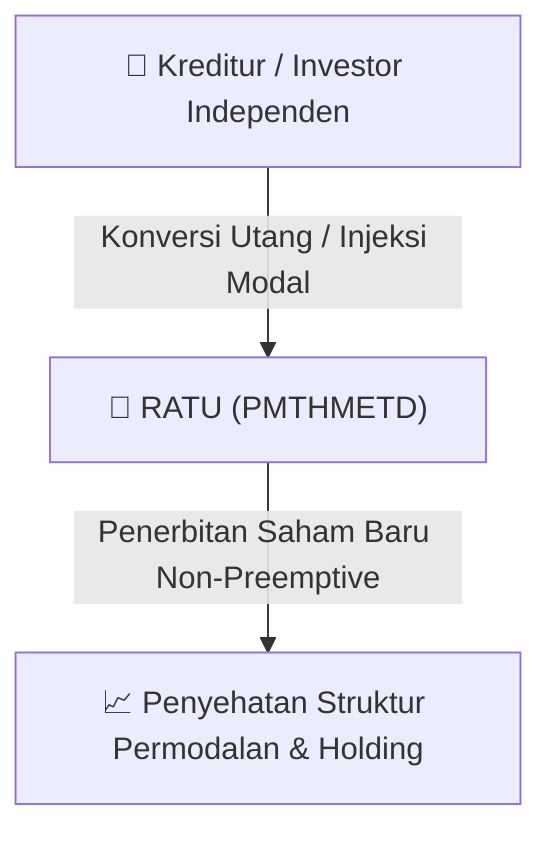

# ⚡ Laporan Intelijen Aksi Korporasi: [[RATU]] - RUPS

⬅️ [[knowledge-base/daily-digests/Daily_Digest_20260904|Kembali ke Daily Digest]] | 📅 **2026-09-04** | 🎛️ [[Dashboard|Ke Dashboard Utama]]

> [!IMPORTANT]
> Laporan ini disusun secara otomatis oleh **Corporate Action Intelligence Agent** untuk memetakan implikasi strategis, rasio keuangan, alokasi dana, jadwal penting, dan panduan investor.

---

## 📌 1. Ringkasan Eksekutif & Katalis Strategis
- **Kode & Nama Emiten**: `[[RATU]]`
- **Kategori Aksi Korporasi**: `RUPS`
- **Dokumen Resmi Bursa**: `Pemanggilan RUPS`
- **Ringkasan Inti Aksi**: Informasi dan fakta material RATU: REC/CO/04.261/IX/2026 PT Raharja Energi Cepu Tbk RATU 1 Pemanggilan Rapat Umum Pemegang Saham Luar Biasa(KOREKSI) Mengoreksi surat kami nomor : REC/CO/14.243/VIII/2026 tanggal 14 Agustus 2026 Pemanggilan Rapat Umum Pemegang Saham Luar Biasa, dengan ini perseroan menyampaikan hal sebagai berikut: bahwa koreksi ini akan dilakukan pemenuhan pada Form terpisah dikarenakan mata acara persetujuan PMTHMETD pelaporannya dilaporkan terpisah sebagai pemenuhan administrasi Merujuk pada surat Perseroan Nomo

---

## 📊 2. Matriks Parameter Material & Angka Kunci
| Parameter Utama | Nilai / Keterangan Resmi |
| :--- | :--- |
| **Uraian Kejadian** | `REC/CO/04.261/IX/2026 PT Raharja Energi Cepu Tbk RATU 1 Pemanggilan Rapat Umum Pemegang Saham Luar Biasa(KOREKSI) Mengoreksi surat kami nomor : REC/CO/14.243/VIII/2026 tanggal 14 Agustus 2026 Pemanggilan Rapat Umum Pemegang Saham Luar Biasa, dengan ini perseroan menyampaikan hal sebagai berikut: bahwa koreksi ini akan dilakukan pemenuhan pada Form terpisah dikarenakan mata acara persetujuan PMTHMETD pelaporannya dilaporkan terpisah sebagai pemenuhan administrasi Merujuk pada surat Perseroan Nomo` |

---

## 🏢 3. Detail Rencana PMTHMETD / Private Placement [[RATU]]
- **Jenis Aksi Korporasi**: `Penambahan Modal Tanpa Hak Memesan Efek Terlebih Dahulu (PMTHMETD / Private Placement)`
- **Tujuan Utama**: `Informasi dan fakta material RATU: REC/CO/04.261/IX/2026 PT Raharja Energi Cepu Tbk RATU 1 Pemanggilan Rapat Umum Pemegang Saham Luar Biasa(KOREKSI) Mengoreksi surat kami nomor : REC/CO/14.243/VIII/2026 tanggal 14 Agustus 2026 Pemanggilan Rapat Umum Pemegang Saham Luar Biasa, dengan ini perseroan menyampaikan hal sebagai berikut: bahwa koreksi ini akan dilakukan pemenuhan pada Form terpisah dikarenakan mata acara persetujuan PMTHMETD pelaporannya dilaporkan terpisah sebagai pemenuhan administrasi Merujuk pada surat Perseroan Nomo`
- **Mekanisme**: Konversi Utang Menjadi Saham (*Debt-to-Equity Swap*) & Penerbitan Saham Baru kepada Investor Standby / Independen.

## 📈 4. Visualisasi Alur Private Placement (PMTHMETD)

## 💡 5. Panduan Strategi Investor & Analisis Dampak
- 🟢 **Penyehatan Struktur Permodalan**: Konversi utang menjadi saham mengurangi beban bunga (*interest expense*) dan memperbaiki ekuitas [[RATU]].
- ⚠️ **Dampak Dilusi Tanpa HMETD**: Karena dilakukan tanpa HMETD, pemegang saham publik tidak mendapatkan hak membeli saham baru, sehingga terjadi dilusi persentase kepemilikan.

---

## 🔗 Hubungan Note Terkait (Knowledge Graph)
- [[knowledge-base/daily-digests/Daily_Digest_20260904|📄 Daily Digest 2026-09-04]]
- [[knowledge-base/trading-signals/Trading_Signals_20260904|🎯 Sinyal Cuan 2026-09-04]]
- [[Dashboard|🎛️ Kembali ke Dashboard]]