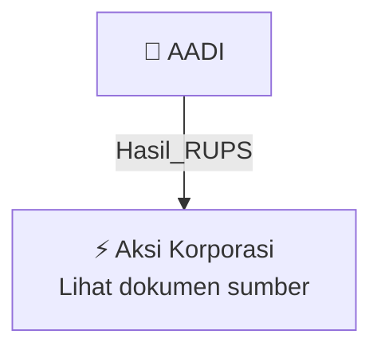

# 🏛️ Hasil & Keputusan RUPS / RUPSLB — [[AADI]]

⬅️ [[knowledge-base/daily-digests/Daily_Digest_20261002|Kembali ke Daily Digest]] | 📅 **2026-10-02** | 🎛️ [[Dashboard|Ke Dashboard Utama]]

> [!IMPORTANT]
> Laporan ini disusun secara otomatis oleh **Corporate Action Intelligence Agent** pada **2026-10-02**.
> Sumber dokumen: `20261001_AADI_20260929_AADI_Transaksi Material Tanpa Persetujuan RUPS_32161672_lamp1.pdf`

---

## 📌 1. Ringkasan Eksekutif & Tujuan Strategis

- **Kode & Nama Emiten**: `[[AADI]]`
- **Kategori Aksi Korporasi**: `Hasil_RUPS`
- **Dokumen Sumber**: `20261001_AADI_20260929_AADI_Transaksi Material Tanpa Persetujuan RUPS_32161672_lamp1.pdf`
- **Tanggal Laporan**: `2026-10-02`

[Analisis LLM tidak tersedia — isi manual]

---

## 📊 2. Fakta Material & Parameter Keuangan

| Parameter Utama | Nilai / Keterangan |
| :--- | :--- |
| **Nama Perseroan** | `PT Adaro Andalan Indonesia Tbk` |
| **Kode Emiten** | `AADI` |
| **Jenis Transaksi** | `Transaksi Material` |
| **Dasar Hukum** | `POJK No. 17/POJK.04/2020 tentang Transaksi Material dan Perubahan Kegiatan Usaha; POJK No. 42/POJK.04/2020 tentang Transaksi Afiliasi dan Transaksi Benturan Kepentingan` |
| **Pihak Penjual** | `Adaro Capital Limited (ACL)` |
| **Pihak Pembeli** | `Yancoal Australia Limited (Yancoal)` |
| **Objek Transaksi** | `Seluruh saham dan waran milik ACL di Kestrel Coal Group Pty Ltd (Kestrel)` |
| **Tanggal Sale and Purchase Agreement** | `14 April 2026` |
| **Nomor Surat Keterbukaan Informasi Sebelumnya** | `AAI/018/IV-26/corsec` |
| **Tanggal Surat Keterbukaan Informasi Sebelumnya** | `14 April 2026` |
| **Status Transaksi Afiliasi** | `Bukan Transaksi Afiliasi` |
| **Status Benturan Kepentingan** | `Bukan Transaksi Benturan Kepentingan` |
| **Dampak Kelangsungan Usaha** | `Tidak berpotensi mengakibatkan terganggunya kelangsungan usaha Perseroan` |
| **Penilai Independen** | `KJPP Desmar, Susanto, Salman dan Rekan` |
| **Laporan Keuangan Kestrel** | `Laporan Keuangan Konsolidasian Kestrel per 30 Juni 2026 dan untuk periode enam bulan yang berakhir 30 Juni 2026, diaudit oleh PricewaterhouseCoopers Australia` |
| **Laporan Keuangan Perseroan** | `Laporan Keuangan Konsolidasian Perseroan per 30 Juni 2026 dan untuk periode enam bulan yang berakhir 30 Juni 2026, ditelaah terbatas oleh Rintis, Jumadi, Rianto & Rekan` |
| **Tanggal Penerbitan Keterbukaan Informasi** | `1 Oktober 2026` |
| **Kantor Pusat** | `Cyber 2 Tower Lantai 26, Jakarta 12950, Indonesia` |
| **Kegiatan Usaha** | `Aktivitas perusahaan holding; pertambangan batu bara; jasa pertambangan; konsultasi manajemen; pengelolaan sumber daya air; ketenagalistrikan; jasa pengangkutan barang khusus; perkebunan kelapa sawit; perkebunan karet dan tanaman penghasil getah lainnya` |

---

## 👥 3. Struktur Kepemilikan, Pengendali & Pembeli Siaga

- **Emiten**: `AADI` | Informasi kepemilikan mengacu pada dokumen resmi sumber.

---

## 🎯 4. Alokasi & Rencana Penggunaan Dana

- Informasi alokasi dana belum tersedia — lihat prospektus / dokumen resmi.

---

## 📅 5. Timeline & Jadwal Pelaksanaan

| Tahapan / Event | Tanggal |
| :--- | :---: |
| **Jadwal** | Lihat dokumen sumber. |

---

## 📈 6. Diagram Visual Flowchart (Mermaid)

---

## 💡 7. Rekomendasi Investor & Strategi Trading

[Analisis LLM tidak tersedia — isi manual]

---

## 🔗 8. Hubungan Note Terkait (Knowledge Graph)

- [[knowledge-base/daily-digests/Daily_Digest_20261002|📄 Daily Digest 2026-10-02]]
- [[knowledge-base/trading-signals/Trading_Signals_20261002|🎯 Sinyal Cuan 2026-10-02]]
- [[AADI|🏬 Halaman Emiten AADI]]
- [[Dashboard|🎛️ Kembali ke Dashboard Utama]]

---

*Laporan dibuat otomatis oleh Corporate Action Intelligence Agent · 2026-10-02*