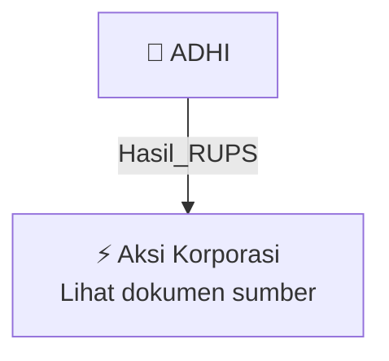

# 🏛️ Hasil & Keputusan RUPS / RUPSLB — [[ADHI]]

⬅️ [[knowledge-base/daily-digests/Daily_Digest_20261005|Kembali ke Daily Digest]] | 📅 **2026-10-05** | 🎛️ [[Dashboard|Ke Dashboard Utama]]

> [!IMPORTANT]
> Laporan ini disusun secara otomatis oleh **Corporate Action Intelligence Agent** pada **2026-10-05**.
> Sumber dokumen: `20261002_ADHI_20261002_ADHI_Ringkasan RisalahRisalah RUPS_32162681_lamp1.pdf`

---

## 📌 1. Ringkasan Eksekutif & Tujuan Strategis

- **Kode & Nama Emiten**: `[[ADHI]]`
- **Kategori Aksi Korporasi**: `Hasil_RUPS`
- **Dokumen Sumber**: `20261002_ADHI_20261002_ADHI_Ringkasan RisalahRisalah RUPS_32162681_lamp1.pdf`
- **Tanggal Laporan**: `2026-10-05`

[Analisis LLM tidak tersedia — isi manual]

---

## 📊 2. Fakta Material & Parameter Keuangan

| Parameter Utama | Nilai / Keterangan |
| :--- | :--- |
| **Jenis RUPS** | `Extraordinary General Meeting of Shareholders (EGMS) / RUPS Luar Biasa` |
| **Penyelenggara** | `PT ADHI KARYA (Persero) Tbk` |
| **Tempat** | `Auditorium, Lantai 16, ADHI Tower, Jalan M.T. Haryono Kav. 27, Jakarta Timur` |
| **Waktu Mulai** | `14:37 WIB` |
| **Tanggal Akta RUPS** | `30 September 2025` |
| **Nomor Akta RUPS** | `193` |
| **Notaris** | `Rosida Rajagukguk-Siregar, S.H., M.Kn.` |
| **Nomor Cover Note Notaris** | `192/NOT-RRS/CN/PT/IX/2026` |
| **Kuorum Kehadiran - Jumlah Saham** | `5.437.413.007 saham` |
| **Kuorum Kehadiran - Persentase** | `64,67%` |
| **Total Saham dengan Hak Suara** | `8.407.608.979 saham` |
| **Agenda Pertama** | `Menyetujui Proposal Restrukturisasi yang diajukan Perseroan sebagai langkah strategis untuk memperbaiki kondisi dan kinerja internal Perseroan; memberikan kewenangan dan kuasa kepada pemegang saham Seri B terbanyak untuk memberikan persetujuan jika terjadi perubahan metode restrukturisasi.` |
| **Agenda Kedua** | `Menyetujui penerimaan pinjaman bank dan/atau non-bank jangka menengah dan/atau panjang sebagai salah satu langkah restrukturisasi; memberikan kewenangan kepada Direksi untuk mengambil semua tindakan yang diperlukan.` |
| **Hasil Voting Agenda Pertama** | `Abstain: 7.566.164; Negatif: 19.519.152; Afirmatif: 5.410.327.691; Total Afirmatif: 5.417.893.855` |
| **Hasil Voting Agenda Kedua** | `Abstain: 7.566.264; Negatif: 19.519.152; Afirmatif: 5.410.327.591; Total Afirmatif: 5.417.893.855` |
| **Mekanisme Pengambilan Keputusan** | `Musyawarah untuk mufakat; jika tidak tercapai, melalui voting.` |
| **Pertanyaan Pemegang Saham Agenda Pertama** | `Tidak ada` |
| **Pertanyaan Pemegang Saham Agenda Kedua** | `Tidak ada` |
| **Dewan Komisaris** | `Presiden Komisaris: Dody Usodo Hargo Suseno; Komisaris: Alexander Rubi Satyo Adi; Komisaris Independen: Erwin Moeslimin Singajuru, Elan Suherlan, Rustam Sofyan Sirait` |
| **Direksi** | `Direktur Utama: Moeharmein Zein Chainago; Direktur Keuangan: Bani Iqbal; Direktur Operasi I: Harimawan; Direktur Operasi II: Yan Arianto; Direktur Human Capital and Legal: Ki Syahgolang Permata; Direktur Business Portfolio and Risk: Rozi Sparta` |

---

## 👥 3. Struktur Kepemilikan, Pengendali & Pembeli Siaga

- **Emiten**: `ADHI` | Informasi kepemilikan mengacu pada dokumen resmi sumber.

---

## 🎯 4. Alokasi & Rencana Penggunaan Dana

- Informasi alokasi dana belum tersedia — lihat prospektus / dokumen resmi.

---

## 📅 5. Timeline & Jadwal Pelaksanaan

| Tahapan / Event | Tanggal |
| :--- | :---: |
| **Jadwal** | Lihat dokumen sumber. |

---

## 📈 6. Diagram Visual Flowchart (Mermaid)

---

## 💡 7. Rekomendasi Investor & Strategi Trading

[Analisis LLM tidak tersedia — isi manual]

---

## 🔗 8. Hubungan Note Terkait (Knowledge Graph)

- [[knowledge-base/daily-digests/Daily_Digest_20261005|📄 Daily Digest 2026-10-05]]
- [[knowledge-base/trading-signals/Trading_Signals_20261005|🎯 Sinyal Cuan 2026-10-05]]
- [[ADHI|🏬 Halaman Emiten ADHI]]
- [[Dashboard|🎛️ Kembali ke Dashboard Utama]]

---

*Laporan dibuat otomatis oleh Corporate Action Intelligence Agent · 2026-10-05*