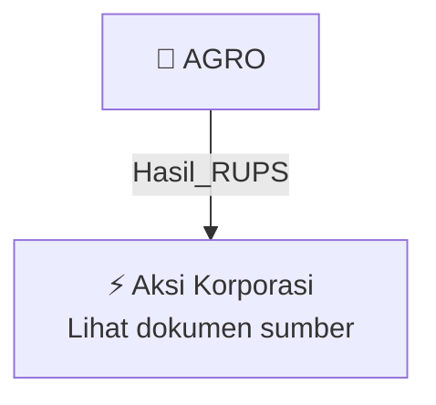

# 🏛️ Hasil & Keputusan RUPS / RUPSLB — [[AGRO]]

⬅️ [[knowledge-base/daily-digests/Daily_Digest_20261012|Kembali ke Daily Digest]] | 📅 **2026-10-12** | 🎛️ [[Dashboard|Ke Dashboard Utama]]

> [!IMPORTANT]
> Laporan ini disusun secara otomatis oleh **Corporate Action Intelligence Agent** pada **2026-10-12**.
> Sumber dokumen: `20261009_AGRO_20261009_AGRO_Ringkasan RisalahRisalah RUPS_32165033.pdf`

---

## 📌 1. Ringkasan Eksekutif & Tujuan Strategis

- **Kode & Nama Emiten**: `[[AGRO]]`
- **Kategori Aksi Korporasi**: `Hasil_RUPS`
- **Dokumen Sumber**: `20261009_AGRO_20261009_AGRO_Ringkasan RisalahRisalah RUPS_32165033.pdf`
- **Tanggal Laporan**: `2026-10-12`

[Analisis LLM tidak tersedia — isi manual]

---

## 📊 2. Fakta Material & Parameter Keuangan

| Parameter Utama | Nilai / Keterangan |
| :--- | :--- |
| **Jenis RUPS** | `Rapat Umum Pemegang Saham Luar Biasa` |
| **Tanggal penyelenggaraan RUPS** | `07 Oktober 2026` |
| **Nomor surat penyampaian hasil RUPS** | `B.459/DIR.02/CSC/10/2026` |
| **Kuorum kehadiran RUPS** | `Dihadiri oleh pemegang saham yang mewakili 21.492.346.572 saham atau 97,1352% dari seluruh saham dengan hak suara yang sah` |
| **Agenda 1** | `Perubahan Anggaran Dasar Perseroan dalam rangka penyelarasan Anggaran Dasar Perseroan terhadap ketentuan peraturan perundang-undangan yang berlaku, termasuk ketentuan terkait Anak Usaha Badan Usaha Milik Negara beserta peraturan pelaksanaannya` |
| **Hasil Agenda 1** | `Setuju 21.491.346.572 saham (99,995%); Tidak Setuju 0 (0%); Abstain 1.000.000 (0,005%)` |
| **Agenda 2** | `Perubahan Susunan Pengurus Perseroan` |
| **Hasil Agenda 2** | `Setuju 21.491.346.572 saham (99,995%); Tidak Setuju 0 (0%); Abstain 1.000.000 (0,005%)` |
| **Pengunduran diri pengurus** | `Sdr. Kicky Andrie Davetra mengundurkan diri dan diberhentikan dengan hormat sebagai Direktur Bisnis terhitung sejak 13 Juli 2026` |
| **Pengangkatan pengurus** | `Sdr. Hari Basuki diangkat sebagai Direktur Bisnis Perseroan, efektif setelah mendapat persetujuan OJK dan memenuhi ketentuan perundang-undangan` |
| **Masa jabatan Direktur Bisnis yang diangkat** | `Paling lama sampai dengan penutupan RUPS Tahunan ke-5 sejak ditutupnya rapat ini, tanpa mengurangi hak RUPS untuk memberhentikan sewaktu-waktu` |
| **Susunan Dewan Komisaris** | `Komisaris Utama: Muhammad Sidik Heruwibowo; Komisaris Independen: Johanes Kuntjoro Adisardjono, Retno Wahyuni Wijayanti, Farid Rahman; Komisaris: Tatang Yuliono (efektif setelah penilaian kemampuan dan kepatutan disetujui OJK)` |
| **Susunan Direksi** | `Direktur Utama: Ida Bagus Ketut Subagia; Direktur Digital dan Operasional: Lukman Hakim; Direktur Keuangan: Rustarti Suri Pertiwi; Direktur Manajemen Risiko, Kepatuhan dan Sumber Daya Manusia: Danar Widyantoro; Direktur Bisnis: Hari Basuki` |
| **Permintaan kepada Direksi terkait Fit & Proper Test** | `Direksi diminta mengajukan permohonan tertulis kepada Otoritas Jasa Keuangan untuk pelaksanaan Penilaian Kemampuan dan Kepatutan atas pengangkatan pengurus` |
| **Kuasa kepada Direksi** | `Direksi diberi kuasa dengan hak substitusi untuk menyatakan keputusan RUPS dalam bentuk Akta Notaris serta melakukan penyesuaian atau perbaikan yang diperlukan` |
| **Periode jabatan Direksi - Ida Bagus Ketut Subagia** | `Direktur Utama, 25 Juni 2025 sampai 25 Juni 2030, periode ke-2` |
| **Periode jabatan Direksi - Rustarti Suri Pertiwi** | `Direktur, 10 Mei 2023 sampai 10 Mei 2028, periode ke-1` |
| **Periode jabatan Direksi - Danar Widyantoro** | `Direktur, 10 Mei 2023 sampai 10 Mei 2028, periode ke-1` |
| **Periode jabatan Direksi - Lukman Hakim** | `Direktur, 30 April 2024 sampai 30 April 2029, periode ke-1` |
| **Periode jabatan Direksi - Hari Basuki** | `Direktur, 07 Oktober 2026 sampai 07 Oktober 2031, periode ke-1` |
| **Periode jabatan Dewan Komisaris - Muhamad Sidik Heruwibowo** | `Komisaris Utama, 10 Mei 2023 sampai 10 Mei 2028, periode ke-1` |

---

## 👥 3. Struktur Kepemilikan, Pengendali & Pembeli Siaga

- **Emiten**: `AGRO` | Informasi kepemilikan mengacu pada dokumen resmi sumber.

---

## 🎯 4. Alokasi & Rencana Penggunaan Dana

- Informasi alokasi dana belum tersedia — lihat prospektus / dokumen resmi.

---

## 📅 5. Timeline & Jadwal Pelaksanaan

| Tahapan / Event | Tanggal |
| :--- | :---: |
| **Jadwal** | Lihat dokumen sumber. |

---

## 📈 6. Diagram Visual Flowchart (Mermaid)

---

## 💡 7. Rekomendasi Investor & Strategi Trading

[Analisis LLM tidak tersedia — isi manual]

---

## 🔗 8. Hubungan Note Terkait (Knowledge Graph)

- [[knowledge-base/daily-digests/Daily_Digest_20261012|📄 Daily Digest 2026-10-12]]
- [[knowledge-base/trading-signals/Trading_Signals_20261012|🎯 Sinyal Cuan 2026-10-12]]
- [[AGRO|🏬 Halaman Emiten AGRO]]
- [[Dashboard|🎛️ Kembali ke Dashboard Utama]]

---

*Laporan dibuat otomatis oleh Corporate Action Intelligence Agent · 2026-10-12*