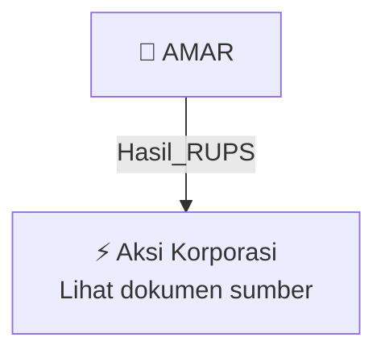

# 🏛️ Hasil & Keputusan RUPS / RUPSLB — [[AMAR]]

⬅️ [[knowledge-base/daily-digests/Daily_Digest_20261005|Kembali ke Daily Digest]] | 📅 **2026-10-05** | 🎛️ [[Dashboard|Ke Dashboard Utama]]

> [!IMPORTANT]
> Laporan ini disusun secara otomatis oleh **Corporate Action Intelligence Agent** pada **2026-10-05**.
> Sumber dokumen: `20261002_AMAR_20261002_AMAR_Ringkasan RisalahRisalah RUPS_32162740_lamp1.pdf`

---

## 📌 1. Ringkasan Eksekutif & Tujuan Strategis

- **Kode & Nama Emiten**: `[[AMAR]]`
- **Kategori Aksi Korporasi**: `Hasil_RUPS`
- **Dokumen Sumber**: `20261002_AMAR_20261002_AMAR_Ringkasan RisalahRisalah RUPS_32162740_lamp1.pdf`
- **Tanggal Laporan**: `2026-10-05`

[Analisis LLM tidak tersedia — isi manual]

---

## 📊 2. Fakta Material & Parameter Keuangan

| Parameter Utama | Nilai / Keterangan |
| :--- | :--- |
| **Jenis Rapat** | `Rapat Umum Pemegang Saham Luar Biasa (RUPSLB)` |
| **Hari/Tanggal** | `Rabu, 30 September 2026` |
| **Waktu** | `14.13 – 14.27 WIB` |
| **Tempat** | `Kantor Pusat Perseroan, RDTX Square Lt. 11, Jl. Prof. DR. Satrio No.164, RT.4/RW.4, Karet Semanggi, Setiabudi, Kota Jakarta Selatan, 12930` |
| **Mekanisme** | `Rapat dihadiri secara langsung oleh anggota Dewan Komisaris dan Direksi Perseroan` |
| **Pimpinan Rapat** | `Bapak Zainal Abidin Hasni selaku Komisaris Independen Perseroan` |
| **Kuorum Kehadiran Pemegang Saham** | `14.884.550.644 saham atau 82,63% dari seluruh saham dengan hak suara yang sah` |
| **Jumlah Seluruh Saham dengan Hak Suara Sah** | `18.013.673.305 saham` |
| **Pertanyaan/Pendapat Pemegang Saham** | `Tidak terdapat pertanyaan dan/atau pendapat dari pemegang saham atau kuasa pemegang saham hingga akhir Rapat` |
| **Metode Pengambilan Keputusan** | `Semua keputusan diambil berdasarkan musyawarah untuk mufakat; jika tidak tercapai, dilakukan melalui pemungutan suara` |
| **Hak Suara** | `Tiap 1 saham berhak mengeluarkan 1 suara` |
| **Dewan Komisaris yang Hadir** | `Zainal Abidin Hasni (Komisaris Independen), Ratna Heimawaty Zain (Komisaris Independen)` |
| **Direksi yang Hadir** | `Thio Sucy (Direktur Kepatuhan), Kevin Kane Wardhana (Direktur), Abraham Christo Lumban Batu (Direktur)` |
| **Pihak Independen/Profesi Penunjang Pasar Modal** | `Dr. Christina Dwi Utami, SH, M.Hum, Mkn; PT Datindo Entrycom selaku Biro Administrasi Efek` |

---

## 👥 3. Struktur Kepemilikan, Pengendali & Pembeli Siaga

- **Emiten**: `AMAR` | Informasi kepemilikan mengacu pada dokumen resmi sumber.

---

## 🎯 4. Alokasi & Rencana Penggunaan Dana

- Informasi alokasi dana belum tersedia — lihat prospektus / dokumen resmi.

---

## 📅 5. Timeline & Jadwal Pelaksanaan

| Tahapan / Event | Tanggal |
| :--- | :---: |
| **Jadwal** | Lihat dokumen sumber. |

---

## 📈 6. Diagram Visual Flowchart (Mermaid)

---

## 💡 7. Rekomendasi Investor & Strategi Trading

[Analisis LLM tidak tersedia — isi manual]

---

## 🔗 8. Hubungan Note Terkait (Knowledge Graph)

- [[knowledge-base/daily-digests/Daily_Digest_20261005|📄 Daily Digest 2026-10-05]]
- [[knowledge-base/trading-signals/Trading_Signals_20261005|🎯 Sinyal Cuan 2026-10-05]]
- [[AMAR|🏬 Halaman Emiten AMAR]]
- [[Dashboard|🎛️ Kembali ke Dashboard Utama]]

---

*Laporan dibuat otomatis oleh Corporate Action Intelligence Agent · 2026-10-05*