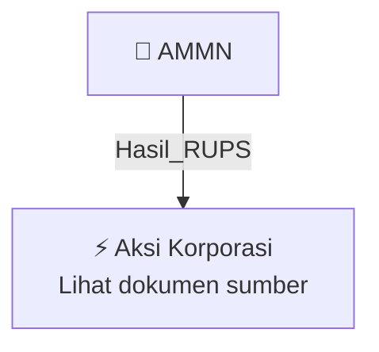

# 🏛️ Hasil & Keputusan RUPS / RUPSLB — [[AMMN]]

⬅️ [[knowledge-base/daily-digests/Daily_Digest_20261002|Kembali ke Daily Digest]] | 📅 **2026-10-02** | 🎛️ [[Dashboard|Ke Dashboard Utama]]

> [!IMPORTANT]
> Laporan ini disusun secara otomatis oleh **Corporate Action Intelligence Agent** pada **2026-10-02**.
> Sumber dokumen: `20261001_AMMN_20261001_AMMN_Laporan Informasi dan Fakta Material_32162438_lamp1.pdf`

---

## 📌 1. Ringkasan Eksekutif & Tujuan Strategis

- **Kode & Nama Emiten**: `[[AMMN]]`
- **Kategori Aksi Korporasi**: `Hasil_RUPS`
- **Dokumen Sumber**: `20261001_AMMN_20261001_AMMN_Laporan Informasi dan Fakta Material_32162438_lamp1.pdf`
- **Tanggal Laporan**: `2026-10-02`

[Analisis LLM tidak tersedia — isi manual]

---

## 📊 2. Fakta Material & Parameter Keuangan

| Parameter Utama | Nilai / Keterangan |
| :--- | :--- |
| **Nama Perusahaan** | `PT Amman Mineral Internasional Tbk` |
| **Kode Emiten** | `AMMN` |
| **Tanggal Siaran Pers** | `1 Oktober 2026` |
| **Pihak Terkait** | `M. Teguh Pamuji` |
| **Jabatan Pihak Terkait** | `Komisaris AMMAN` |
| **Tahun Pengangkatan sebagai Komisaris AMMAN** | `2021` |
| **Periode Perkara** | `Sebelum Bapak M. Teguh Pamuji diangkat sebagai Komisaris AMMAN pada tahun 2021` |
| **Keterkaitan Perkara dengan Perseroan** | `Tidak terkait dengan Perseroan maupun kegiatan usaha dan operasional Perseroan` |
| **Status Sementara** | `M. Teguh Pamuji untuk sementara waktu tidak menjalankan tugas, tanggung jawab, dan kewenangannya sebagai anggota Dewan Komisaris Perseroan` |
| **Rencana Tindak Lanjut** | `Perseroan akan mengambil langkah-langkah yang diperlukan terkait kedudukan M. Teguh Pamuji sebagai anggota Dewan Komisaris, termasuk mempertimbangkan pembahasan dalam Rapat Umum Pemegang Saham Perseroan` |
| **Pernyataan Perusahaan** | `Perseroan menghormati proses hukum yang sedang berlangsung serta akan terus memantau perkembangan yang relevan sesuai ketentuan peraturan perundang-undangan yang berlaku` |
| **Narasumber** | `Kartika Octaviana, Vice President Corporate Communications AMMAN` |
| **Komitmen Tata Kelola** | `Menerapkan prinsip tata kelola perusahaan yang baik (good corporate governance), integritas, akuntabilitas, transparansi, dan kepatuhan terhadap seluruh peraturan yang berlaku` |

---

## 👥 3. Struktur Kepemilikan, Pengendali & Pembeli Siaga

- **Emiten**: `AMMN` | Informasi kepemilikan mengacu pada dokumen resmi sumber.

---

## 🎯 4. Alokasi & Rencana Penggunaan Dana

- Informasi alokasi dana belum tersedia — lihat prospektus / dokumen resmi.

---

## 📅 5. Timeline & Jadwal Pelaksanaan

| Tahapan / Event | Tanggal |
| :--- | :---: |
| **Jadwal** | Lihat dokumen sumber. |

---

## 📈 6. Diagram Visual Flowchart (Mermaid)

---

## 💡 7. Rekomendasi Investor & Strategi Trading

[Analisis LLM tidak tersedia — isi manual]

---

## 🔗 8. Hubungan Note Terkait (Knowledge Graph)

- [[knowledge-base/daily-digests/Daily_Digest_20261002|📄 Daily Digest 2026-10-02]]
- [[knowledge-base/trading-signals/Trading_Signals_20261002|🎯 Sinyal Cuan 2026-10-02]]
- [[AMMN|🏬 Halaman Emiten AMMN]]
- [[Dashboard|🎛️ Kembali ke Dashboard Utama]]

---

*Laporan dibuat otomatis oleh Corporate Action Intelligence Agent · 2026-10-02*