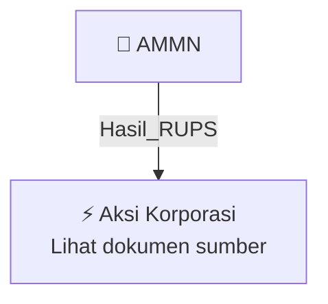

# 🏛️ Hasil & Keputusan RUPS / RUPSLB — [[AMMN]]

⬅️ [[knowledge-base/daily-digests/Daily_Digest_20261005|Kembali ke Daily Digest]] | 📅 **2026-10-05** | 🎛️ [[Dashboard|Ke Dashboard Utama]]

> [!IMPORTANT]
> Laporan ini disusun secara otomatis oleh **Corporate Action Intelligence Agent** pada **2026-10-05**.
> Sumber dokumen: `20261002_AMMN_20261002_AMMN_Tanggapan atas Permintaan Penjelasan Bursa_32162708_lamp1.pdf`

---

## 📌 1. Ringkasan Eksekutif & Tujuan Strategis

- **Kode & Nama Emiten**: `[[AMMN]]`
- **Kategori Aksi Korporasi**: `Hasil_RUPS`
- **Dokumen Sumber**: `20261002_AMMN_20261002_AMMN_Tanggapan atas Permintaan Penjelasan Bursa_32162708_lamp1.pdf`
- **Tanggal Laporan**: `2026-10-05`

[Analisis LLM tidak tersedia — isi manual]

---

## 📊 2. Fakta Material & Parameter Keuangan

| Parameter Utama | Nilai / Keterangan |
| :--- | :--- |
| **Nomor surat Perseroan** | `082/AMI/X/2026` |
| **Tanggal surat Perseroan** | `2 Oktober 2026` |
| **Referensi surat BEI** | `S-12623/BEI.PP2/10-2026` |
| **Tanggal surat BEI** | `1 Oktober 2026` |
| **Media pemberitaan** | `CNBC Indonesia` |
| **Judul berita** | `Tersangka ke-5 Kasus Nikel CNI Ternyata Komisaris Amman Mineral` |
| **Tanggal berita** | `29 September 2026` |
| **Pihak terkait** | `M. Teguh Pamuji, Komisaris Perseroan` |
| **Periode perkara** | `Sebelum pengangkatan sebagai Komisaris Perseroan pada tahun 2021` |
| **Tahun pengangkatan sebagai Komisaris** | `2021` |
| **Keterkaitan perkara dengan Perseroan** | `Tidak terkait dengan Perseroan maupun kegiatan usaha dan operasional Perseroan` |
| **Dampak terhadap Perseroan** | `Tidak berdampak merugikan terhadap kegiatan operasional, hukum, kondisi keuangan, atau kelangsungan usaha Perseroan` |
| **Status sementara M. Teguh Pamuji** | `Tidak menjalankan tugas, tanggung jawab, dan kewenangan sebagai anggota Dewan Komisaris untuk sementara waktu` |
| **Langkah Perseroan** | `Akan mengambil langkah terkait kedudukan M. Teguh Pamuji sebagai anggota Dewan Komisaris, termasuk mempertimbangkan pembahasan dalam RUPS sesuai peraturan dan Anggaran Dasar` |

---

## 👥 3. Struktur Kepemilikan, Pengendali & Pembeli Siaga

- **Emiten**: `AMMN` | Informasi kepemilikan mengacu pada dokumen resmi sumber.

---

## 🎯 4. Alokasi & Rencana Penggunaan Dana

- Informasi alokasi dana belum tersedia — lihat prospektus / dokumen resmi.

---

## 📅 5. Timeline & Jadwal Pelaksanaan

| Tahapan / Event | Tanggal |
| :--- | :---: |
| **Jadwal** | Lihat dokumen sumber. |

---

## 📈 6. Diagram Visual Flowchart (Mermaid)

---

## 💡 7. Rekomendasi Investor & Strategi Trading

[Analisis LLM tidak tersedia — isi manual]

---

## 🔗 8. Hubungan Note Terkait (Knowledge Graph)

- [[knowledge-base/daily-digests/Daily_Digest_20261005|📄 Daily Digest 2026-10-05]]
- [[knowledge-base/trading-signals/Trading_Signals_20261005|🎯 Sinyal Cuan 2026-10-05]]
- [[AMMN|🏬 Halaman Emiten AMMN]]
- [[Dashboard|🎛️ Kembali ke Dashboard Utama]]

---

*Laporan dibuat otomatis oleh Corporate Action Intelligence Agent · 2026-10-05*