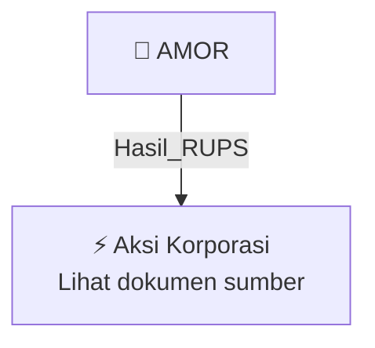

# 🏛️ Hasil & Keputusan RUPS / RUPSLB — [[AMOR]]

⬅️ [[knowledge-base/daily-digests/Daily_Digest_20260929|Kembali ke Daily Digest]] | 📅 **2026-09-29** | 🎛️ [[Dashboard|Ke Dashboard Utama]]

> [!IMPORTANT]
> Laporan ini disusun secara otomatis oleh **Corporate Action Intelligence Agent** pada **2026-09-29**.
> Sumber dokumen: `20260928_AMOR_20260928_AMOR_Keterbukaan Informasi terkait Aksi Korporasi_32161455.pdf`

---

## 📌 1. Ringkasan Eksekutif & Tujuan Strategis

- **Kode & Nama Emiten**: `[[AMOR]]`
- **Kategori Aksi Korporasi**: `Hasil_RUPS`
- **Dokumen Sumber**: `20260928_AMOR_20260928_AMOR_Keterbukaan Informasi terkait Aksi Korporasi_32161455.pdf`
- **Tanggal Laporan**: `2026-09-29`

[Analisis LLM tidak tersedia — isi manual]

---

## 📊 2. Fakta Material & Parameter Keuangan

| Parameter Utama | Nilai / Keterangan |
| :--- | :--- |
| **Uraian Kejadian** | `049/OJK/ASH/0926 PT Ashmore Asset Management Indonesia Tbk. AMOR 2 Keterbukaan Informasi terkait Aksi Korporasi Dengan ini Perusahaan Menyampaikan Penyampaian Informasi rencana Transaksi material, Rencana Transaksi Material Dengan Persetujuan RUPS Pacific Century Place, Lantai 18 SCBD Lot 10, Jl. Jendral Sudirman Kav 52-53 Nama Pengirim PT Ashmore Asset Management Indonesia Tbk. Arief Wana PT Ashmore Asset Management Indonesia Tbk. Arief Wana Jabatan 28-09-2026 17:40 1. KI Rencana Refloat Saham` |

---

## 👥 3. Struktur Kepemilikan, Pengendali & Pembeli Siaga

- **Emiten**: `AMOR` | Informasi kepemilikan mengacu pada dokumen resmi sumber.

---

## 🎯 4. Alokasi & Rencana Penggunaan Dana

- Informasi alokasi dana belum tersedia — lihat prospektus / dokumen resmi.

---

## 📅 5. Timeline & Jadwal Pelaksanaan

| Tahapan / Event | Tanggal |
| :--- | :---: |
| **Jadwal** | Lihat dokumen sumber. |

---

## 📈 6. Diagram Visual Flowchart (Mermaid)

---

## 💡 7. Rekomendasi Investor & Strategi Trading

[Analisis LLM tidak tersedia — isi manual]

---

## 🔗 8. Hubungan Note Terkait (Knowledge Graph)

- [[knowledge-base/daily-digests/Daily_Digest_20260929|📄 Daily Digest 2026-09-29]]
- [[knowledge-base/trading-signals/Trading_Signals_20260929|🎯 Sinyal Cuan 2026-09-29]]
- [[AMOR|🏬 Halaman Emiten AMOR]]
- [[Dashboard|🎛️ Kembali ke Dashboard Utama]]

---

*Laporan dibuat otomatis oleh Corporate Action Intelligence Agent · 2026-09-29*