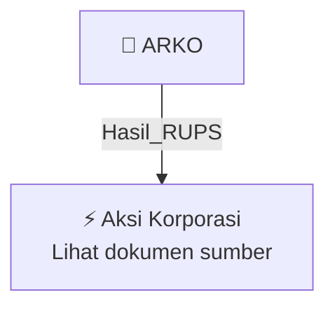

# 🏛️ Hasil & Keputusan RUPS / RUPSLB — [[ARKO]]

⬅️ [[knowledge-base/daily-digests/Daily_Digest_20260923|Kembali ke Daily Digest]] | 📅 **2026-09-23** | 🎛️ [[Dashboard|Ke Dashboard Utama]]

> [!IMPORTANT]
> Laporan ini disusun secara otomatis oleh **Corporate Action Intelligence Agent** pada **2026-09-23**.
> Sumber dokumen: `20260922_ARKO_20260922_ARKO_Pemberitahuan RencanaPenyampaian PanggilanHasil RUPORUPSURUP EBA-SP_32150326_lamp1.pdf`

---

## 📌 1. Ringkasan Eksekutif & Tujuan Strategis

- **Kode & Nama Emiten**: `[[ARKO]]`
- **Kategori Aksi Korporasi**: `Hasil_RUPS`
- **Dokumen Sumber**: `20260922_ARKO_20260922_ARKO_Pemberitahuan RencanaPenyampaian PanggilanHasil RUPORUPSURUP EBA-SP_32150326_lamp1.pdf`
- **Tanggal Laporan**: `2026-09-23`

[Analisis LLM tidak tersedia — isi manual]

---

## 📊 2. Fakta Material & Parameter Keuangan

| Parameter Utama | Nilai / Keterangan |
| :--- | :--- |
| **Uraian Kejadian** | `„ NERACA Momentum peringatan Hari Batik Nasional dihara- pkan tidak hanya mening- katkan kecintaan masya- rakat terhadap batik sebagai warisan budaya bangsa, tetapi juga membuka pelu- ang yang lebih luas bagi in- dustri kecil dan menengah (IKM) batik untuk berkem- bang dan memperluas pasar. Menteri Perindustrian Agus Gumiwang Kartasas- mita mengatakan, industri batik memiliki peran pent- ing dalam struktur industri nasional karena tidak hanya mengandung nilai budaya yang tinggi, tetapi juga memb` |

---

## 👥 3. Struktur Kepemilikan, Pengendali & Pembeli Siaga

- **Emiten**: `ARKO` | Informasi kepemilikan mengacu pada dokumen resmi sumber.

---

## 🎯 4. Alokasi & Rencana Penggunaan Dana

- Informasi alokasi dana belum tersedia — lihat prospektus / dokumen resmi.

---

## 📅 5. Timeline & Jadwal Pelaksanaan

| Tahapan / Event | Tanggal |
| :--- | :---: |
| **Jadwal** | Lihat dokumen sumber. |

---

## 📈 6. Diagram Visual Flowchart (Mermaid)

---

## 💡 7. Rekomendasi Investor & Strategi Trading

[Analisis LLM tidak tersedia — isi manual]

---

## 🔗 8. Hubungan Note Terkait (Knowledge Graph)

- [[knowledge-base/daily-digests/Daily_Digest_20260923|📄 Daily Digest 2026-09-23]]
- [[knowledge-base/trading-signals/Trading_Signals_20260923|🎯 Sinyal Cuan 2026-09-23]]
- [[ARKO|🏬 Halaman Emiten ARKO]]
- [[Dashboard|🎛️ Kembali ke Dashboard Utama]]

---

*Laporan dibuat otomatis oleh Corporate Action Intelligence Agent · 2026-09-23*