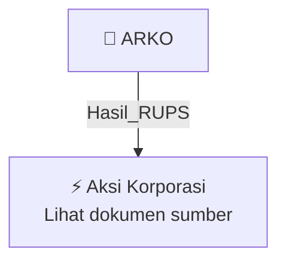

# 🏛️ Hasil & Keputusan RUPS / RUPSLB — [[ARKO]]

⬅️ [[knowledge-base/daily-digests/Daily_Digest_20260924|Kembali ke Daily Digest]] | 📅 **2026-09-24** | 🎛️ [[Dashboard|Ke Dashboard Utama]]

> [!IMPORTANT]
> Laporan ini disusun secara otomatis oleh **Corporate Action Intelligence Agent** pada **2026-09-24**.
> Sumber dokumen: `20260923_ARKO_20260921_ARKO_Transaksi Material Tanpa Persetujuan RUPS_32150125.pdf`

---

## 📌 1. Ringkasan Eksekutif & Tujuan Strategis

- **Kode & Nama Emiten**: `[[ARKO]]`
- **Kategori Aksi Korporasi**: `Hasil_RUPS`
- **Dokumen Sumber**: `20260923_ARKO_20260921_ARKO_Transaksi Material Tanpa Persetujuan RUPS_32150125.pdf`
- **Tanggal Laporan**: `2026-09-24`

[Analisis LLM tidak tersedia — isi manual]

---

## 📊 2. Fakta Material & Parameter Keuangan

| Parameter Utama | Nilai / Keterangan |
| :--- | :--- |
| **Uraian Kejadian** | `337/06/CS-AH/IX/2026 PT Arkora Hydro Tbk. ARKO 1 Transaksi Material Tanpa Persetujuan RUPS Perseroan menyampaikan informasi tentang Transaksi Material Tanpa Persetujuan RUPS sebagai berikut : Ya Apakah transaksi ini termasuk yang dikecualikan dari kewajiban penggunaan Penilai? 2. Transaksi pinjaman yang diterima secara langsung dari bank, perusahaan modal ventura, perusahaan pembiayaan, atau perusahaan pembiayaan infrastruktur baik dari dalam negeri maupun luar negeri Uraian singkat mengenai Tra` |

---

## 👥 3. Struktur Kepemilikan, Pengendali & Pembeli Siaga

- **Emiten**: `ARKO` | Informasi kepemilikan mengacu pada dokumen resmi sumber.

---

## 🎯 4. Alokasi & Rencana Penggunaan Dana

- Informasi alokasi dana belum tersedia — lihat prospektus / dokumen resmi.

---

## 📅 5. Timeline & Jadwal Pelaksanaan

| Tahapan / Event | Tanggal |
| :--- | :---: |
| **Jadwal** | Lihat dokumen sumber. |

---

## 📈 6. Diagram Visual Flowchart (Mermaid)

---

## 💡 7. Rekomendasi Investor & Strategi Trading

[Analisis LLM tidak tersedia — isi manual]

---

## 🔗 8. Hubungan Note Terkait (Knowledge Graph)

- [[knowledge-base/daily-digests/Daily_Digest_20260924|📄 Daily Digest 2026-09-24]]
- [[knowledge-base/trading-signals/Trading_Signals_20260924|🎯 Sinyal Cuan 2026-09-24]]
- [[ARKO|🏬 Halaman Emiten ARKO]]
- [[Dashboard|🎛️ Kembali ke Dashboard Utama]]

---

*Laporan dibuat otomatis oleh Corporate Action Intelligence Agent · 2026-09-24*