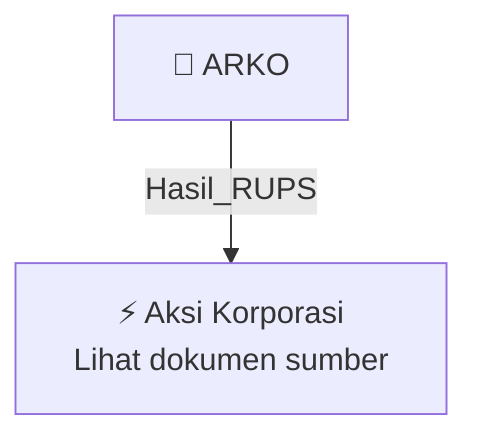

# 🏛️ Hasil & Keputusan RUPS / RUPSLB — [[ARKO]]

⬅️ [[knowledge-base/daily-digests/Daily_Digest_20261009|Kembali ke Daily Digest]] | 📅 **2026-10-09** | 🎛️ [[Dashboard|Ke Dashboard Utama]]

> [!IMPORTANT]
> Laporan ini disusun secara otomatis oleh **Corporate Action Intelligence Agent** pada **2026-10-09**.
> Sumber dokumen: `20261008_ARKO_20261008_ARKO_Pemberitahuan RencanaPenyampaian PanggilanHasil RUPORUPSURUP EBA-SP_32164557_lamp1.pdf`

---

## 📌 1. Ringkasan Eksekutif & Tujuan Strategis

- **Kode & Nama Emiten**: `[[ARKO]]`
- **Kategori Aksi Korporasi**: `Hasil_RUPS`
- **Dokumen Sumber**: `20261008_ARKO_20261008_ARKO_Pemberitahuan RencanaPenyampaian PanggilanHasil RUPORUPSURUP EBA-SP_32164557_lamp1.pdf`
- **Tanggal Laporan**: `2026-10-09`

[Analisis LLM tidak tersedia — isi manual]

---

## 📊 2. Fakta Material & Parameter Keuangan

| Parameter Utama | Nilai / Keterangan |
| :--- | :--- |
| **Nama Rapat** | `RUPO Obligasi Berwawasan Lingkungan (Green Bond) I Arkora Hydro Tahun 2023` |
| **Hari/Tanggal RUPO** | `Selasa, 6 Oktober 2026` |
| **Waktu RUPO** | `10.46 WIB – 11.07 WIB` |
| **Tempat RUPO** | `Kantor PT Arkora Hydro Tbk, Treasury Tower Level 9 Unit G-H, District 8 SCBD Lot 28` |
| **Mata Acara 1** | `Persetujuan atas penggantian Wali Amanat dan pengangkatan Wali Amanat baru Obligasi Berwawasan Lingkungan I Arkora Hydro Tahun 2023` |
| **Mata Acara 2** | `Persetujuan atas perubahan Perjanjian Perwaliamanatan Obligasi Berwawasan Lingkungan I Arkora Hydro Tahun 2023 sehubungan dengan penggantian dan pengangkatan Wali Amanat baru` |
| **Wali Amanat Lama** | `PT Bank Negara Indonesia (Persero) Tbk` |
| **Wali Amanat Pengganti** | `PT Bank Mega Tbk` |
| **Emiten Diwakili Oleh** | `Aldo Henry Artoko (Direktur Utama) dan Ricky Hartono (Direktur)` |
| **Kehadiran Pemegang Obligasi** | `Rp19.500.000.000 atau 89,31% dari jumlah pokok Obligasi yang masih belum dilunasi` |
| **Total Pokok Obligasi Belum Dilunasi** | `Rp21.835.000.000` |
| **Kuorum Kehadiran** | `Terpenuhi sesuai Pasal 10 ayat 5 huruf a butir (i) Perjanjian Perwaliamanatan dan Pasal 22 huruf (g) angka 1.a).1) POJK No. 20/POJK.04/2020` |
| **Jumlah Pemegang Obligasi yang Mengajukan Pertanyaan** | `2 pemegang obligasi` |
| **Dasar Kuorum Pengambilan Keputusan** | `Paling sedikit 3/4 dari Jumlah Pokok Obligasi yang terutang` |
| **Mekanisme Pengambilan Keputusan** | `Musyawarah untuk mufakat; apabila tidak setuju atau abstain, dilakukan pemungutan suara dengan Kartu Suara` |
| **Hasil Suara Setuju** | `Rp19.500.000.000 (100%)` |
| **Hasil Suara Tidak Setuju** | `0 (0%)` |
| **Hasil Suara Abstain** | `0 (0%)` |
| **Keputusan RUPO** | `Menyetujui penggantian Wali Amanat dan perubahan Perjanjian Perwaliamanatan` |
| **Acquit et de Charge** | `Diberikan kepada PT Bank Negara Indonesia (Persero) Tbk sepanjang tindakan-tindakan yang telah dilakukannya sebagai Wali Amanat` |

---

## 👥 3. Struktur Kepemilikan, Pengendali & Pembeli Siaga

- **Emiten**: `ARKO` | Informasi kepemilikan mengacu pada dokumen resmi sumber.

---

## 🎯 4. Alokasi & Rencana Penggunaan Dana

- Informasi alokasi dana belum tersedia — lihat prospektus / dokumen resmi.

---

## 📅 5. Timeline & Jadwal Pelaksanaan

| Tahapan / Event | Tanggal |
| :--- | :---: |
| **Jadwal** | Lihat dokumen sumber. |

---

## 📈 6. Diagram Visual Flowchart (Mermaid)

---

## 💡 7. Rekomendasi Investor & Strategi Trading

[Analisis LLM tidak tersedia — isi manual]

---

## 🔗 8. Hubungan Note Terkait (Knowledge Graph)

- [[knowledge-base/daily-digests/Daily_Digest_20261009|📄 Daily Digest 2026-10-09]]
- [[knowledge-base/trading-signals/Trading_Signals_20261009|🎯 Sinyal Cuan 2026-10-09]]
- [[ARKO|🏬 Halaman Emiten ARKO]]
- [[Dashboard|🎛️ Kembali ke Dashboard Utama]]

---

*Laporan dibuat otomatis oleh Corporate Action Intelligence Agent · 2026-10-09*