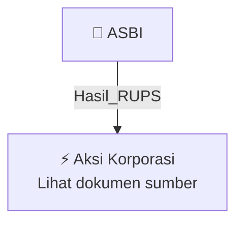

# 🏛️ Hasil & Keputusan RUPS / RUPSLB — [[ASBI]]

⬅️ [[knowledge-base/daily-digests/Daily_Digest_20261002|Kembali ke Daily Digest]] | 📅 **2026-10-02** | 🎛️ [[Dashboard|Ke Dashboard Utama]]

> [!IMPORTANT]
> Laporan ini disusun secara otomatis oleh **Corporate Action Intelligence Agent** pada **2026-10-02**.
> Sumber dokumen: `20261001_ASBI_20261001_ASBI_Ringkasan RisalahRisalah RUPS_32162380_lamp1.pdf`

---

## 📌 1. Ringkasan Eksekutif & Tujuan Strategis

- **Kode & Nama Emiten**: `[[ASBI]]`
- **Kategori Aksi Korporasi**: `Hasil_RUPS`
- **Dokumen Sumber**: `20261001_ASBI_20261001_ASBI_Ringkasan RisalahRisalah RUPS_32162380_lamp1.pdf`
- **Tanggal Laporan**: `2026-10-02`

[Analisis LLM tidak tersedia — isi manual]

---

## 📊 2. Fakta Material & Parameter Keuangan

| Parameter Utama | Nilai / Keterangan |
| :--- | :--- |
| **Jenis Rapat** | `Rapat Umum Pemegang Saham Luar Biasa (RUPSLB)` |
| **Metode Penyelenggaraan** | `Elektronik sesuai Peraturan Otoritas Jasa Keuangan Nomor 16/POJK.04/2020` |
| **Hari/Tanggal Rapat** | `Rabu, 30 September 2026` |
| **Waktu Rapat** | `11.01 WIB s/d 11.51 WIB` |
| **Tempat Rapat** | `Kantor Pusat PT Asuransi Bintang Tbk` |
| **Kehadiran Direksi dan Dewan Komisaris** | `Ronald Waas sebagai Presiden Komisaris merangkap Komisaris Independen; Hastanto Sri Margi Widodo sebagai Presiden Direktur; Reniwati Darmakusumah sebagai Direktur; Zafar Dinesh Idham sebagai Direktur Kepatuhan` |
| **Kehadiran Pemegang Saham** | `89,4618% saham atau 311.672.771 dari 348.386.472 saham` |
| **Kuorum Rapat** | `Terpenuhi sesuai Pasal 23 ayat 1 huruf a, ayat 9 huruf a, dan ayat 10 huruf b Anggaran Dasar Perseroan` |
| **Pihak Independen** | `Notaris Ir. Nanette Cahyanie Handari Adi Warsito, SH dan PT Bima Registra` |
| **Agenda Pertama** | `Perubahan Susunan Pengurus Perseroan` |
| **Jumlah Pemegang Saham yang Bertanya** | `Tidak terdapat pertanyaan` |
| **Hasil Pemungutan Suara Agenda Pertama** | `Setuju 311.672.771 saham atau 100%; Tidak Setuju: Tidak ada; Abstain: Tidak ada` |
| **Keputusan Pemberhentian** | `Menyetujui penguatan pemberhentian sementara Dewan Komisaris dan memberhentikan Jenry Cardo Manurung dari jabatan Direktur Keuangan dan Layanan Perseroan terhitung sejak ditutupnya RUPS Luar Biasa` |
| **Alasan Pemberhentian** | `Rapat menilai yang bersangkutan tidak melaksanakan pengurusan Perseroan dengan itikad baik dan penuh tanggung jawab sebagaimana diwajibkan Pasal 97 ayat (2) UUPT` |
| **Pengunduran Diri** | `Menerima pengunduran diri Hastanto Sri Margi Widodo dari jabatan Presiden Direktur terhitung sejak ditutupnya RUPS Luar Biasa` |
| **Pengangkatan Presiden Direktur** | `Zafar Dinesh Idham diangkat sebagai Presiden Direktur, efektif setelah lulus Fit and Proper Test OJK, masa jabatan sampai penutupan RUPST 2029` |
| **Pengangkatan Direktur Kepatuhan** | `Andree Nugroho Saragih diangkat sebagai Direktur Kepatuhan, efektif setelah lulus Fit and Proper Test OJK, masa jabatan sampai penutupan RUPST 2029` |
| **Pengangkatan Direktur Keuangan** | `Salusra Satria diangkat sebagai Direktur Keuangan, efektif setelah lulus Fit and Proper Test OJK, masa jabatan sampai penutupan RUPST 2029` |

---

## 👥 3. Struktur Kepemilikan, Pengendali & Pembeli Siaga

- **Emiten**: `ASBI` | Informasi kepemilikan mengacu pada dokumen resmi sumber.

---

## 🎯 4. Alokasi & Rencana Penggunaan Dana

- Informasi alokasi dana belum tersedia — lihat prospektus / dokumen resmi.

---

## 📅 5. Timeline & Jadwal Pelaksanaan

| Tahapan / Event | Tanggal |
| :--- | :---: |
| **Jadwal** | Lihat dokumen sumber. |

---

## 📈 6. Diagram Visual Flowchart (Mermaid)

---

## 💡 7. Rekomendasi Investor & Strategi Trading

[Analisis LLM tidak tersedia — isi manual]

---

## 🔗 8. Hubungan Note Terkait (Knowledge Graph)

- [[knowledge-base/daily-digests/Daily_Digest_20261002|📄 Daily Digest 2026-10-02]]
- [[knowledge-base/trading-signals/Trading_Signals_20261002|🎯 Sinyal Cuan 2026-10-02]]
- [[ASBI|🏬 Halaman Emiten ASBI]]
- [[Dashboard|🎛️ Kembali ke Dashboard Utama]]

---

*Laporan dibuat otomatis oleh Corporate Action Intelligence Agent · 2026-10-02*