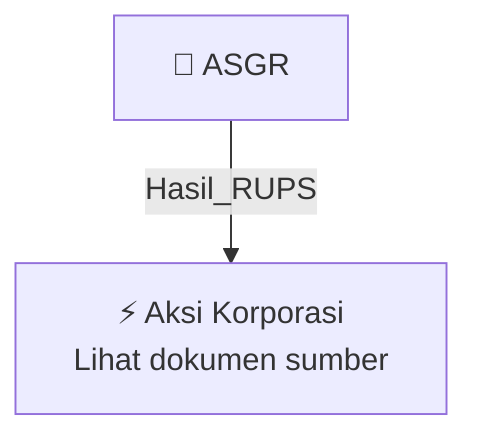

# 🏛️ Hasil & Keputusan RUPS / RUPSLB — [[ASGR]]

⬅️ [[knowledge-base/daily-digests/Daily_Digest_20261002|Kembali ke Daily Digest]] | 📅 **2026-10-02** | 🎛️ [[Dashboard|Ke Dashboard Utama]]

> [!IMPORTANT]
> Laporan ini disusun secara otomatis oleh **Corporate Action Intelligence Agent** pada **2026-10-02**.
> Sumber dokumen: `20260930_ASGR_20260930_ASGR_Laporan Informasi dan Fakta Material_32162305_lamp1.pdf`

---

## 📌 1. Ringkasan Eksekutif & Tujuan Strategis

- **Kode & Nama Emiten**: `[[ASGR]]`
- **Kategori Aksi Korporasi**: `Hasil_RUPS`
- **Dokumen Sumber**: `20260930_ASGR_20260930_ASGR_Laporan Informasi dan Fakta Material_32162305_lamp1.pdf`
- **Tanggal Laporan**: `2026-10-02`

[Analisis LLM tidak tersedia — isi manual]

---

## 📊 2. Fakta Material & Parameter Keuangan

| Parameter Utama | Nilai / Keterangan |
| :--- | :--- |
| **Nomor surat** | `CSL/AG-080-IX-2026` |
| **Jenis informasi atau fakta material** | `Perubahan Rencana Pembagian Dividen` |
| **Perubahan rencana dividen** | `Dari rencana pembagian dividen interim menjadi rencana pembagian tambahan dividen tunai final` |
| **Jumlah dividen** | `Rp400.048.296.300` |
| **Dividen per saham** | `Rp297 per saham` |
| **Sumber dividen** | `Saldo laba ditahan (retained earnings) tahun-tahun buku sebelumnya` |
| **Persetujuan yang dibutuhkan** | `Persetujuan pemegang saham dalam Rapat Umum Pemegang Saham Luar Biasa (RUPSLB)` |
| **Rencana penyelenggaraan RUPSLB** | `November 2026` |
| **Referensi keterbukaan informasi sebelumnya** | `No. CSL/AG-077-IX-2026 tanggal 29 September 2026` |
| **Dampak kejadian** | `Tidak berdampak material terhadap kegiatan operasional, hukum, kondisi keuangan, atau kelangsungan usaha Perseroan` |

---

## 👥 3. Struktur Kepemilikan, Pengendali & Pembeli Siaga

- **Emiten**: `ASGR` | Informasi kepemilikan mengacu pada dokumen resmi sumber.

---

## 🎯 4. Alokasi & Rencana Penggunaan Dana

- Informasi alokasi dana belum tersedia — lihat prospektus / dokumen resmi.

---

## 📅 5. Timeline & Jadwal Pelaksanaan

| Tahapan / Event | Tanggal |
| :--- | :---: |
| **Jadwal** | Lihat dokumen sumber. |

---

## 📈 6. Diagram Visual Flowchart (Mermaid)

---

## 💡 7. Rekomendasi Investor & Strategi Trading

[Analisis LLM tidak tersedia — isi manual]

---

## 🔗 8. Hubungan Note Terkait (Knowledge Graph)

- [[knowledge-base/daily-digests/Daily_Digest_20261002|📄 Daily Digest 2026-10-02]]
- [[knowledge-base/trading-signals/Trading_Signals_20261002|🎯 Sinyal Cuan 2026-10-02]]
- [[ASGR|🏬 Halaman Emiten ASGR]]
- [[Dashboard|🎛️ Kembali ke Dashboard Utama]]

---

*Laporan dibuat otomatis oleh Corporate Action Intelligence Agent · 2026-10-02*