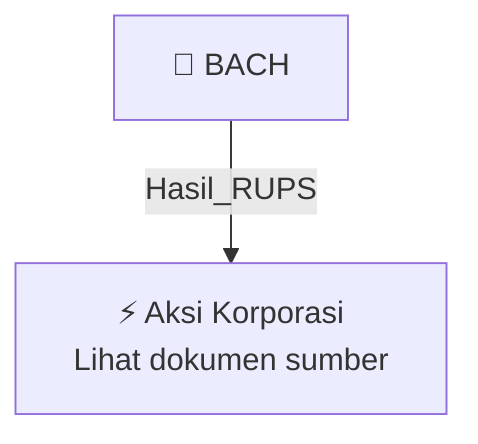

# 🏛️ Hasil & Keputusan RUPS / RUPSLB — [[BACH]]

⬅️ [[knowledge-base/daily-digests/Daily_Digest_20261002|Kembali ke Daily Digest]] | 📅 **2026-10-02** | 🎛️ [[Dashboard|Ke Dashboard Utama]]

> [!IMPORTANT]
> Laporan ini disusun secara otomatis oleh **Corporate Action Intelligence Agent** pada **2026-10-02**.
> Sumber dokumen: `20261001_BACH_20261001_BACH_Transaksi Material Tanpa Persetujuan RUPS_32162441.pdf`

---

## 📌 1. Ringkasan Eksekutif & Tujuan Strategis

- **Kode & Nama Emiten**: `[[BACH]]`
- **Kategori Aksi Korporasi**: `Hasil_RUPS`
- **Dokumen Sumber**: `20261001_BACH_20261001_BACH_Transaksi Material Tanpa Persetujuan RUPS_32162441.pdf`
- **Tanggal Laporan**: `2026-10-02`

[Analisis LLM tidak tersedia — isi manual]

---

## 📊 2. Fakta Material & Parameter Keuangan

| Parameter Utama | Nilai / Keterangan |
| :--- | :--- |
| **Nomor Surat** | `008/S-CORPSEC/BACH/X/2026` |
| **Perihal** | `Transaksi Material Tanpa Persetujuan RUPS` |
| **Uraian Singkat Transaksi** | `Penandatanganan Perjanjian Kredit` |
| **Nilai Transaksi Material** | `450.000.000.000` |
| **Persentase Nilai Transaksi terhadap Ekuitas** | `73 %` |
| **Periode Laporan Keuangan Acuan** | `30 Juni 2026` |
| **Tanggal Transaksi** | `30 September 2026` |
| **Dikecualikan dari Kewajiban Penggunaan Penilai** | `Ya` |
| **Jenis Pengecualian** | `Transaksi pinjaman yang diterima secara langsung dari bank, perusahaan modal ventura, perusahaan pembiayaan, atau perusahaan pembiayaan infrastruktur baik dari dalam negeri maupun luar negeri` |
| **Tanggal Penerbitan/Pengumuman** | `01 Oktober 2026` |
| **Media Pengumuman** | `Situs Web Perseroan; Situs Web Bursa Efek Indonesia` |
| **Nama Pengirim** | `Audia Michael Septian` |
| **Jabatan Pengirim** | `Director` |
| **Tanggal dan Waktu Pengumuman** | `01-10-2026 17:47` |
| **Lampiran** | `BACH - Final - KI Kredit Maybank_signed.pdf` |
| **Alamat** | `Wisma 81` |

---

## 👥 3. Struktur Kepemilikan, Pengendali & Pembeli Siaga

- **Emiten**: `BACH` | Informasi kepemilikan mengacu pada dokumen resmi sumber.

---

## 🎯 4. Alokasi & Rencana Penggunaan Dana

- Informasi alokasi dana belum tersedia — lihat prospektus / dokumen resmi.

---

## 📅 5. Timeline & Jadwal Pelaksanaan

| Tahapan / Event | Tanggal |
| :--- | :---: |
| **Jadwal** | Lihat dokumen sumber. |

---

## 📈 6. Diagram Visual Flowchart (Mermaid)

---

## 💡 7. Rekomendasi Investor & Strategi Trading

[Analisis LLM tidak tersedia — isi manual]

---

## 🔗 8. Hubungan Note Terkait (Knowledge Graph)

- [[knowledge-base/daily-digests/Daily_Digest_20261002|📄 Daily Digest 2026-10-02]]
- [[knowledge-base/trading-signals/Trading_Signals_20261002|🎯 Sinyal Cuan 2026-10-02]]
- [[BACH|🏬 Halaman Emiten BACH]]
- [[Dashboard|🎛️ Kembali ke Dashboard Utama]]

---

*Laporan dibuat otomatis oleh Corporate Action Intelligence Agent · 2026-10-02*