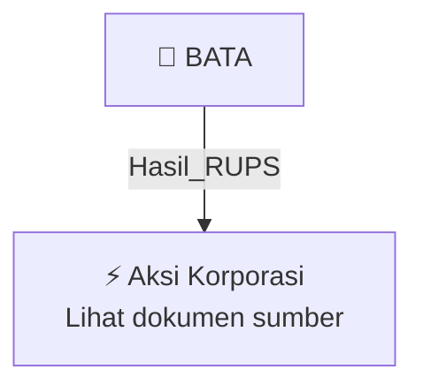

# 🏛️ Hasil & Keputusan RUPS / RUPSLB — [[BATA]]

⬅️ [[knowledge-base/daily-digests/Daily_Digest_20261002|Kembali ke Daily Digest]] | 📅 **2026-10-02** | 🎛️ [[Dashboard|Ke Dashboard Utama]]

> [!IMPORTANT]
> Laporan ini disusun secara otomatis oleh **Corporate Action Intelligence Agent** pada **2026-10-02**.
> Sumber dokumen: `20261001_BATA_20261001_BATA_Laporan Informasi dan Fakta Material_32162392.pdf`

---

## 📌 1. Ringkasan Eksekutif & Tujuan Strategis

- **Kode & Nama Emiten**: `[[BATA]]`
- **Kategori Aksi Korporasi**: `Hasil_RUPS`
- **Dokumen Sumber**: `20261001_BATA_20261001_BATA_Laporan Informasi dan Fakta Material_32162392.pdf`
- **Tanggal Laporan**: `2026-10-02`

[Analisis LLM tidak tersedia — isi manual]

---

## 📊 2. Fakta Material & Parameter Keuangan

| Parameter Utama | Nilai / Keterangan |
| :--- | :--- |
| **Nomor Surat** | `036/BATA-CS/X/2026` |
| **Nama Emiten** | `Sepatu Bata Tbk` |
| **Kode Emiten** | `BATA` |
| **Bidang Usaha** | `Industri Alas Kaki` |
| **Tanggal Kejadian** | `30 September 2026` |
| **Jenis Informasi atau Fakta Material** | `Pengunduran Diri Direksi PT Sepatu Bata Tbk` |
| **Nama Direktur yang Mengundurkan Diri** | `Ian Duncan Mcnab Cowe` |
| **Jabatan** | `Direktur Perseroan` |
| **Alasan Pengunduran Diri** | `Rotasi jabatan di Bata Group` |
| **Dasar Hukum** | `Pasal 19.9 Anggaran Dasar Perseroan dan Pasal 8 ayat (3) POJK No. 33/2014` |
| **Mekanisme Keputusan** | `Akan diputuskan dalam Rapat Umum Pemegang Saham Perseroan` |
| **Dampak Kejadian** | `Tidak ada dampak terhadap kegiatan operasional, hukum, kondisi keuangan, atau kelangsungan usaha Emiten atau Perusahaan Publik` |
| **Nama Pengirim** | `Sanusi` |
| **Jabatan Pengirim** | `Sanusi` |
| **Tanggal dan Waktu Pelaporan** | `01-10-2026 17:19` |
| **Lampiran** | `BATA KI Pengunduran Diri Direksi.pdf` |

---

## 👥 3. Struktur Kepemilikan, Pengendali & Pembeli Siaga

- **Emiten**: `BATA` | Informasi kepemilikan mengacu pada dokumen resmi sumber.

---

## 🎯 4. Alokasi & Rencana Penggunaan Dana

- Informasi alokasi dana belum tersedia — lihat prospektus / dokumen resmi.

---

## 📅 5. Timeline & Jadwal Pelaksanaan

| Tahapan / Event | Tanggal |
| :--- | :---: |
| **Jadwal** | Lihat dokumen sumber. |

---

## 📈 6. Diagram Visual Flowchart (Mermaid)

---

## 💡 7. Rekomendasi Investor & Strategi Trading

[Analisis LLM tidak tersedia — isi manual]

---

## 🔗 8. Hubungan Note Terkait (Knowledge Graph)

- [[knowledge-base/daily-digests/Daily_Digest_20261002|📄 Daily Digest 2026-10-02]]
- [[knowledge-base/trading-signals/Trading_Signals_20261002|🎯 Sinyal Cuan 2026-10-02]]
- [[BATA|🏬 Halaman Emiten BATA]]
- [[Dashboard|🎛️ Kembali ke Dashboard Utama]]

---

*Laporan dibuat otomatis oleh Corporate Action Intelligence Agent · 2026-10-02*