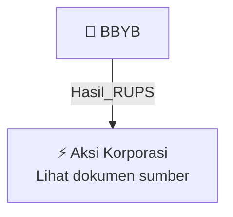

# 🏛️ Hasil & Keputusan RUPS / RUPSLB — [[BBYB]]

⬅️ [[knowledge-base/daily-digests/Daily_Digest_20261006|Kembali ke Daily Digest]] | 📅 **2026-10-06** | 🎛️ [[Dashboard|Ke Dashboard Utama]]

> [!IMPORTANT]
> Laporan ini disusun secara otomatis oleh **Corporate Action Intelligence Agent** pada **2026-10-06**.
> Sumber dokumen: `20261005_BBYB_20261005_BBYB_Laporan Informasi dan Fakta Material_32163084.pdf`

---

## 📌 1. Ringkasan Eksekutif & Tujuan Strategis

- **Kode & Nama Emiten**: `[[BBYB]]`
- **Kategori Aksi Korporasi**: `Hasil_RUPS`
- **Dokumen Sumber**: `20261005_BBYB_20261005_BBYB_Laporan Informasi dan Fakta Material_32163084.pdf`
- **Tanggal Laporan**: `2026-10-06`

[Analisis LLM tidak tersedia — isi manual]

---

## 📊 2. Fakta Material & Parameter Keuangan

| Parameter Utama | Nilai / Keterangan |
| :--- | :--- |
| **Nomor Surat** | `049/BNC-Tbk/E-Report/IDX/X/2026` |
| **Nama Emiten atau Perusahaan Publik** | `PT Bank Neo Commerce Tbk.` |
| **Kode Emiten** | `BBYB` |
| **Bidang Usaha** | `Perbankan` |
| **Jenis Informasi atau Fakta Material** | `Pengunduran Diri anggota Direksi Perseroan` |
| **Tanggal Kejadian** | `02 Oktober 2026` |
| **Nama Direktur yang Mengundurkan Diri** | `Eri Budiono` |
| **Jabatan** | `Direktur Utama Perseroan` |
| **Tanggal Perseroan Menerima Permohonan Pengunduran Diri** | `2 Oktober 2026` |
| **Surat OJK** | `No. SR-241/PB.32/2026` |
| **Tanggal Surat OJK** | `28 September 2026` |
| **Tindak Lanjut** | `Akan dimintakan persetujuan dalam Rapat Umum Pemegang Saham Perseroan` |
| **Dampak** | `Tidak berdampak merugikan terhadap kegiatan usaha dan keuangan Perseroan` |
| **Nama Pengirim** | `Heru Sulistiadhi` |
| **Tanggal dan Waktu Laporan** | `05-10-2026 17:25` |
| **Lampiran** | `232.pdf` |

---

## 👥 3. Struktur Kepemilikan, Pengendali & Pembeli Siaga

- **Emiten**: `BBYB` | Informasi kepemilikan mengacu pada dokumen resmi sumber.

---

## 🎯 4. Alokasi & Rencana Penggunaan Dana

- Informasi alokasi dana belum tersedia — lihat prospektus / dokumen resmi.

---

## 📅 5. Timeline & Jadwal Pelaksanaan

| Tahapan / Event | Tanggal |
| :--- | :---: |
| **Jadwal** | Lihat dokumen sumber. |

---

## 📈 6. Diagram Visual Flowchart (Mermaid)

---

## 💡 7. Rekomendasi Investor & Strategi Trading

[Analisis LLM tidak tersedia — isi manual]

---

## 🔗 8. Hubungan Note Terkait (Knowledge Graph)

- [[knowledge-base/daily-digests/Daily_Digest_20261006|📄 Daily Digest 2026-10-06]]
- [[knowledge-base/trading-signals/Trading_Signals_20261006|🎯 Sinyal Cuan 2026-10-06]]
- [[BBYB|🏬 Halaman Emiten BBYB]]
- [[Dashboard|🎛️ Kembali ke Dashboard Utama]]

---

*Laporan dibuat otomatis oleh Corporate Action Intelligence Agent · 2026-10-06*