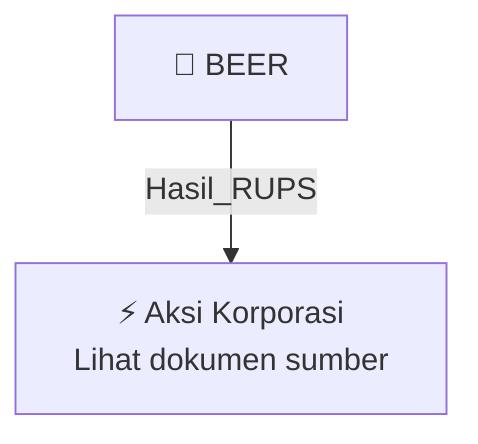

# 🏛️ Hasil & Keputusan RUPS / RUPSLB — [[BEER]]

⬅️ [[knowledge-base/daily-digests/Daily_Digest_20261002|Kembali ke Daily Digest]] | 📅 **2026-10-02** | 🎛️ [[Dashboard|Ke Dashboard Utama]]

> [!IMPORTANT]
> Laporan ini disusun secara otomatis oleh **Corporate Action Intelligence Agent** pada **2026-10-02**.
> Sumber dokumen: `20261001_BEER_20261001_BEER_Laporan Informasi dan Fakta Material_32162485_lamp2.pdf`

---

## 📌 1. Ringkasan Eksekutif & Tujuan Strategis

- **Kode & Nama Emiten**: `[[BEER]]`
- **Kategori Aksi Korporasi**: `Hasil_RUPS`
- **Dokumen Sumber**: `20261001_BEER_20261001_BEER_Laporan Informasi dan Fakta Material_32162485_lamp2.pdf`
- **Tanggal Laporan**: `2026-10-02`

[Analisis LLM tidak tersedia — isi manual]

---

## 📊 2. Fakta Material & Parameter Keuangan

| Parameter Utama | Nilai / Keterangan |
| :--- | :--- |
| **Nama Perseroan** | `PT Jobubu Jarum Minahasa Tbk` |
| **Jenis Dokumen** | `Ralat Pemanggilan Rapat Umum Pemegang Saham Luar Biasa (RUPSLB)` |
| **Perubahan Informasi** | `Pengurangan mata acara Rapat` |
| **Hari/Tanggal RUPSLB** | `Jumat, 2 Oktober 2026` |
| **Waktu RUPSLB** | `10.00 WIB – selesai` |
| **Tempat RUPSLB** | `Secara elektronik melalui fasilitas Electronic General Meeting yang disediakan oleh PT Kustodian Sentral Efek Indonesia` |
| **Agenda RUPSLB** | `Persetujuan atas Perubahan Pasal 3 Anggaran Dasar Perseroan dalam rangka penyesuaian dengan Klasifikasi Baku Lapangan Usaha Indonesia 2025 (KBLI 2025)` |
| **Referensi Pemanggilan Sebelumnya** | `10 September 2026` |
| **Pemegang Saham yang Berhak Hadir** | `Pemegang Saham yang namanya tercatat dalam Daftar Pemegang Saham pada Rabu, 9 September 2026 sampai dengan pukul 16.00 WIB` |
| **Dasar Hukum** | `Pasal 52 POJK 15/2020 juncto Pasal 21 ayat 10 a (i) Anggaran Dasar Perseroan; POJK No. 14 Tahun 2025; Pasal 24 Anggaran Dasar Perseroan` |
| **Mekanisme Keikutsertaan Pemegang Saham** | `Hadir secara elektronik, hadir secara fisik dengan kuota yang ditetapkan Perseroan, atau memberikan kuasa dengan format surat kuasa tertulis` |
| **Tanggal Pelaporan Berdasarkan Nama Dokumen** | `2026-10-01` |

---

## 👥 3. Struktur Kepemilikan, Pengendali & Pembeli Siaga

- **Emiten**: `BEER` | Informasi kepemilikan mengacu pada dokumen resmi sumber.

---

## 🎯 4. Alokasi & Rencana Penggunaan Dana

- Informasi alokasi dana belum tersedia — lihat prospektus / dokumen resmi.

---

## 📅 5. Timeline & Jadwal Pelaksanaan

| Tahapan / Event | Tanggal |
| :--- | :---: |
| **Jadwal** | Lihat dokumen sumber. |

---

## 📈 6. Diagram Visual Flowchart (Mermaid)

---

## 💡 7. Rekomendasi Investor & Strategi Trading

[Analisis LLM tidak tersedia — isi manual]

---

## 🔗 8. Hubungan Note Terkait (Knowledge Graph)

- [[knowledge-base/daily-digests/Daily_Digest_20261002|📄 Daily Digest 2026-10-02]]
- [[knowledge-base/trading-signals/Trading_Signals_20261002|🎯 Sinyal Cuan 2026-10-02]]
- [[BEER|🏬 Halaman Emiten BEER]]
- [[Dashboard|🎛️ Kembali ke Dashboard Utama]]

---

*Laporan dibuat otomatis oleh Corporate Action Intelligence Agent · 2026-10-02*