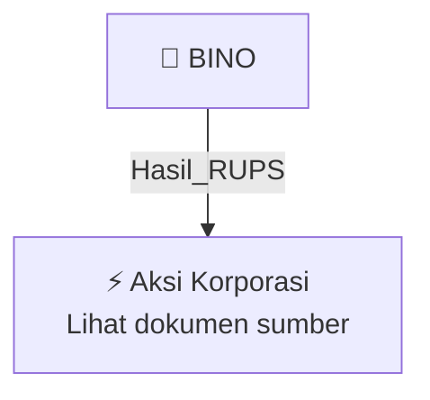

# 🏛️ Hasil & Keputusan RUPS / RUPSLB — [[BINO]]

⬅️ [[knowledge-base/daily-digests/Daily_Digest_20261006|Kembali ke Daily Digest]] | 📅 **2026-10-06** | 🎛️ [[Dashboard|Ke Dashboard Utama]]

> [!IMPORTANT]
> Laporan ini disusun secara otomatis oleh **Corporate Action Intelligence Agent** pada **2026-10-06**.
> Sumber dokumen: `20261006_BINO_20261005_BINO_Laporan Penggunaan Dana Hasil Penawaran Umum_32163038_lamp3.pdf`

---

## 📌 1. Ringkasan Eksekutif & Tujuan Strategis

- **Kode & Nama Emiten**: `[[BINO]]`
- **Kategori Aksi Korporasi**: `Hasil_RUPS`
- **Dokumen Sumber**: `20261006_BINO_20261005_BINO_Laporan Penggunaan Dana Hasil Penawaran Umum_32163038_lamp3.pdf`
- **Tanggal Laporan**: `2026-10-06`

[Analisis LLM tidak tersedia — isi manual]

---

## 📊 2. Fakta Material & Parameter Keuangan

| Parameter Utama | Nilai / Keterangan |
| :--- | :--- |
| **Jenis Penawaran Umum** | `Penawaran Umum Saham Perdana (IPO)` |
| **Tanggal Efektif** | `2021-11-16` |
| **Jumlah Hasil Penawaran Umum** | `Rp60.030.000.000` |
| **Total Biaya Penawaran Umum** | `Rp4.200.000.000` |
| **Biaya jasa penjaminan** | `Rp1.980.000.000 (47,142857%)` |
| **Biaya jasa akuntan** | `Rp1.036.630.769 (24,681685%)` |
| **Biaya jasa konsultasi (advisory)** | `Rp607.500.000 (14,464286%)` |
| **Biaya jasa notaris** | `Rp375.769.231 (8,946886%)` |
| **Biaya jasa lembaga penunjang pasar modal** | `Rp70.000.000 (1,666667%)` |
| **Biaya registrasi OJK** | `Rp11.100.000 (0,264286%)` |
| **Biaya aktuaria independen** | `Rp119.000.000 (2,833333%)` |
| **Total rencana penggunaan dana** | `Rp55.830.000.000` |
| **Rencana pelunasan utang perseroan kepada pihak ketiga** | `Rp38.000.000.000` |
| **Rencana pinjaman kepada entitas anak PT Batara Indah untuk pembelian mesin** | `Rp4.500.000.000` |
| **Rencana pembelian aset tetap berupa tanah** | `Rp2.850.000.000` |
| **Rencana modal kerja entitas anak Bino Digital Solutions PTE Ltd** | `Rp2.550.000.000` |
| **Rencana operasional perusahaan** | `Rp100.000.000` |
| **Rencana modal kerja entitas anak PT Bino Mitra Sejati** | `Rp7.830.000.000` |
| **Realisasi pelunasan utang perseroan kepada pihak ketiga** | `Rp38.000.000.000` |
| **Realisasi pinjaman kepada entitas anak PT Batara Indah untuk pembelian mesin** | `Rp4.500.000.000` |
| **Realisasi pembelian aset tetap berupa tanah** | `Rp1.521.050.000` |
| **Realisasi modal kerja entitas anak Bino Digital Solutions PTE Ltd** | `Rp2.550.000.000` |
| **Realisasi operasional perusahaan** | `Rp100.000.000` |
| **Realisasi modal kerja entitas anak PT Bino Mitra Sejati** | `Rp7.830.000.000` |
| **Perubahan alokasi sisa dana hasil IPO** | `Rp1.328.950.000` |
| **Tujuan perubahan alokasi** | `Dari pembelian tanah di Klaten menjadi pembayaran sebagian kewajiban/utang kepada pemegang saham` |
| **Alasan perubahan alokasi** | `Kendala legalitas serta perubahan kebijakan zonasi peruntukan lahan` |
| **Persetujuan perubahan alokasi** | `RUPS Tahunan tahun 2025` |

---

## 👥 3. Struktur Kepemilikan, Pengendali & Pembeli Siaga

- **Emiten**: `BINO` | Informasi kepemilikan mengacu pada dokumen resmi sumber.

---

## 🎯 4. Alokasi & Rencana Penggunaan Dana

- Informasi alokasi dana belum tersedia — lihat prospektus / dokumen resmi.

---

## 📅 5. Timeline & Jadwal Pelaksanaan

| Tahapan / Event | Tanggal |
| :--- | :---: |
| **Jadwal** | Lihat dokumen sumber. |

---

## 📈 6. Diagram Visual Flowchart (Mermaid)

---

## 💡 7. Rekomendasi Investor & Strategi Trading

[Analisis LLM tidak tersedia — isi manual]

---

## 🔗 8. Hubungan Note Terkait (Knowledge Graph)

- [[knowledge-base/daily-digests/Daily_Digest_20261006|📄 Daily Digest 2026-10-06]]
- [[knowledge-base/trading-signals/Trading_Signals_20261006|🎯 Sinyal Cuan 2026-10-06]]
- [[BINO|🏬 Halaman Emiten BINO]]
- [[Dashboard|🎛️ Kembali ke Dashboard Utama]]

---

*Laporan dibuat otomatis oleh Corporate Action Intelligence Agent · 2026-10-06*