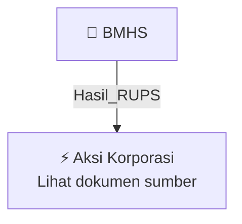

# 🏛️ Hasil & Keputusan RUPS / RUPSLB — [[BMHS]]

⬅️ [[knowledge-base/daily-digests/Daily_Digest_20261009|Kembali ke Daily Digest]] | 📅 **2026-10-09** | 🎛️ [[Dashboard|Ke Dashboard Utama]]

> [!IMPORTANT]
> Laporan ini disusun secara otomatis oleh **Corporate Action Intelligence Agent** pada **2026-10-09**.
> Sumber dokumen: `20261009_BMHS_20261009_BMHS_Laporan Informasi dan Fakta Material_32165039.pdf`

---

## 📌 1. Ringkasan Eksekutif & Tujuan Strategis

- **Kode & Nama Emiten**: `[[BMHS]]`
- **Kategori Aksi Korporasi**: `Hasil_RUPS`
- **Dokumen Sumber**: `20261009_BMHS_20261009_BMHS_Laporan Informasi dan Fakta Material_32165039.pdf`
- **Tanggal Laporan**: `2026-10-09`

[Analisis LLM tidak tersedia — isi manual]

---

## 📊 2. Fakta Material & Parameter Keuangan

| Parameter Utama | Nilai / Keterangan |
| :--- | :--- |
| **Nama Emiten atau Perusahaan Publik** | `PT Bundamedik Tbk` |
| **Kode Emiten** | `BMHS` |
| **Bidang Usaha** | `Aktivitas rumah sakit swasta` |
| **Tanggal Kejadian** | `07 Oktober 2026` |
| **Jenis Informasi atau Fakta Material** | `Pengunduran Diri Wakil Presiden Komisaris Perseroan` |
| **Nama Pihak yang Mengundurkan Diri** | `Bapak Shubhasish Chattoraj` |
| **Jabatan yang Ditinggalkan** | `Wakil Presiden Komisaris` |
| **Dasar Tindak Lanjut** | `Peraturan Otoritas Jasa Keuangan Nomor 33/POJK.04/2014 tentang Direksi dan Dewan Komisaris Emiten atau Perusahaan Publik (POJK 33) dan Anggaran Dasar Perseroan` |
| **Rencana Tindak Lanjut** | `Menyelenggarakan Rapat Umum Pemegang Saham Luar Biasa dan meminta persetujuan pemegang saham atas pengunduran diri tersebut` |
| **Dampak Kejadian** | `Tidak ada dampak material yang merugikan terhadap reorganisasi Dewan Komisaris, kegiatan operasional, hukum, kondisi keuangan, atau kelangsungan operasional Perseroan` |
| **Nama Pengirim Laporan** | `Josephine Tobing` |
| **Tanggal dan Waktu Pelaporan** | `09-10-2026 17:04` |

---

## 👥 3. Struktur Kepemilikan, Pengendali & Pembeli Siaga

- **Emiten**: `BMHS` | Informasi kepemilikan mengacu pada dokumen resmi sumber.

---

## 🎯 4. Alokasi & Rencana Penggunaan Dana

- Informasi alokasi dana belum tersedia — lihat prospektus / dokumen resmi.

---

## 📅 5. Timeline & Jadwal Pelaksanaan

| Tahapan / Event | Tanggal |
| :--- | :---: |
| **Jadwal** | Lihat dokumen sumber. |

---

## 📈 6. Diagram Visual Flowchart (Mermaid)

---

## 💡 7. Rekomendasi Investor & Strategi Trading

[Analisis LLM tidak tersedia — isi manual]

---

## 🔗 8. Hubungan Note Terkait (Knowledge Graph)

- [[knowledge-base/daily-digests/Daily_Digest_20261009|📄 Daily Digest 2026-10-09]]
- [[knowledge-base/trading-signals/Trading_Signals_20261009|🎯 Sinyal Cuan 2026-10-09]]
- [[BMHS|🏬 Halaman Emiten BMHS]]
- [[Dashboard|🎛️ Kembali ke Dashboard Utama]]

---

*Laporan dibuat otomatis oleh Corporate Action Intelligence Agent · 2026-10-09*