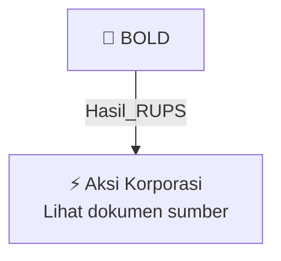

# 🏛️ Hasil & Keputusan RUPS / RUPSLB — [[BOLD]]

⬅️ [[knowledge-base/daily-digests/Daily_Digest_20261006|Kembali ke Daily Digest]] | 📅 **2026-10-06** | 🎛️ [[Dashboard|Ke Dashboard Utama]]

> [!IMPORTANT]
> Laporan ini disusun secara otomatis oleh **Corporate Action Intelligence Agent** pada **2026-10-06**.
> Sumber dokumen: `20261006_BOLD_20261006_BOLD_Laporan Informasi dan Fakta Material_32163492_lamp1.pdf`

---

## 📌 1. Ringkasan Eksekutif & Tujuan Strategis

- **Kode & Nama Emiten**: `[[BOLD]]`
- **Kategori Aksi Korporasi**: `Hasil_RUPS`
- **Dokumen Sumber**: `20261006_BOLD_20261006_BOLD_Laporan Informasi dan Fakta Material_32163492_lamp1.pdf`
- **Tanggal Laporan**: `2026-10-06`

[Analisis LLM tidak tersedia — isi manual]

---

## 📊 2. Fakta Material & Parameter Keuangan

| Parameter Utama | Nilai / Keterangan |
| :--- | :--- |
| **Nama Emiten atau Perusahaan Publik** | `PT Bukit Makmur Mandiri Utama` |
| **Bidang Usaha** | `Jasa Pertambangan Umum / General Mining Services` |
| **Tanggal Kejadian** | `2 Oktober 2026` |
| **Jenis Informasi atau Fakta Material** | `Perubahan Susunan Direksi Perseroan` |
| **Dasar Perubahan** | `Keputusan Sirkuler Pemegang Saham PT Bukit Makmur Mandiri Utama sebagai Pengganti Rapat Umum Pemegang Saham Luar Biasa tertanggal 02 Oktober 2026` |
| **Direktur Utama Sebelum Perubahan** | `Dian Sofia Andyasuri` |
| **Direktur Utama Sesudah Perubahan** | `Dian Sofia Andyasuri` |
| **Wakil Direktur Utama Sebelum Perubahan** | `Nanang Rizal Achyar` |
| **Wakil Direktur Utama Sesudah Perubahan** | `Yohanes Budi Kurniawan` |
| **Direktur Sebelum Perubahan** | `Silfanny Fadillah Bahar, Brett McGuire` |
| **Direktur Sesudah Perubahan** | `Nanang Rizal Achyar, Silfanny Fadillah Bahar, Brett McGuire, Novendra` |
| **Dampak Kejadian** | `Tidak berdampak material terhadap kondisi keuangan, operasional, maupun kelangsungan usaha Perseroan.` |
| **Keterangan Lain-lain** | `Tidak ada` |
| **Tanggal Surat Pelaporan** | `5 Oktober 2026` |
| **Nomor Referensi Surat** | `BUMA/DIR/2026/X/0799` |
| **Penandatangan** | `Riska Aurisna Febriane` |

---

## 👥 3. Struktur Kepemilikan, Pengendali & Pembeli Siaga

- **Emiten**: `BOLD` | Informasi kepemilikan mengacu pada dokumen resmi sumber.

---

## 🎯 4. Alokasi & Rencana Penggunaan Dana

- Informasi alokasi dana belum tersedia — lihat prospektus / dokumen resmi.

---

## 📅 5. Timeline & Jadwal Pelaksanaan

| Tahapan / Event | Tanggal |
| :--- | :---: |
| **Jadwal** | Lihat dokumen sumber. |

---

## 📈 6. Diagram Visual Flowchart (Mermaid)

---

## 💡 7. Rekomendasi Investor & Strategi Trading

[Analisis LLM tidak tersedia — isi manual]

---

## 🔗 8. Hubungan Note Terkait (Knowledge Graph)

- [[knowledge-base/daily-digests/Daily_Digest_20261006|📄 Daily Digest 2026-10-06]]
- [[knowledge-base/trading-signals/Trading_Signals_20261006|🎯 Sinyal Cuan 2026-10-06]]
- [[BOLD|🏬 Halaman Emiten BOLD]]
- [[Dashboard|🎛️ Kembali ke Dashboard Utama]]

---

*Laporan dibuat otomatis oleh Corporate Action Intelligence Agent · 2026-10-06*