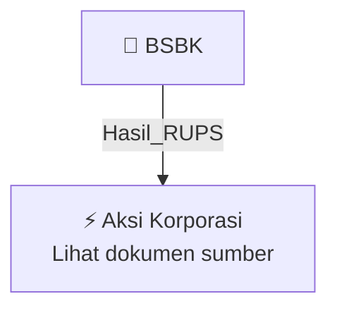

# 🏛️ Hasil & Keputusan RUPS / RUPSLB — [[BSBK]]

⬅️ [[knowledge-base/daily-digests/Daily_Digest_20261006|Kembali ke Daily Digest]] | 📅 **2026-10-06** | 🎛️ [[Dashboard|Ke Dashboard Utama]]

> [!IMPORTANT]
> Laporan ini disusun secara otomatis oleh **Corporate Action Intelligence Agent** pada **2026-10-06**.
> Sumber dokumen: `20261005_BSBK_20261005_BSBK_Jadwal Aksi Korporasi (Khusus Penyampaian Dividen Interim)_32163425_lamp1.pdf`

---

## 📌 1. Ringkasan Eksekutif & Tujuan Strategis

- **Kode & Nama Emiten**: `[[BSBK]]`
- **Kategori Aksi Korporasi**: `Hasil_RUPS`
- **Dokumen Sumber**: `20261005_BSBK_20261005_BSBK_Jadwal Aksi Korporasi (Khusus Penyampaian Dividen Interim)_32163425_lamp1.pdf`
- **Tanggal Laporan**: `2026-10-06`

[Analisis LLM tidak tersedia — isi manual]

---

## 📊 2. Fakta Material & Parameter Keuangan

| Parameter Utama | Nilai / Keterangan |
| :--- | :--- |
| **Jumlah Dividen** | `Rp 25.091.882.375` |
| **Dividen per Lembar Saham** | `Rp 1,-` |
| **Tanggal Pembayaran** | `20 Oktober 2026` |
| **Tahun Buku** | `2026` |
| **Dasar Laporan Keuangan** | `Laporan Keuangan Interim periode yang berakhir pada tanggal 30 Juni 2026` |
| **Keputusan Direksi** | `No. 056/CS-BSBK/X/2026` |
| **Persetujuan Dewan Komisaris** | `No. 055/CS-BSBK/X/2026 tertanggal 01 Oktober 2026` |
| **Tanggal Keputusan Direksi** | `01 Oktober 2026` |
| **Perhitungan dalam RUPST** | `Akan diperhitungkan dalam Rapat Umum Pemegang Saham Tahunan Tahun Buku 2026 yang akan diselenggarakan pada tahun 2027` |

---

## 👥 3. Struktur Kepemilikan, Pengendali & Pembeli Siaga

- **Emiten**: `BSBK` | Informasi kepemilikan mengacu pada dokumen resmi sumber.

---

## 🎯 4. Alokasi & Rencana Penggunaan Dana

- Informasi alokasi dana belum tersedia — lihat prospektus / dokumen resmi.

---

## 📅 5. Timeline & Jadwal Pelaksanaan

| Tahapan / Event | Tanggal |
| :--- | :---: |
| **Jadwal** | Lihat dokumen sumber. |

---

## 📈 6. Diagram Visual Flowchart (Mermaid)

---

## 💡 7. Rekomendasi Investor & Strategi Trading

[Analisis LLM tidak tersedia — isi manual]

---

## 🔗 8. Hubungan Note Terkait (Knowledge Graph)

- [[knowledge-base/daily-digests/Daily_Digest_20261006|📄 Daily Digest 2026-10-06]]
- [[knowledge-base/trading-signals/Trading_Signals_20261006|🎯 Sinyal Cuan 2026-10-06]]
- [[BSBK|🏬 Halaman Emiten BSBK]]
- [[Dashboard|🎛️ Kembali ke Dashboard Utama]]

---

*Laporan dibuat otomatis oleh Corporate Action Intelligence Agent · 2026-10-06*