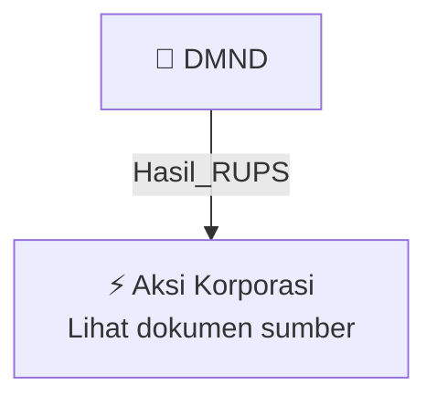

# 🏛️ Hasil & Keputusan RUPS / RUPSLB — [[DMND]]

⬅️ [[knowledge-base/daily-digests/Daily_Digest_20261005|Kembali ke Daily Digest]] | 📅 **2026-10-05** | 🎛️ [[Dashboard|Ke Dashboard Utama]]

> [!IMPORTANT]
> Laporan ini disusun secara otomatis oleh **Corporate Action Intelligence Agent** pada **2026-10-05**.
> Sumber dokumen: `20261002_DMND_20261002_DMND_Ringkasan RisalahRisalah RUPS_32162777_lamp1.pdf`

---

## 📌 1. Ringkasan Eksekutif & Tujuan Strategis

- **Kode & Nama Emiten**: `[[DMND]]`
- **Kategori Aksi Korporasi**: `Hasil_RUPS`
- **Dokumen Sumber**: `20261002_DMND_20261002_DMND_Ringkasan RisalahRisalah RUPS_32162777_lamp1.pdf`
- **Tanggal Laporan**: `2026-10-05`

[Analisis LLM tidak tersedia — isi manual]

---

## 📊 2. Fakta Material & Parameter Keuangan

| Parameter Utama | Nilai / Keterangan |
| :--- | :--- |
| **Jenis Rapat** | `Rapat Umum Pemegang Saham Luar Biasa (RUPSLB)` |
| **Hari/Tanggal Rapat** | `Rabu, 30 September 2026` |
| **Waktu Rapat** | `14.12 WIB – 14.39 WIB` |
| **Tempat Rapat** | `Ruang Cendana, DoubleTree by Hilton Jakarta Kemayoran Lt. 2, Jl. Griya Utama No.1 Blok B, Sunter Agung, Tanjung Priok, Jakarta, 14350` |
| **Mata Acara 1** | `Perubahan Susunan Dewan Komisaris` |
| **Mata Acara 2** | `Persetujuan atas perubahan ketentuan Pasal 3 Anggaran Dasar Perseroan mengenai Maksud dan Tujuan serta Kegiatan Usaha Perseroan, dalam rangka penyesuaian dengan Klasifikasi Baku Lapangan Usaha Indonesia (KBLI) 2025` |
| **Keputusan Mata Acara Pertama** | `Menyetujui pengangkatan Bapak Leonard sebagai Komisaris Independen Perseroan, dengan masa jabatan terhitung sejak ditutupnya Rapat sampai dengan penutupan RUPS Tahunan Perseroan tahun 2029` |
| **Hasil Voting Mata Acara Pertama - Setuju** | `8.396.529.375 saham atau 99,99999881% dari total seluruh saham yang sah yang hadir dalam Rapat` |
| **Hasil Voting Mata Acara Pertama - Tidak Setuju** | `100 saham atau 0,00000119% dari total seluruh saham yang sah yang hadir dalam Rapat` |
| **Hasil Voting Mata Acara Pertama - Abstain** | `Tidak ada pemegang saham dan/atau kuasa pemegang saham yang menyatakan suara abstain` |
| **Total Saham Hadir dalam Rapat** | `8.396.529.475 saham atau 88,6798808% dari seluruh saham yang telah ditempatkan dan disetor penuh` |
| **Total Saham Ditempatkan dan Disetor Penuh** | `9.468.359.000 saham` |
| **Susunan Dewan Komisaris Setelah Rapat** | `Komisaris Utama: Chen Tsen Nan (sampai RUPS Tahunan 2028); Komisaris Independen: Lim Beng Lin (sampai RUPS Tahunan 2028); Komisaris Independen: Corneiles Tedjo Endriyarto (sampai RUPS Tahunan 2028); Komisaris Independen: Istini Tatiek Siddharta (sampai RUPS Tahunan 2028); Komisaris Independen: Nakrin Narula (sampai RUPS Tahunan 2028)` |
| **Direksi yang Hadir** | `Philip Min Lih Chen (Direktur Utama), Ir. Widianto Juwono (Direktur), Troy Parwata (Direktur)` |
| **Komisaris yang Hadir** | `Chen Tsen Nan (Komisaris Utama), Lim Beng Lin (Komisaris Independen), Corneiles Tedjo Endriyarto (Komisaris Independen), Istini Tatiek Siddharta (Komisaris Independen), Nakrin Narula (Komisaris Independen), Wu Qianfei (Komisaris Independen)` |

---

## 👥 3. Struktur Kepemilikan, Pengendali & Pembeli Siaga

- **Emiten**: `DMND` | Informasi kepemilikan mengacu pada dokumen resmi sumber.

---

## 🎯 4. Alokasi & Rencana Penggunaan Dana

- Informasi alokasi dana belum tersedia — lihat prospektus / dokumen resmi.

---

## 📅 5. Timeline & Jadwal Pelaksanaan

| Tahapan / Event | Tanggal |
| :--- | :---: |
| **Jadwal** | Lihat dokumen sumber. |

---

## 📈 6. Diagram Visual Flowchart (Mermaid)

---

## 💡 7. Rekomendasi Investor & Strategi Trading

[Analisis LLM tidak tersedia — isi manual]

---

## 🔗 8. Hubungan Note Terkait (Knowledge Graph)

- [[knowledge-base/daily-digests/Daily_Digest_20261005|📄 Daily Digest 2026-10-05]]
- [[knowledge-base/trading-signals/Trading_Signals_20261005|🎯 Sinyal Cuan 2026-10-05]]
- [[DMND|🏬 Halaman Emiten DMND]]
- [[Dashboard|🎛️ Kembali ke Dashboard Utama]]

---

*Laporan dibuat otomatis oleh Corporate Action Intelligence Agent · 2026-10-05*