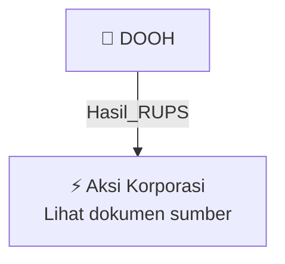

# 🏛️ Hasil & Keputusan RUPS / RUPSLB — [[DOOH]]

⬅️ [[knowledge-base/daily-digests/Daily_Digest_20261002|Kembali ke Daily Digest]] | 📅 **2026-10-02** | 🎛️ [[Dashboard|Ke Dashboard Utama]]

> [!IMPORTANT]
> Laporan ini disusun secara otomatis oleh **Corporate Action Intelligence Agent** pada **2026-10-02**.
> Sumber dokumen: `20261001_DOOH_20261001_DOOH_Rencana Transaksi Material Dengan Persetujuan RUPS_32162590_lamp1.pdf`

---

## 📌 1. Ringkasan Eksekutif & Tujuan Strategis

- **Kode & Nama Emiten**: `[[DOOH]]`
- **Kategori Aksi Korporasi**: `Hasil_RUPS`
- **Dokumen Sumber**: `20261001_DOOH_20261001_DOOH_Rencana Transaksi Material Dengan Persetujuan RUPS_32162590_lamp1.pdf`
- **Tanggal Laporan**: `2026-10-02`

[Analisis LLM tidak tersedia — isi manual]

---

## 📊 2. Fakta Material & Parameter Keuangan

| Parameter Utama | Nilai / Keterangan |
| :--- | :--- |
| **Nama Perseroan** | `PT Era Media Sejahtera Tbk` |
| **Kode Emiten** | `DOOH` |
| **Entitas Anak Pembeli** | `PT Cakrawala Nexus Investama (CNI)` |
| **Pihak Penjual** | `PT Abadi Kreasi Unggul Nusantara (AKUN)` |
| **Objek Transaksi** | `6.685.000.000 lembar saham PT Sinergi Inti Andalan Prima Tbk (INET)` |
| **Persentase Kepemilikan yang Dibeli** | `29,88% dari modal ditempatkan dan disetor INET` |
| **Nilai Transaksi** | `Rp2.005.500.000.000` |
| **Harga per Lembar Saham** | `Rp300 per saham` |
| **Persentase Nilai Transaksi terhadap Ekuitas Perseroan** | `647,90% dari nilai ekuitas Perseroan berdasarkan Laporan Keuangan Konsolidasian periode 30 Juni 2026` |
| **Kantor Akuntan Publik** | `KAP Anwar & Rekan` |
| **Dasar Transaksi** | `Perjanjian Pengikatan Jual Beli Saham antara AKUN dan CNI tanggal 1 September 2026` |
| **Tanggal PPJB Saham** | `2026-09-01` |
| **Mekanisme Pelaksanaan Transaksi** | `Pasar negosiasi Bursa Efek Indonesia dan penyelesaian melalui sistem C-BEST PT Kustodian Sentral Efek Indonesia` |
| **Status Transaksi** | `Transaksi Material berdasarkan POJK 17/2020` |
| **Status Transaksi Afiliasi dan Benturan Kepentingan** | `Bukan transaksi afiliasi dan bukan transaksi benturan kepentingan berdasarkan POJK 42/2020` |
| **Hubungan Afiliasi** | `Tidak terdapat hubungan afiliasi antara Perseroan maupun CNI selaku Pembeli dengan AKUN selaku Penjual` |
| **Kepemilikan AKUN Setelah Transaksi** | `29,89% atau 6.688.689.331 saham, tetap menjadi pemegang saham pengendali INET` |
| **Kepemilikan CNI Setelah Transaksi** | `29,88% atau 6.685.000.000 saham, tidak menjadikan CNI sebagai pengendali INET` |
| **Tanggal Keterbukaan Informasi** | `2026-10-01` |

---

## 👥 3. Struktur Kepemilikan, Pengendali & Pembeli Siaga

- **Emiten**: `DOOH` | Informasi kepemilikan mengacu pada dokumen resmi sumber.

---

## 🎯 4. Alokasi & Rencana Penggunaan Dana

- Informasi alokasi dana belum tersedia — lihat prospektus / dokumen resmi.

---

## 📅 5. Timeline & Jadwal Pelaksanaan

| Tahapan / Event | Tanggal |
| :--- | :---: |
| **Jadwal** | Lihat dokumen sumber. |

---

## 📈 6. Diagram Visual Flowchart (Mermaid)

---

## 💡 7. Rekomendasi Investor & Strategi Trading

[Analisis LLM tidak tersedia — isi manual]

---

## 🔗 8. Hubungan Note Terkait (Knowledge Graph)

- [[knowledge-base/daily-digests/Daily_Digest_20261002|📄 Daily Digest 2026-10-02]]
- [[knowledge-base/trading-signals/Trading_Signals_20261002|🎯 Sinyal Cuan 2026-10-02]]
- [[DOOH|🏬 Halaman Emiten DOOH]]
- [[Dashboard|🎛️ Kembali ke Dashboard Utama]]

---

*Laporan dibuat otomatis oleh Corporate Action Intelligence Agent · 2026-10-02*