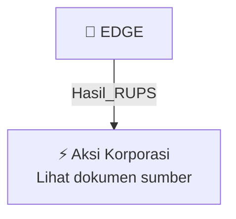

# 🏛️ Hasil & Keputusan RUPS / RUPSLB — [[EDGE]]

⬅️ [[knowledge-base/daily-digests/Daily_Digest_20261007|Kembali ke Daily Digest]] | 📅 **2026-10-07** | 🎛️ [[Dashboard|Ke Dashboard Utama]]

> [!IMPORTANT]
> Laporan ini disusun secara otomatis oleh **Corporate Action Intelligence Agent** pada **2026-10-07**.
> Sumber dokumen: `20261006_EDGE_20261006_EDGE_Transaksi Material Tanpa Persetujuan RUPS_32163904_lamp1.pdf`

---

## 📌 1. Ringkasan Eksekutif & Tujuan Strategis

- **Kode & Nama Emiten**: `[[EDGE]]`
- **Kategori Aksi Korporasi**: `Hasil_RUPS`
- **Dokumen Sumber**: `20261006_EDGE_20261006_EDGE_Transaksi Material Tanpa Persetujuan RUPS_32163904_lamp1.pdf`
- **Tanggal Laporan**: `2026-10-07`

[Analisis LLM tidak tersedia — isi manual]

---

## 📊 2. Fakta Material & Parameter Keuangan

| Parameter Utama | Nilai / Keterangan |
| :--- | :--- |
| **Tanggal Transaksi** | `2 Oktober 2026` |
| **Tanggal Pelaporan** | `6 Oktober 2026` |
| **Nomor Surat** | `059/Indonet-Corsec/Srt/X/2026` |
| **Pihak yang Bertransaksi** | `PT Indointernet Tbk dan PT Ekagrata Data Gemilang (EDG)` |
| **Kreditur** | `PT Bank Central Asia Tbk` |
| **Objek Transaksi** | `Penambahan fasilitas kredit (KI-5)` |
| **Nilai Fasilitas Kredit** | `Tidak lebih dari Rp1.700.000.000.000` |
| **Jangka Waktu** | `9 tahun` |
| **Tingkat Bunga** | `Suku bunga mengambang (floating rate)` |
| **Jaminan** | `Aset Perseroan dan EDG dengan nilai penjaminan lebih dari 50% jumlah kekayaan bersih masing-masing` |
| **Jaminan Tambahan** | `Tanah dan bangunan serta mesin dan peralatan milik EDG` |
| **Tujuan Penggunaan** | `Membiayai kebutuhan umum kegiatan usaha, termasuk belanja modal, ekspansi kabel fiber optik, dan kebutuhan pendanaan lainnya` |
| **Dasar Hukum** | `POJK No. 45 Tahun 2024, POJK No. 17/POJK.04/2020, POJK No. 42/POJK.04/2020, dan Peraturan BEI No. I-E` |

---

## 👥 3. Struktur Kepemilikan, Pengendali & Pembeli Siaga

- **Emiten**: `EDGE` | Informasi kepemilikan mengacu pada dokumen resmi sumber.

---

## 🎯 4. Alokasi & Rencana Penggunaan Dana

- Informasi alokasi dana belum tersedia — lihat prospektus / dokumen resmi.

---

## 📅 5. Timeline & Jadwal Pelaksanaan

| Tahapan / Event | Tanggal |
| :--- | :---: |
| **Jadwal** | Lihat dokumen sumber. |

---

## 📈 6. Diagram Visual Flowchart (Mermaid)

---

## 💡 7. Rekomendasi Investor & Strategi Trading

[Analisis LLM tidak tersedia — isi manual]

---

## 🔗 8. Hubungan Note Terkait (Knowledge Graph)

- [[knowledge-base/daily-digests/Daily_Digest_20261007|📄 Daily Digest 2026-10-07]]
- [[knowledge-base/trading-signals/Trading_Signals_20261007|🎯 Sinyal Cuan 2026-10-07]]
- [[EDGE|🏬 Halaman Emiten EDGE]]
- [[Dashboard|🎛️ Kembali ke Dashboard Utama]]

---

*Laporan dibuat otomatis oleh Corporate Action Intelligence Agent · 2026-10-07*