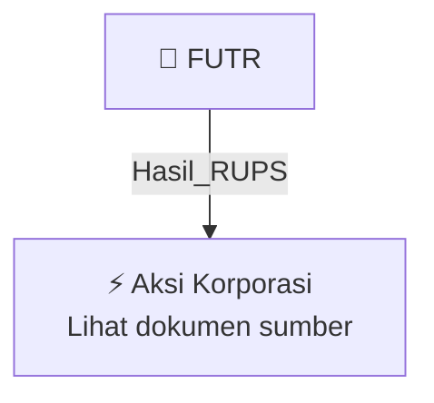

# 🏛️ Hasil & Keputusan RUPS / RUPSLB — [[FUTR]]

⬅️ [[knowledge-base/daily-digests/Daily_Digest_20261002|Kembali ke Daily Digest]] | 📅 **2026-10-02** | 🎛️ [[Dashboard|Ke Dashboard Utama]]

> [!IMPORTANT]
> Laporan ini disusun secara otomatis oleh **Corporate Action Intelligence Agent** pada **2026-10-02**.
> Sumber dokumen: `20261001_FUTR_20261001_FUTR_Laporan Informasi dan Fakta Material_32162621.pdf`

---

## 📌 1. Ringkasan Eksekutif & Tujuan Strategis

- **Kode & Nama Emiten**: `[[FUTR]]`
- **Kategori Aksi Korporasi**: `Hasil_RUPS`
- **Dokumen Sumber**: `20261001_FUTR_20261001_FUTR_Laporan Informasi dan Fakta Material_32162621.pdf`
- **Tanggal Laporan**: `2026-10-02`

[Analisis LLM tidak tersedia — isi manual]

---

## 📊 2. Fakta Material & Parameter Keuangan

| Parameter Utama | Nilai / Keterangan |
| :--- | :--- |
| **Nomor Surat** | `085/FUTR-OJK/KI/X/2026` |
| **Tanggal Kejadian** | `30 September 2026` |
| **Jenis Informasi atau Fakta Material** | `Penandatanganan perjanjian jual beli saham bersyarat (CSPA)` |
| **Penjual** | `PT Adhi Karya (Persero) Tbk` |
| **Objek Transaksi** | `Saham PT Dumai Tirta Persada (DTP)` |
| **Jumlah Saham Dibeli** | `74.353 saham` |
| **Persentase Kepemilikan** | `51% dari seluruh saham yang telah ditempatkan dan disetor dalam DTP` |
| **Harga Pembelian** | `Rp141.000.000.000` |
| **Metode Perolehan** | `Proses lelang; Perseroan bertindak sebagai peserta lelang dan ditetapkan sebagai pemenang lelang` |
| **Status Pengalihan Saham** | `Belum berlaku secara efektif pada tanggal laporan` |
| **Kepemilikan Setelah Penyelesaian** | `51% (mayoritas) saham DTP` |
| **Klasifikasi Transaksi** | `Transaksi material sesuai POJK No. 17/POJK.04/2020` |
| **Pengecualian Kewajiban** | `Dikecualikan dari kewajiban menggunakan Penilai dan memperoleh persetujuan RUPS berdasarkan Pasal 11 huruf f POJK No. 17/2020 karena dilakukan melalui proses lelang` |
| **Status Transaksi Afiliasi** | `Bukan merupakan transaksi afiliasi sesuai POJK No. 42/POJK.04/2020` |
| **Dampak Kejadian** | `Penandatanganan CSPA belum mengubah kepemilikan saham Perseroan dalam DTP; setelah Penyelesaian, Perseroan akan memiliki 51% saham DTP dan melakukan pembayaran Rp141.000.000.000 sesuai ketentuan CSPA` |
| **Dampak Akuntansi** | `Dicatat sesuai dengan standar akuntansi keuangan yang berlaku` |
| **Direktur Utama** | `Anggara Suryawan` |
| **Tanggal Pelaporan** | `01-10-2026 22:35` |

---

## 👥 3. Struktur Kepemilikan, Pengendali & Pembeli Siaga

- **Emiten**: `FUTR` | Informasi kepemilikan mengacu pada dokumen resmi sumber.

---

## 🎯 4. Alokasi & Rencana Penggunaan Dana

- Informasi alokasi dana belum tersedia — lihat prospektus / dokumen resmi.

---

## 📅 5. Timeline & Jadwal Pelaksanaan

| Tahapan / Event | Tanggal |
| :--- | :---: |
| **Jadwal** | Lihat dokumen sumber. |

---

## 📈 6. Diagram Visual Flowchart (Mermaid)

---

## 💡 7. Rekomendasi Investor & Strategi Trading

[Analisis LLM tidak tersedia — isi manual]

---

## 🔗 8. Hubungan Note Terkait (Knowledge Graph)

- [[knowledge-base/daily-digests/Daily_Digest_20261002|📄 Daily Digest 2026-10-02]]
- [[knowledge-base/trading-signals/Trading_Signals_20261002|🎯 Sinyal Cuan 2026-10-02]]
- [[FUTR|🏬 Halaman Emiten FUTR]]
- [[Dashboard|🎛️ Kembali ke Dashboard Utama]]

---

*Laporan dibuat otomatis oleh Corporate Action Intelligence Agent · 2026-10-02*