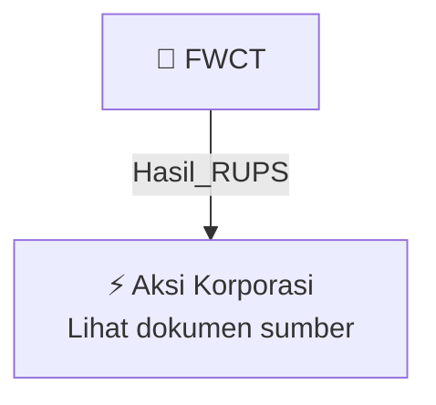

# 🏛️ Hasil & Keputusan RUPS / RUPSLB — [[FWCT]]

⬅️ [[knowledge-base/daily-digests/Daily_Digest_20261005|Kembali ke Daily Digest]] | 📅 **2026-10-05** | 🎛️ [[Dashboard|Ke Dashboard Utama]]

> [!IMPORTANT]
> Laporan ini disusun secara otomatis oleh **Corporate Action Intelligence Agent** pada **2026-10-05**.
> Sumber dokumen: `20261002_FWCT_20261002_FWCT_Ringkasan RisalahRisalah RUPS_32162761_lamp3.pdf`

---

## 📌 1. Ringkasan Eksekutif & Tujuan Strategis

- **Kode & Nama Emiten**: `[[FWCT]]`
- **Kategori Aksi Korporasi**: `Hasil_RUPS`
- **Dokumen Sumber**: `20261002_FWCT_20261002_FWCT_Ringkasan RisalahRisalah RUPS_32162761_lamp3.pdf`
- **Tanggal Laporan**: `2026-10-05`

[Analisis LLM tidak tersedia — isi manual]

---

## 📊 2. Fakta Material & Parameter Keuangan

| Parameter Utama | Nilai / Keterangan |
| :--- | :--- |
| **Jenis Rapat** | `Rapat Umum Pemegang Saham Luar Biasa (RUPSLB)` |
| **Hari/Tanggal Rapat** | `Kamis, 01 Oktober 2026` |
| **Waktu Rapat** | `14:12 - 14:35 WIB` |
| **Tempat Rapat** | `Meeting Room 01, Puri Indah Financial Tower Lantai 27, Jakarta Barat, DKI Jakarta - 11610` |
| **Mekanisme Rapat** | `Media Conferencing / elektronik` |
| **Ketua Rapat** | `Erwin Kurnia Winenda, Presiden Komisaris Independen` |
| **Direktur Utama** | `Budi Tjahjadi` |
| **Kuorum Kehadiran** | `1.612.496.000 saham atau 82,14% dari total saham diterbitkan` |
| **Total Saham Diterbitkan** | `1.963.000.000 saham per 08 September 2026` |
| **Agenda Rapat** | `Perubahan Anggaran Dasar Perseroan terkait penyesuaian Klasifikasi Baku Lapangan Usaha Indonesia (KBLI) untuk mematuhi PP Republik Indonesia No. 28 Tahun 2025 tentang Penyelenggaraan Perizinan Berusaha Berbasis Risiko` |
| **Hasil Voting Agenda** | `Setuju: 1.612.495.900 saham (99,999994%); Tidak Setuju: 100 saham (0,000006%); Abstain: 0 saham (0,000000%)` |
| **Keputusan Rapat** | `Menyetujui perubahan Pasal 3 Anggaran Dasar Perseroan` |
| **Notaris** | `Dr. Sugih Haryati, SH, M.Kn` |
| **Biro Administrasi Efek** | `PT Adimitra Jasa Korpora` |
| **Tanggal Ringkasan Risalah** | `02 Oktober 2026` |

---

## 👥 3. Struktur Kepemilikan, Pengendali & Pembeli Siaga

- **Emiten**: `FWCT` | Informasi kepemilikan mengacu pada dokumen resmi sumber.

---

## 🎯 4. Alokasi & Rencana Penggunaan Dana

- Informasi alokasi dana belum tersedia — lihat prospektus / dokumen resmi.

---

## 📅 5. Timeline & Jadwal Pelaksanaan

| Tahapan / Event | Tanggal |
| :--- | :---: |
| **Jadwal** | Lihat dokumen sumber. |

---

## 📈 6. Diagram Visual Flowchart (Mermaid)

---

## 💡 7. Rekomendasi Investor & Strategi Trading

[Analisis LLM tidak tersedia — isi manual]

---

## 🔗 8. Hubungan Note Terkait (Knowledge Graph)

- [[knowledge-base/daily-digests/Daily_Digest_20261005|📄 Daily Digest 2026-10-05]]
- [[knowledge-base/trading-signals/Trading_Signals_20261005|🎯 Sinyal Cuan 2026-10-05]]
- [[FWCT|🏬 Halaman Emiten FWCT]]
- [[Dashboard|🎛️ Kembali ke Dashboard Utama]]

---

*Laporan dibuat otomatis oleh Corporate Action Intelligence Agent · 2026-10-05*