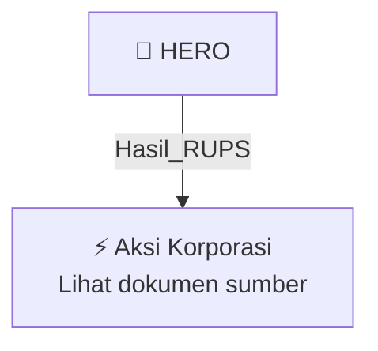

# 🏛️ Hasil & Keputusan RUPS / RUPSLB — [[HERO]]

⬅️ [[knowledge-base/daily-digests/Daily_Digest_20261002|Kembali ke Daily Digest]] | 📅 **2026-10-02** | 🎛️ [[Dashboard|Ke Dashboard Utama]]

> [!IMPORTANT]
> Laporan ini disusun secara otomatis oleh **Corporate Action Intelligence Agent** pada **2026-10-02**.
> Sumber dokumen: `20261001_HERO_20261001_HERO_Laporan Informasi dan Fakta Material_32162489.pdf`

---

## 📌 1. Ringkasan Eksekutif & Tujuan Strategis

- **Kode & Nama Emiten**: `[[HERO]]`
- **Kategori Aksi Korporasi**: `Hasil_RUPS`
- **Dokumen Sumber**: `20261001_HERO_20261001_HERO_Laporan Informasi dan Fakta Material_32162489.pdf`
- **Tanggal Laporan**: `2026-10-02`

[Analisis LLM tidak tersedia — isi manual]

---

## 📊 2. Fakta Material & Parameter Keuangan

| Parameter Utama | Nilai / Keterangan |
| :--- | :--- |
| **Nomor Surat** | `069/Corsec/X/2026` |
| **Nama Emiten atau Perusahaan Publik** | `PT DFI Retail Nusantara Tbk` |
| **Bidang Usaha** | `Perdagangan Eceran Grosir` |
| **Tanggal Kejadian** | `01 Oktober 2026` |
| **Jenis Informasi atau Fakta Material** | `Perubahan anggota Direksi dan/atau anggota Dewan Komisaris` |
| **Pihak yang Mengundurkan Diri dari Presiden Direktur** | `Bapak Hadrianus Wahyu Trikusumo` |
| **Pihak yang Mengundurkan Diri dari Direktur** | `Bapak Charles David Landale` |
| **Tindak Lanjut** | `Perseroan akan menyelenggarakan Rapat Umum Pemegang Saham Luar Biasa (RUPSLB) untuk memutuskan permohonan pengunduran diri` |
| **Dasar Hukum** | `Pasal 8 dan Pasal 9 Peraturan Otoritas Jasa Keuangan Nomor 33/POJK.04/2014 tentang Direksi dan Dewan Komisaris Emiten atau Perusahaan Publik` |
| **Dampak terhadap Kegiatan Operasional, Hukum, Kondisi Keuangan, atau Kelangsungan Usaha** | `-` |

---

## 👥 3. Struktur Kepemilikan, Pengendali & Pembeli Siaga

- **Emiten**: `HERO` | Informasi kepemilikan mengacu pada dokumen resmi sumber.

---

## 🎯 4. Alokasi & Rencana Penggunaan Dana

- Informasi alokasi dana belum tersedia — lihat prospektus / dokumen resmi.

---

## 📅 5. Timeline & Jadwal Pelaksanaan

| Tahapan / Event | Tanggal |
| :--- | :---: |
| **Jadwal** | Lihat dokumen sumber. |

---

## 📈 6. Diagram Visual Flowchart (Mermaid)

---

## 💡 7. Rekomendasi Investor & Strategi Trading

[Analisis LLM tidak tersedia — isi manual]

---

## 🔗 8. Hubungan Note Terkait (Knowledge Graph)

- [[knowledge-base/daily-digests/Daily_Digest_20261002|📄 Daily Digest 2026-10-02]]
- [[knowledge-base/trading-signals/Trading_Signals_20261002|🎯 Sinyal Cuan 2026-10-02]]
- [[HERO|🏬 Halaman Emiten HERO]]
- [[Dashboard|🎛️ Kembali ke Dashboard Utama]]

---

*Laporan dibuat otomatis oleh Corporate Action Intelligence Agent · 2026-10-02*