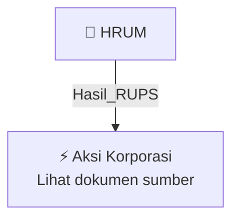

# 🏛️ Hasil & Keputusan RUPS / RUPSLB — [[HRUM]]

⬅️ [[knowledge-base/daily-digests/Daily_Digest_20260923|Kembali ke Daily Digest]] | 📅 **2026-09-23** | 🎛️ [[Dashboard|Ke Dashboard Utama]]

> [!IMPORTANT]
> Laporan ini disusun secara otomatis oleh **Corporate Action Intelligence Agent** pada **2026-09-23**.
> Sumber dokumen: `20260922_HRUM_20260921_HRUM_Ringkasan RisalahRisalah RUPS_32150038_lamp2.pdf`

---

## 📌 1. Ringkasan Eksekutif & Tujuan Strategis

- **Kode & Nama Emiten**: `[[HRUM]]`
- **Kategori Aksi Korporasi**: `Hasil_RUPS`
- **Dokumen Sumber**: `20260922_HRUM_20260921_HRUM_Ringkasan RisalahRisalah RUPS_32150038_lamp2.pdf`
- **Tanggal Laporan**: `2026-09-23`

[Analisis LLM tidak tersedia — isi manual]

---

## 📊 2. Fakta Material & Parameter Keuangan

| Parameter Utama | Nilai / Keterangan |
| :--- | :--- |
| **Uraian Kejadian** | `1 PENGUMUMAN RINGKASAN RISALAH RAPAT UMUM PEMEGANG SAHAM LUAR BIASA PT HARUM ENERGY TBK ANNOUNCEMENT SUMMARY OF MINUTES OF EXTRAORDINARY GENERAL MEETING OF SHAREHOLDERS PT HARUM ENERGY TBK Direksi PT Harum Energy Tbk. (”Perseroan”) dengan ini memberitahukan bahwa Rapat Umum Pemegang Saham Luar Biasa (“RUPSLB”) Perseroan telah dilaksanakan pada hari Jumat, 18 September 2026 pukul 10.04 – 10.21 WIB di The Board of Directors of PT Harum Energy Tbk. (the “Company”) hereby announce that the Extraordi` |

---

## 👥 3. Struktur Kepemilikan, Pengendali & Pembeli Siaga

- **Emiten**: `HRUM` | Informasi kepemilikan mengacu pada dokumen resmi sumber.

---

## 🎯 4. Alokasi & Rencana Penggunaan Dana

- Informasi alokasi dana belum tersedia — lihat prospektus / dokumen resmi.

---

## 📅 5. Timeline & Jadwal Pelaksanaan

| Tahapan / Event | Tanggal |
| :--- | :---: |
| **Jadwal** | Lihat dokumen sumber. |

---

## 📈 6. Diagram Visual Flowchart (Mermaid)

---

## 💡 7. Rekomendasi Investor & Strategi Trading

[Analisis LLM tidak tersedia — isi manual]

---

## 🔗 8. Hubungan Note Terkait (Knowledge Graph)

- [[knowledge-base/daily-digests/Daily_Digest_20260923|📄 Daily Digest 2026-09-23]]
- [[knowledge-base/trading-signals/Trading_Signals_20260923|🎯 Sinyal Cuan 2026-09-23]]
- [[HRUM|🏬 Halaman Emiten HRUM]]
- [[Dashboard|🎛️ Kembali ke Dashboard Utama]]

---

*Laporan dibuat otomatis oleh Corporate Action Intelligence Agent · 2026-09-23*