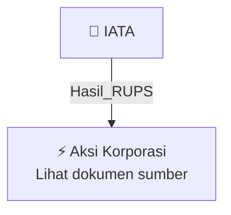

# 🏛️ Hasil & Keputusan RUPS / RUPSLB — [[IATA]]

⬅️ [[knowledge-base/daily-digests/Daily_Digest_20261009|Kembali ke Daily Digest]] | 📅 **2026-10-09** | 🎛️ [[Dashboard|Ke Dashboard Utama]]

> [!IMPORTANT]
> Laporan ini disusun secara otomatis oleh **Corporate Action Intelligence Agent** pada **2026-10-09**.
> Sumber dokumen: `20261008_IATA_20261008_IATA_Laporan Informasi dan Fakta Material_32164902_lamp1.pdf`

---

## 📌 1. Ringkasan Eksekutif & Tujuan Strategis

- **Kode & Nama Emiten**: `[[IATA]]`
- **Kategori Aksi Korporasi**: `Hasil_RUPS`
- **Dokumen Sumber**: `20261008_IATA_20261008_IATA_Laporan Informasi dan Fakta Material_32164902_lamp1.pdf`
- **Tanggal Laporan**: `2026-10-09`

[Analisis LLM tidak tersedia — isi manual]

---

## 📊 2. Fakta Material & Parameter Keuangan

| Parameter Utama | Nilai / Keterangan |
| :--- | :--- |
| **Status kepemilikan** | `PT Karya Pacific Energy Tbk bukan lagi emiten yang dimiliki Hary Tanoesoedibjo atau bagian dari MNC Group` |
| **Nama sebelumnya** | `PT MNC Energy Investments Tbk` |
| **Nama baru** | `PT Karya Pacific Energy Tbk` |
| **Dasar perubahan nama** | `Keputusan Rapat Umum Pemegang Saham Tahunan tanggal 22 Juni 2026` |
| **Tanggal RUPS Tahunan** | `2026-06-22` |
| **Pemegang saham utama** | `PT Karya Pacific Investama` |
| **Klarifikasi penyebutan media** | `Penyebutan 'emiten Hary Tanoe' sudah tidak mencerminkan kondisi kepemilikan Perseroan yang berlaku saat ini` |
| **Kontak Perseroan** | `Andi Tenri Dala F; office.iata@karya-pacific.com; https://karyapacificenergy.com/` |

---

## 👥 3. Struktur Kepemilikan, Pengendali & Pembeli Siaga

- **Emiten**: `IATA` | Informasi kepemilikan mengacu pada dokumen resmi sumber.

---

## 🎯 4. Alokasi & Rencana Penggunaan Dana

- Informasi alokasi dana belum tersedia — lihat prospektus / dokumen resmi.

---

## 📅 5. Timeline & Jadwal Pelaksanaan

| Tahapan / Event | Tanggal |
| :--- | :---: |
| **Jadwal** | Lihat dokumen sumber. |

---

## 📈 6. Diagram Visual Flowchart (Mermaid)

---

## 💡 7. Rekomendasi Investor & Strategi Trading

[Analisis LLM tidak tersedia — isi manual]

---

## 🔗 8. Hubungan Note Terkait (Knowledge Graph)

- [[knowledge-base/daily-digests/Daily_Digest_20261009|📄 Daily Digest 2026-10-09]]
- [[knowledge-base/trading-signals/Trading_Signals_20261009|🎯 Sinyal Cuan 2026-10-09]]
- [[IATA|🏬 Halaman Emiten IATA]]
- [[Dashboard|🎛️ Kembali ke Dashboard Utama]]

---

*Laporan dibuat otomatis oleh Corporate Action Intelligence Agent · 2026-10-09*