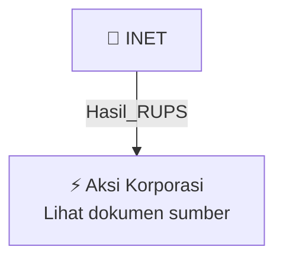

# 🏛️ Hasil & Keputusan RUPS / RUPSLB — [[INET]]

⬅️ [[knowledge-base/daily-digests/Daily_Digest_20261007|Kembali ke Daily Digest]] | 📅 **2026-10-07** | 🎛️ [[Dashboard|Ke Dashboard Utama]]

> [!IMPORTANT]
> Laporan ini disusun secara otomatis oleh **Corporate Action Intelligence Agent** pada **2026-10-07**.
> Sumber dokumen: `20261006_INET_20261006_INET_Tanggapan atas Permintaan Penjelasan Bursa_32163928_lamp1.pdf`

---

## 📌 1. Ringkasan Eksekutif & Tujuan Strategis

- **Kode & Nama Emiten**: `[[INET]]`
- **Kategori Aksi Korporasi**: `Hasil_RUPS`
- **Dokumen Sumber**: `20261006_INET_20261006_INET_Tanggapan atas Permintaan Penjelasan Bursa_32163928_lamp1.pdf`
- **Tanggal Laporan**: `2026-10-07`

[Analisis LLM tidak tersedia — isi manual]

---

## 📊 2. Fakta Material & Parameter Keuangan

| Parameter Utama | Nilai / Keterangan |
| :--- | :--- |
| **Nomor surat Perseroan** | `178/INET/CORSEC/X/2026` |
| **Tanggal surat Perseroan** | `6 Oktober 2026` |
| **Nomor surat Bursa Efek Indonesia** | `S-12651/BEI.PP2/10-2026` |
| **Tanggal surat Bursa Efek Indonesia** | `5 Oktober 2026` |
| **Perihal surat Bursa** | `Permintaan Penjelasan Atas Pemberitaan di Media Massa` |
| **Pihak yang menerbitkan siaran pers** | `PT Era Media Sejahtera Tbk (DOOH)` |
| **Tanggal siaran pers DOOH** | `1 Oktober 2026` |
| **Rencana transaksi** | `Pengambilalihan 29,88% saham Perseroan milik PT Abadi Kreasi Unggul Nusantara (AKUN) melalui PT Cakrawala Nexus Investama (CNI)` |
| **Jumlah saham yang dialihkan** | `6,685 miliar saham Perseroan` |
| **Harga per saham** | `Rp300 per saham` |
| **Nilai transaksi** | `Sekitar Rp2,005 triliun` |
| **Status transaksi** | `Masih berupa rencana; Perseroan belum menerima dokumen transaksi dari para pihak` |
| **Keterlibatan Perseroan** | `Perseroan tidak menjadi pihak dalam rencana transaksi saham antara AKUN dan CNI atau DOOH, serta tidak terlibat dalam negosiasi komersial` |
| **Latar belakang rencana pelepasan saham** | `Untuk mendivestasikan sebagian kepemilikan AKUN; merupakan keputusan investasi AKUN selaku pemegang saham` |
| **Dokumen perjanjian yang diketahui** | `Perjanjian Pengikatan Jual Beli Saham antara PT Abadi Kreasi Unggul Nusantara dengan PT Cakrawala Nexus Investama tanggal 1 September 2026` |
| **Sumber informasi perjanjian** | `Laporan Pendapat Kewajaran (Fairness Opinion) Nomor 00109/2.0014-00/BS/06/0080/1/IX/2026 tanggal 29 September 2026` |
| **Status persetujuan transaksi** | `Menurut DOOH memerlukan persetujuan Rapat Umum Pemegang Saham Luar Biasa (RUPSLB) DOOH` |
| **Jadwal RUPSLB DOOH** | `9 November 2026` |
| **Dasar penentuan harga transaksi** | `Harga Rp300 per saham dicapai berdasarkan kesepakatan kedua belah pihak dengan mempertimbangkan hasil laporan Penilai Independen untuk menentukan nilai wajar transaksi` |
| **Pihak pengendali dan penerima manfaat akhir setelah pengambilalihan** | `Berdasarkan konfirmasi AKUN, setelah terlaksana pengambilalihan akan dijelaskan lebih lanjut; dokumen terpotong pada bagian ini` |

---

## 👥 3. Struktur Kepemilikan, Pengendali & Pembeli Siaga

- **Emiten**: `INET` | Informasi kepemilikan mengacu pada dokumen resmi sumber.

---

## 🎯 4. Alokasi & Rencana Penggunaan Dana

- Informasi alokasi dana belum tersedia — lihat prospektus / dokumen resmi.

---

## 📅 5. Timeline & Jadwal Pelaksanaan

| Tahapan / Event | Tanggal |
| :--- | :---: |
| **Jadwal** | Lihat dokumen sumber. |

---

## 📈 6. Diagram Visual Flowchart (Mermaid)

---

## 💡 7. Rekomendasi Investor & Strategi Trading

[Analisis LLM tidak tersedia — isi manual]

---

## 🔗 8. Hubungan Note Terkait (Knowledge Graph)

- [[knowledge-base/daily-digests/Daily_Digest_20261007|📄 Daily Digest 2026-10-07]]
- [[knowledge-base/trading-signals/Trading_Signals_20261007|🎯 Sinyal Cuan 2026-10-07]]
- [[INET|🏬 Halaman Emiten INET]]
- [[Dashboard|🎛️ Kembali ke Dashboard Utama]]

---

*Laporan dibuat otomatis oleh Corporate Action Intelligence Agent · 2026-10-07*