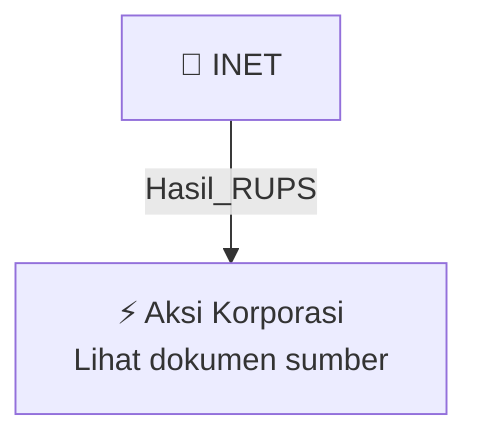

# 🏛️ Hasil & Keputusan RUPS / RUPSLB — [[INET]]

⬅️ [[knowledge-base/daily-digests/Daily_Digest_20261009|Kembali ke Daily Digest]] | 📅 **2026-10-09** | 🎛️ [[Dashboard|Ke Dashboard Utama]]

> [!IMPORTANT]
> Laporan ini disusun secara otomatis oleh **Corporate Action Intelligence Agent** pada **2026-10-09**.
> Sumber dokumen: `20261008_INET_20261008_INET_Pemberitahuan RencanaPenyampaian PanggilanHasil RUPORUPSURUP EBA-SP_32164910_lamp1.pdf`

---

## 📌 1. Ringkasan Eksekutif & Tujuan Strategis

- **Kode & Nama Emiten**: `[[INET]]`
- **Kategori Aksi Korporasi**: `Hasil_RUPS`
- **Dokumen Sumber**: `20261008_INET_20261008_INET_Pemberitahuan RencanaPenyampaian PanggilanHasil RUPORUPSURUP EBA-SP_32164910_lamp1.pdf`
- **Tanggal Laporan**: `2026-10-09`

[Analisis LLM tidak tersedia — isi manual]

---

## 📊 2. Fakta Material & Parameter Keuangan

| Parameter Utama | Nilai / Keterangan |
| :--- | :--- |
| **Jenis aksi korporasi** | `RUPO Obligasi I Sinergi Inti Andalan Prima Tahun 2026` |
| **Obligasi** | `Obligasi I Sinergi Inti Andalan Prima Tahun 2026` |
| **Emiten peminta RUPO** | `PT Sinergi Inti Andalan Prima Tbk` |
| **Wali Amanat** | `PT Bank KB Indonesia Tbk` |
| **Nomor surat permintaan Emiten** | `176/INET/CS/X/2026` |
| **Tanggal surat permintaan Emiten** | `2026-10-05` |
| **Rencana tanggal RUPO** | `2026-11-05` |
| **Hari RUPO** | `Kamis` |
| **Lokasi RUPO** | `Jakarta` |
| **Tanggal panggilan di surat kabar** | `2026-10-22` |
| **Media panggilan** | `1 surat kabar harian berperedaran nasional` |
| **Dasar perwaliamanatan** | `Akta Perjanjian Perwaliamanatan Obligasi I Sinergi Inti Andalan Prima Tahun 2025 No. 2.886 tanggal 28 Oktober 2025; Addendum V Perjanjian Perwaliamanatan Obligasi I Sinergi Inti Andalan Prima Tahun 2026 No. 3.387 tanggal 28 Januari 2026` |
| **Notaris** | `MOHAMAD FAJRI MEKKA PUTRA, S.H., M.Kn. Notaris di Jakarta Selatan` |
| **Syarat pemegang obligasi yang berhak hadir** | `Memiliki Konfirmasi Tertulis Untuk RUPO (KTUR) dan namanya tercatat dalam Daftar Pemegang sebelum tanggal penyelenggaraan RUPO` |
| **Tanggal pengumuman** | `2026-10-08` |

---

## 👥 3. Struktur Kepemilikan, Pengendali & Pembeli Siaga

- **Emiten**: `INET` | Informasi kepemilikan mengacu pada dokumen resmi sumber.

---

## 🎯 4. Alokasi & Rencana Penggunaan Dana

- Informasi alokasi dana belum tersedia — lihat prospektus / dokumen resmi.

---

## 📅 5. Timeline & Jadwal Pelaksanaan

| Tahapan / Event | Tanggal |
| :--- | :---: |
| **Jadwal** | Lihat dokumen sumber. |

---

## 📈 6. Diagram Visual Flowchart (Mermaid)

---

## 💡 7. Rekomendasi Investor & Strategi Trading

[Analisis LLM tidak tersedia — isi manual]

---

## 🔗 8. Hubungan Note Terkait (Knowledge Graph)

- [[knowledge-base/daily-digests/Daily_Digest_20261009|📄 Daily Digest 2026-10-09]]
- [[knowledge-base/trading-signals/Trading_Signals_20261009|🎯 Sinyal Cuan 2026-10-09]]
- [[INET|🏬 Halaman Emiten INET]]
- [[Dashboard|🎛️ Kembali ke Dashboard Utama]]

---

*Laporan dibuat otomatis oleh Corporate Action Intelligence Agent · 2026-10-09*