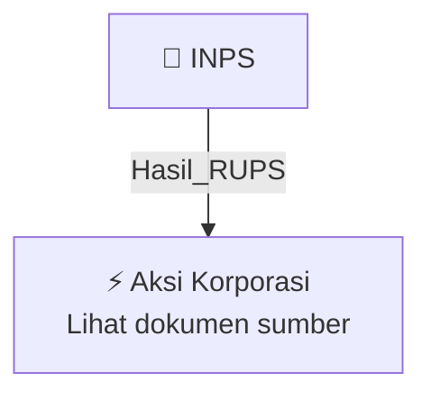

# 🏛️ Hasil & Keputusan RUPS / RUPSLB — [[INPS]]

⬅️ [[knowledge-base/daily-digests/Daily_Digest_20260924|Kembali ke Daily Digest]] | 📅 **2026-09-24** | 🎛️ [[Dashboard|Ke Dashboard Utama]]

> [!IMPORTANT]
> Laporan ini disusun secara otomatis oleh **Corporate Action Intelligence Agent** pada **2026-09-24**.
> Sumber dokumen: `20260923_INPS_20260923_INPS_Laporan Informasi dan Fakta Material_32150569.pdf`

---

## 📌 1. Ringkasan Eksekutif & Tujuan Strategis

- **Kode & Nama Emiten**: `[[INPS]]`
- **Kategori Aksi Korporasi**: `Hasil_RUPS`
- **Dokumen Sumber**: `20260923_INPS_20260923_INPS_Laporan Informasi dan Fakta Material_32150569.pdf`
- **Tanggal Laporan**: `2026-09-24`

[Analisis LLM tidak tersedia — isi manual]

---

## 📊 2. Fakta Material & Parameter Keuangan

| Parameter Utama | Nilai / Keterangan |
| :--- | :--- |
| **Nomor Laporan** | `015/INPS-OJK/IX/2026` |
| **Tanggal Kejadian** | `11 Juni 2026` |
| **Jenis Informasi Material** | `Perubahan anggota Direksi dan/atau anggota Dewan Komisaris` |
| **Direktur Utama Sebelumnya** | `Eddy Purwanto Winata` |
| **Direktur Utama Sesudahnya** | `Muhammad Reagy Sukmana` |
| **Direktur Sebelumnya** | `Jerry Erfansyah, SE` |
| **Direktur Sesudahnya** | `Budiarto Santoso dan Jerry Erfansyah` |
| **Komisaris Utama Sebelumnya** | `Lies Erliawati Winata` |
| **Komisaris Utama Sesudahnya** | `Gloria Jaya` |
| **Komisaris Independen Sebelumnya** | `Ir Hadi Avilla Tamzil` |
| **Komisaris Independen Sesudahnya** | `Hartanto Kurniawan` |
| **Dampak Material** | `Tidak ada dampak negatif material terhadap operasional, hukum, kondisi keuangan, atau kelangsungan usaha` |

---

## 👥 3. Struktur Kepemilikan, Pengendali & Pembeli Siaga

- **Emiten**: `INPS` | Informasi kepemilikan mengacu pada dokumen resmi sumber.

---

## 🎯 4. Alokasi & Rencana Penggunaan Dana

- Informasi alokasi dana belum tersedia — lihat prospektus / dokumen resmi.

---

## 📅 5. Timeline & Jadwal Pelaksanaan

| Tahapan / Event | Tanggal |
| :--- | :---: |
| **Jadwal** | Lihat dokumen sumber. |

---

## 📈 6. Diagram Visual Flowchart (Mermaid)

---

## 💡 7. Rekomendasi Investor & Strategi Trading

[Analisis LLM tidak tersedia — isi manual]

---

## 🔗 8. Hubungan Note Terkait (Knowledge Graph)

- [[knowledge-base/daily-digests/Daily_Digest_20260924|📄 Daily Digest 2026-09-24]]
- [[knowledge-base/trading-signals/Trading_Signals_20260924|🎯 Sinyal Cuan 2026-09-24]]
- [[INPS|🏬 Halaman Emiten INPS]]
- [[Dashboard|🎛️ Kembali ke Dashboard Utama]]

---

*Laporan dibuat otomatis oleh Corporate Action Intelligence Agent · 2026-09-24*