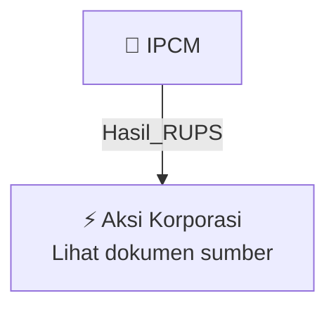

# 🏛️ Hasil & Keputusan RUPS / RUPSLB — [[IPCM]]

⬅️ [[knowledge-base/daily-digests/Daily_Digest_20260925|Kembali ke Daily Digest]] | 📅 **2026-09-25** | 🎛️ [[Dashboard|Ke Dashboard Utama]]

> [!IMPORTANT]
> Laporan ini disusun secara otomatis oleh **Corporate Action Intelligence Agent** pada **2026-09-25**.
> Sumber dokumen: `20260924_IPCM_20260924_IPCM_Ringkasan RisalahRisalah RUPS_32150882_lamp1.pdf`

---

## 📌 1. Ringkasan Eksekutif & Tujuan Strategis

- **Kode & Nama Emiten**: `[[IPCM]]`
- **Kategori Aksi Korporasi**: `Hasil_RUPS`
- **Dokumen Sumber**: `20260924_IPCM_20260924_IPCM_Ringkasan RisalahRisalah RUPS_32150882_lamp1.pdf`
- **Tanggal Laporan**: `2026-09-25`

[Analisis LLM tidak tersedia — isi manual]

---

## 📊 2. Fakta Material & Parameter Keuangan

| Parameter Utama | Nilai / Keterangan |
| :--- | :--- |
| **Uraian Kejadian** | `Halaman 1 dari 4 PENGUMUMAN RINGKASAN RISALAH RAPAT UMUM PEMEGANG SAHAM TAHUNAN PT JASA ARMADA INDONESIA Tbk No. SK.03/24/9/2/KGC/SPR/JAI-26 Direksi PT Jasa Armada Indonesia Tbk (selanjutnya disebut “Perseroan”) dengan ini memberitahukan kepada Para Pemegang Saham Perseroan, bahwa Perseroan telah menyelenggarakan Rapat Umum Pemegang Saham Luar Biasa (selanjutnya disebut “Rapat”) yaitu: A. Pada: Hari/Tanggal : Rabu, 23 September 2026 Waktu : Pukul 16.29 WIB s.d. 17.14 WIB Tempat : Museum Maritim` |

---

## 👥 3. Struktur Kepemilikan, Pengendali & Pembeli Siaga

- **Emiten**: `IPCM` | Informasi kepemilikan mengacu pada dokumen resmi sumber.

---

## 🎯 4. Alokasi & Rencana Penggunaan Dana

- Informasi alokasi dana belum tersedia — lihat prospektus / dokumen resmi.

---

## 📅 5. Timeline & Jadwal Pelaksanaan

| Tahapan / Event | Tanggal |
| :--- | :---: |
| **Jadwal** | Lihat dokumen sumber. |

---

## 📈 6. Diagram Visual Flowchart (Mermaid)

---

## 💡 7. Rekomendasi Investor & Strategi Trading

[Analisis LLM tidak tersedia — isi manual]

---

## 🔗 8. Hubungan Note Terkait (Knowledge Graph)

- [[knowledge-base/daily-digests/Daily_Digest_20260925|📄 Daily Digest 2026-09-25]]
- [[knowledge-base/trading-signals/Trading_Signals_20260925|🎯 Sinyal Cuan 2026-09-25]]
- [[IPCM|🏬 Halaman Emiten IPCM]]
- [[Dashboard|🎛️ Kembali ke Dashboard Utama]]

---

*Laporan dibuat otomatis oleh Corporate Action Intelligence Agent · 2026-09-25*