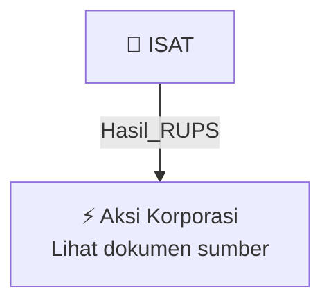

# 🏛️ Hasil & Keputusan RUPS / RUPSLB — [[ISAT]]

⬅️ [[knowledge-base/daily-digests/Daily_Digest_20261001|Kembali ke Daily Digest]] | 📅 **2026-10-01** | 🎛️ [[Dashboard|Ke Dashboard Utama]]

> [!IMPORTANT]
> Laporan ini disusun secara otomatis oleh **Corporate Action Intelligence Agent** pada **2026-10-01**.
> Sumber dokumen: `20260929_ISAT_20260929_ISAT_Ringkasan RisalahRisalah RUPS_32161919.pdf`

---

## 📌 1. Ringkasan Eksekutif & Tujuan Strategis

- **Kode & Nama Emiten**: `[[ISAT]]`
- **Kategori Aksi Korporasi**: `Hasil_RUPS`
- **Dokumen Sumber**: `20260929_ISAT_20260929_ISAT_Ringkasan RisalahRisalah RUPS_32161919.pdf`
- **Tanggal Laporan**: `2026-10-01`

[Analisis LLM tidak tersedia — isi manual]

---

## 📊 2. Fakta Material & Parameter Keuangan

| Parameter Utama | Nilai / Keterangan |
| :--- | :--- |
| **Uraian Kejadian** | `198/AY0-AYD0/LGL/26 PT Indosat Tbk ISAT 1 Ringkasan Risalah Rapat Umum Para Pemegang Saham Luar Biasa Merujuk pada surat Perseroan nomor 185/AY0-AYD0/LGL/26 tanggal 31 Agustus 2026, Perseroan menyampaikan hasil penyelenggaraan Rapat Umum Pemegang Saham yang dilaksanakan pada tanggal 29 September 2026, sebagai berikut: RUPS Luar Biasa Rapat Umum Pemegang Saham Telah memenuhi kuorum karena dihadiri oleh pemegang saham yang mewakili 30.204.843.760 saham atau 93,66% dari seluruh saham dengan hak sua` |

---

## 👥 3. Struktur Kepemilikan, Pengendali & Pembeli Siaga

- **Emiten**: `ISAT` | Informasi kepemilikan mengacu pada dokumen resmi sumber.

---

## 🎯 4. Alokasi & Rencana Penggunaan Dana

- Informasi alokasi dana belum tersedia — lihat prospektus / dokumen resmi.

---

## 📅 5. Timeline & Jadwal Pelaksanaan

| Tahapan / Event | Tanggal |
| :--- | :---: |
| **Jadwal** | Lihat dokumen sumber. |

---

## 📈 6. Diagram Visual Flowchart (Mermaid)

---

## 💡 7. Rekomendasi Investor & Strategi Trading

[Analisis LLM tidak tersedia — isi manual]

---

## 🔗 8. Hubungan Note Terkait (Knowledge Graph)

- [[knowledge-base/daily-digests/Daily_Digest_20261001|📄 Daily Digest 2026-10-01]]
- [[knowledge-base/trading-signals/Trading_Signals_20261001|🎯 Sinyal Cuan 2026-10-01]]
- [[ISAT|🏬 Halaman Emiten ISAT]]
- [[Dashboard|🎛️ Kembali ke Dashboard Utama]]

---

*Laporan dibuat otomatis oleh Corporate Action Intelligence Agent · 2026-10-01*