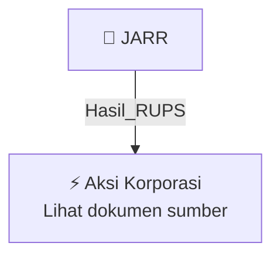

# 🏛️ Hasil & Keputusan RUPS / RUPSLB — [[JARR]]

⬅️ [[knowledge-base/daily-digests/Daily_Digest_20260924|Kembali ke Daily Digest]] | 📅 **2026-09-24** | 🎛️ [[Dashboard|Ke Dashboard Utama]]

> [!IMPORTANT]
> Laporan ini disusun secara otomatis oleh **Corporate Action Intelligence Agent** pada **2026-09-24**.
> Sumber dokumen: `20260923_JARR_20260923_JARR_Ringkasan RisalahRisalah RUPS_32150646.pdf`

---

## 📌 1. Ringkasan Eksekutif & Tujuan Strategis

- **Kode & Nama Emiten**: `[[JARR]]`
- **Kategori Aksi Korporasi**: `Hasil_RUPS`
- **Dokumen Sumber**: `20260923_JARR_20260923_JARR_Ringkasan RisalahRisalah RUPS_32150646.pdf`
- **Tanggal Laporan**: `2026-09-24`

[Analisis LLM tidak tersedia — isi manual]

---

## 📊 2. Fakta Material & Parameter Keuangan

| Parameter Utama | Nilai / Keterangan |
| :--- | :--- |
| **Nomor Surat** | `091/EXT-CORSEC/JARR/IX/2026` |
| **Tanggal RUPS** | `2026-09-21` |
| **Kuorum Kehadiran** | `86,75% (8.007.769.150 saham)` |
| **Agenda RUPS** | `Persetujuan Penyesuaian KBLI Tahun 2025` |
| **Hasil Keputusan** | `Setuju` |
| **Perubahan Kegiatan Usaha Utama** | `KBLI 01262 (Pertanian Kelapa Sawit), 10431 (Industri Minyak Mentah Kelapa Sawit), 10435 (Industri Pemisahan/Fraksinasi Minyak Murni Kelapa Sawit), 10437 (Industri Minyak Goreng Kelapa Sawit), 20115 (Industri Kimia Dasar Organik dari Sumber Daya Alam Hayati), 46202 (Perdagangan Besar Buah yang Mengandung Minyak), 46315 (Perdagangan Besar Minyak dan Lemak Nabati), 46710 (Perdagangan Besar Bahan Bakar Padat, Cair, dan Gas beserta Produk Terkait)` |
| **Perubahan Kegiatan Usaha Penunjang** | `KBLI 52101 (Pengelola Gudang Sistem Resi Gudang), 49231 (Angkutan Bermotor untuk Barang Umum), 35111 (Pembangkitan Tenaga Listrik dari Sumber Energi Tidak Terbarukan yang Menghasilkan Emisi), 20297 (Industri Biofuel Cair)` |
| **Direktur Utama** | `Bapak Indra Irawan (Periode: 06 Oktober 2022 - 30 Juni 2027)` |
| **Direktur** | `Bapak Temmy Iskandar (Periode: 24 Maret 2022 - 30 Juni 2027)` |
| **Komisaris Utama** | `Bapak Jhony Saputra (Periode: 24 Maret 2022 - 30 Juni 2027)` |
| **Komisaris** | `Bapak Bambang Aria Wisena (Periode: 24 Maret 2022 - 30 Juni 2027)` |
| **Komisaris** | `Bapak Usman Aji Purnomo (Periode: 24 Maret 2022 - 30 Juni 2027)` |
| **Komisaris** | `Bapak I Nyoman Jendrika (Periode: 26 Mei 2025 - 26 Mei 2027)` |

---

## 👥 3. Struktur Kepemilikan, Pengendali & Pembeli Siaga

- **Emiten**: `JARR` | Informasi kepemilikan mengacu pada dokumen resmi sumber.

---

## 🎯 4. Alokasi & Rencana Penggunaan Dana

- Informasi alokasi dana belum tersedia — lihat prospektus / dokumen resmi.

---

## 📅 5. Timeline & Jadwal Pelaksanaan

| Tahapan / Event | Tanggal |
| :--- | :---: |
| **Jadwal** | Lihat dokumen sumber. |

---

## 📈 6. Diagram Visual Flowchart (Mermaid)

---

## 💡 7. Rekomendasi Investor & Strategi Trading

[Analisis LLM tidak tersedia — isi manual]

---

## 🔗 8. Hubungan Note Terkait (Knowledge Graph)

- [[knowledge-base/daily-digests/Daily_Digest_20260924|📄 Daily Digest 2026-09-24]]
- [[knowledge-base/trading-signals/Trading_Signals_20260924|🎯 Sinyal Cuan 2026-09-24]]
- [[JARR|🏬 Halaman Emiten JARR]]
- [[Dashboard|🎛️ Kembali ke Dashboard Utama]]

---

*Laporan dibuat otomatis oleh Corporate Action Intelligence Agent · 2026-09-24*