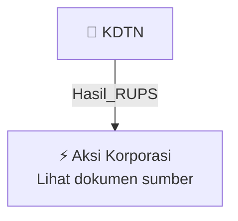

# 🏛️ Hasil & Keputusan RUPS / RUPSLB — [[KDTN]]

⬅️ [[knowledge-base/daily-digests/Daily_Digest_20261009|Kembali ke Daily Digest]] | 📅 **2026-10-09** | 🎛️ [[Dashboard|Ke Dashboard Utama]]

> [!IMPORTANT]
> Laporan ini disusun secara otomatis oleh **Corporate Action Intelligence Agent** pada **2026-10-09**.
> Sumber dokumen: `20261008_KDTN_20261008_KDTN_Laporan Informasi dan Fakta Material_32164741.pdf`

---

## 📌 1. Ringkasan Eksekutif & Tujuan Strategis

- **Kode & Nama Emiten**: `[[KDTN]]`
- **Kategori Aksi Korporasi**: `Hasil_RUPS`
- **Dokumen Sumber**: `20261008_KDTN_20261008_KDTN_Laporan Informasi dan Fakta Material_32164741.pdf`
- **Tanggal Laporan**: `2026-10-09`

[Analisis LLM tidak tersedia — isi manual]

---

## 📊 2. Fakta Material & Parameter Keuangan

| Parameter Utama | Nilai / Keterangan |
| :--- | :--- |
| **Nomor Surat** | `125/PSP-CORSEC/LO/X/2026` |
| **Nama Emiten** | `PT Puri Sentul Permai Tbk` |
| **Bidang Usaha** | `Jasa penyedia akomodasi berupa hotel dan jasa penyediaan makan minum berupa restoran` |
| **Tanggal Kejadian** | `08 Oktober 2026` |
| **Jenis Informasi atau Fakta Material** | `Keterbukaan atas Informasi atau Fakta Material PT Puri Sentul Permai Tbk` |
| **Penerimaan Informasi** | `Perseroan menerima Surat Pemberitahuan Resmi dari Pemegang Saham Utama/Pengendali pada tanggal 8 Oktober 2026` |
| **Calon Pembeli** | `Ruby Mining (Hong Kong) Limited` |
| **Rencana Transaksi** | `Pengambilalihan PT Puri Sentul Permai Tbk oleh Ruby Mining (Hong Kong) Limited` |
| **Penundaan RUPS Independen** | `RUPS Independen terkait rencana transaksi pengambilalihan resmi ditunda sesuai arahan OJK` |
| **Penundaan Jadwal Transaksi** | `Calon pembeli Ruby Mining menunda pelaksanaan transaksi sampai jangka waktu yang belum ditentukan` |
| **Target Awal Penyelesaian Transaksi** | `Kuartal III` |
| **Perubahan Kepengurusan** | `Calon penjual/Pemegang Saham melakukan perubahan kepengurusan Perseroan melalui RUPSLB` |
| **Status CSPA** | `Conditional Sale and Purchase Agreement (CSPA) antara Pemegang Saham dan calon pembeli masih tetap berlaku, belum terdapat perubahan CSPA` |
| **Dampak Material** | `Tidak memiliki dampak material terhadap kegiatan operasional, hukum, kondisi keuangan, atau kelangsungan usaha Perseroan` |
| **Nama Pengirim** | `Amanda Ayu Ningsih` |
| **Tanggal Pengiriman** | `08-10-2026 16:47` |
| **Lampiran** | `1. Pemberitahuan PS kpd KDTN 8 Okt 2026 Final OK.pdf; 2. Surat KI KDTN 20261008 Final OK.pdf` |

---

## 👥 3. Struktur Kepemilikan, Pengendali & Pembeli Siaga

- **Emiten**: `KDTN` | Informasi kepemilikan mengacu pada dokumen resmi sumber.

---

## 🎯 4. Alokasi & Rencana Penggunaan Dana

- Informasi alokasi dana belum tersedia — lihat prospektus / dokumen resmi.

---

## 📅 5. Timeline & Jadwal Pelaksanaan

| Tahapan / Event | Tanggal |
| :--- | :---: |
| **Jadwal** | Lihat dokumen sumber. |

---

## 📈 6. Diagram Visual Flowchart (Mermaid)

---

## 💡 7. Rekomendasi Investor & Strategi Trading

[Analisis LLM tidak tersedia — isi manual]

---

## 🔗 8. Hubungan Note Terkait (Knowledge Graph)

- [[knowledge-base/daily-digests/Daily_Digest_20261009|📄 Daily Digest 2026-10-09]]
- [[knowledge-base/trading-signals/Trading_Signals_20261009|🎯 Sinyal Cuan 2026-10-09]]
- [[KDTN|🏬 Halaman Emiten KDTN]]
- [[Dashboard|🎛️ Kembali ke Dashboard Utama]]

---

*Laporan dibuat otomatis oleh Corporate Action Intelligence Agent · 2026-10-09*