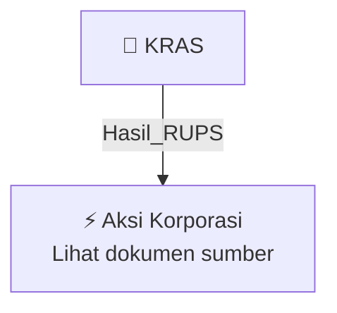

# 🏛️ Hasil & Keputusan RUPS / RUPSLB — [[KRAS]]

⬅️ [[knowledge-base/daily-digests/Daily_Digest_20261006|Kembali ke Daily Digest]] | 📅 **2026-10-06** | 🎛️ [[Dashboard|Ke Dashboard Utama]]

> [!IMPORTANT]
> Laporan ini disusun secara otomatis oleh **Corporate Action Intelligence Agent** pada **2026-10-06**.
> Sumber dokumen: `20261005_KRAS_20261005_KRAS_Transaksi Material Tanpa Persetujuan RUPS_32163259_lamp1.pdf`

---

## 📌 1. Ringkasan Eksekutif & Tujuan Strategis

- **Kode & Nama Emiten**: `[[KRAS]]`
- **Kategori Aksi Korporasi**: `Hasil_RUPS`
- **Dokumen Sumber**: `20261005_KRAS_20261005_KRAS_Transaksi Material Tanpa Persetujuan RUPS_32163259_lamp1.pdf`
- **Tanggal Laporan**: `2026-10-06`

[Analisis LLM tidak tersedia — isi manual]

---

## 📊 2. Fakta Material & Parameter Keuangan

| Parameter Utama | Nilai / Keterangan |
| :--- | :--- |
| **Nama Emiten atau Perusahaan Publik** | `PT Krakatau Steel (Persero) Tbk` |
| **Bidang Usaha** | `Industri Logam Dasar Besi dan Baja` |
| **Tanggal Kejadian** | `30 September 2026` |
| **Jenis Informasi atau Fakta Material** | `Kerja sama pendayagunaan aktiva tetap milik Perseroan dengan PT Cabot Indonesia melalui pemberian rekomendasi Sertipikat Hak Guna Bangunan seluas ±60.000 M2 di atas Sertipikat Hak Pengelolaan Nomor 15/Cilegon atas nama PT Krakatau Sarana Infrastruktur` |
| **Pihak yang Melakukan Transaksi** | `Perseroan selaku pemilik lahan seluas ±60.000 M2; PT KSI selaku pemilik Hak Pengelolaan Nomor 15/Cilegon; PT CI selaku perusahaan yang mendayagunakan lahan milik Perseroan di atas Hak Pengelolaan Nomor 15/Cilegon atas nama PT KSI` |
| **Sifat Hubungan Para Pihak** | `PT KSI adalah Anak Perusahaan Perseroan dengan persentase kepemilikan saham 99,99%` |
| **Jenis Transaksi** | `Pendayagunaan aktiva tetap berupa tanah seluas ±60.000 M2 milik Perseroan di atas Hak Pengelolaan Nomor 15/Cilegon kepada PT CI` |
| **Nilai Transaksi** | `Rp130.740.000.000,00` |
| **Tujuan Pelaksanaan Transaksi** | `Pemenuhan kewajiban restrukturisasi sesuai perjanjian kredit restrukturisasi Perseroan; pendanaan operasional Perseroan` |
| **Dampak Kejadian** | `Memperoleh kompensasi tunai dari PT CI sebesar Rp130.740.000.000,00` |
| **Dasar Regulasi** | `POJK No. 31/POJK.04/2015; POJK No. 45 Tahun 2024; Peraturan BEI No. I-E` |

---

## 👥 3. Struktur Kepemilikan, Pengendali & Pembeli Siaga

- **Emiten**: `KRAS` | Informasi kepemilikan mengacu pada dokumen resmi sumber.

---

## 🎯 4. Alokasi & Rencana Penggunaan Dana

- Informasi alokasi dana belum tersedia — lihat prospektus / dokumen resmi.

---

## 📅 5. Timeline & Jadwal Pelaksanaan

| Tahapan / Event | Tanggal |
| :--- | :---: |
| **Jadwal** | Lihat dokumen sumber. |

---

## 📈 6. Diagram Visual Flowchart (Mermaid)

---

## 💡 7. Rekomendasi Investor & Strategi Trading

[Analisis LLM tidak tersedia — isi manual]

---

## 🔗 8. Hubungan Note Terkait (Knowledge Graph)

- [[knowledge-base/daily-digests/Daily_Digest_20261006|📄 Daily Digest 2026-10-06]]
- [[knowledge-base/trading-signals/Trading_Signals_20261006|🎯 Sinyal Cuan 2026-10-06]]
- [[KRAS|🏬 Halaman Emiten KRAS]]
- [[Dashboard|🎛️ Kembali ke Dashboard Utama]]

---

*Laporan dibuat otomatis oleh Corporate Action Intelligence Agent · 2026-10-06*