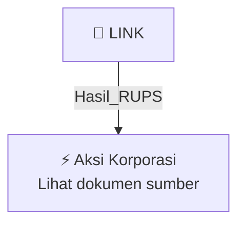

# 🏛️ Hasil & Keputusan RUPS / RUPSLB — [[LINK]]

⬅️ [[knowledge-base/daily-digests/Daily_Digest_20261002|Kembali ke Daily Digest]] | 📅 **2026-10-02** | 🎛️ [[Dashboard|Ke Dashboard Utama]]

> [!IMPORTANT]
> Laporan ini disusun secara otomatis oleh **Corporate Action Intelligence Agent** pada **2026-10-02**.
> Sumber dokumen: `20261001_LINK_20261001_LINK_Laporan Informasi dan Fakta Material_32162366.pdf`

---

## 📌 1. Ringkasan Eksekutif & Tujuan Strategis

- **Kode & Nama Emiten**: `[[LINK]]`
- **Kategori Aksi Korporasi**: `Hasil_RUPS`
- **Dokumen Sumber**: `20261001_LINK_20261001_LINK_Laporan Informasi dan Fakta Material_32162366.pdf`
- **Tanggal Laporan**: `2026-10-02`

[Analisis LLM tidak tersedia — isi manual]

---

## 📊 2. Fakta Material & Parameter Keuangan

| Parameter Utama | Nilai / Keterangan |
| :--- | :--- |
| **Nomor Surat** | `SB-074/CSL-LN/OJK/X/2026` |
| **Nama Emiten** | `PT Link Net Tbk.` |
| **Kode Emiten** | `LINK` |
| **Bidang Usaha** | `Bidang Penyelenggaraan Jaringan Tetap Berbasis Kabel` |
| **Telepon** | `021-55777755` |
| **Email** | `corporate.secretary@linknet.co.id` |
| **Tanggal Kejadian** | `01 Oktober 2026` |
| **Jenis Informasi atau Fakta Material** | `Pengunduran diri anggota Dewan Komisaris Perseroan` |
| **Nama Anggota Dewan Komisaris yang Mengundurkan Diri** | `Vivek Sood` |
| **Jabatan** | `Presiden Komisaris` |
| **Tanggal Surat Pengunduran Diri Diterima** | `1 Oktober 2026` |
| **Tindak Lanjut** | `Perseroan akan mengajukan permohonan persetujuan atas pengunduran diri tersebut dalam Rapat Umum Pemegang Saham Perseroan yang terdekat sesuai dengan ketentuan peraturan perundang-undangan yang berlaku` |
| **Dampak** | `Kejadian, informasi dan fakta material tersebut tidak berdampak secara negatif terhadap kegiatan operasional, hukum, kondisi keuangan, atau kelangsungan usaha Perseroan` |
| **Nama Pengirim** | `Rininta Agustina Widya Pratika` |
| **Waktu Pelaporan** | `01-10-2026 12:01` |
| **Alamat** | `Centennial Tower Lantai 26, Unit D, Jl. Jend. Gatot Subroto Kav. 24-25, Jakarta` |

---

## 👥 3. Struktur Kepemilikan, Pengendali & Pembeli Siaga

- **Emiten**: `LINK` | Informasi kepemilikan mengacu pada dokumen resmi sumber.

---

## 🎯 4. Alokasi & Rencana Penggunaan Dana

- Informasi alokasi dana belum tersedia — lihat prospektus / dokumen resmi.

---

## 📅 5. Timeline & Jadwal Pelaksanaan

| Tahapan / Event | Tanggal |
| :--- | :---: |
| **Jadwal** | Lihat dokumen sumber. |

---

## 📈 6. Diagram Visual Flowchart (Mermaid)

---

## 💡 7. Rekomendasi Investor & Strategi Trading

[Analisis LLM tidak tersedia — isi manual]

---

## 🔗 8. Hubungan Note Terkait (Knowledge Graph)

- [[knowledge-base/daily-digests/Daily_Digest_20261002|📄 Daily Digest 2026-10-02]]
- [[knowledge-base/trading-signals/Trading_Signals_20261002|🎯 Sinyal Cuan 2026-10-02]]
- [[LINK|🏬 Halaman Emiten LINK]]
- [[Dashboard|🎛️ Kembali ke Dashboard Utama]]

---

*Laporan dibuat otomatis oleh Corporate Action Intelligence Agent · 2026-10-02*