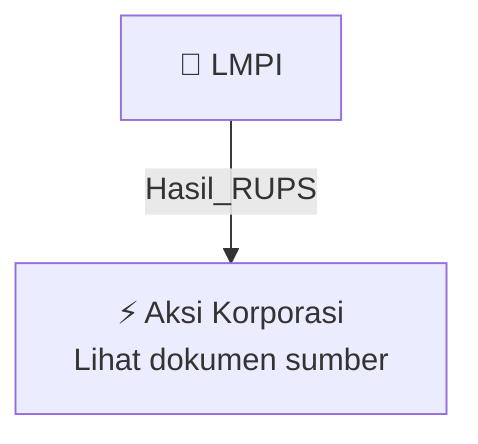

# 🏛️ Hasil & Keputusan RUPS / RUPSLB — [[LMPI]]

⬅️ [[knowledge-base/daily-digests/Daily_Digest_20260929|Kembali ke Daily Digest]] | 📅 **2026-09-29** | 🎛️ [[Dashboard|Ke Dashboard Utama]]

> [!IMPORTANT]
> Laporan ini disusun secara otomatis oleh **Corporate Action Intelligence Agent** pada **2026-09-29**.
> Sumber dokumen: `20260928_LMPI_20260928_LMPI_Ringkasan RisalahRisalah RUPS_32161328_lamp2.pdf`

---

## 📌 1. Ringkasan Eksekutif & Tujuan Strategis

- **Kode & Nama Emiten**: `[[LMPI]]`
- **Kategori Aksi Korporasi**: `Hasil_RUPS`
- **Dokumen Sumber**: `20260928_LMPI_20260928_LMPI_Ringkasan RisalahRisalah RUPS_32161328_lamp2.pdf`
- **Tanggal Laporan**: `2026-09-29`

[Analisis LLM tidak tersedia — isi manual]

---

## 📊 2. Fakta Material & Parameter Keuangan

| Parameter Utama | Nilai / Keterangan |
| :--- | :--- |
| **Uraian Kejadian** | `PT Langgeng Makmur Industri Tbk. (“Perseroan”) PEMBERITAHUAN KEPADA PARA PEMEGANG SAHAM Pemberitahuan kepada Para Pemegang Saham PT Langgeng Makmur Industri Tbk. bahwa Rapat Umum Pemegang Saham Luar Biasa (“RUPS Luar Biasa”) Perseroan (selanjutnya disebut “Rapat”) telah diselenggarakan pada hari Jumat tanggal 25 September 2026, di Pabrik PT Langgeng Makmur Industri Tbk Unit 2, Jalan Desa Bringinbendo, Taman, Sidoarjo, dengan ringkasan risalah sebagai berikut: Agenda Rapat Agenda RUPS Luar Biasa:` |

---

## 👥 3. Struktur Kepemilikan, Pengendali & Pembeli Siaga

- **Emiten**: `LMPI` | Informasi kepemilikan mengacu pada dokumen resmi sumber.

---

## 🎯 4. Alokasi & Rencana Penggunaan Dana

- Informasi alokasi dana belum tersedia — lihat prospektus / dokumen resmi.

---

## 📅 5. Timeline & Jadwal Pelaksanaan

| Tahapan / Event | Tanggal |
| :--- | :---: |
| **Jadwal** | Lihat dokumen sumber. |

---

## 📈 6. Diagram Visual Flowchart (Mermaid)

---

## 💡 7. Rekomendasi Investor & Strategi Trading

[Analisis LLM tidak tersedia — isi manual]

---

## 🔗 8. Hubungan Note Terkait (Knowledge Graph)

- [[knowledge-base/daily-digests/Daily_Digest_20260929|📄 Daily Digest 2026-09-29]]
- [[knowledge-base/trading-signals/Trading_Signals_20260929|🎯 Sinyal Cuan 2026-09-29]]
- [[LMPI|🏬 Halaman Emiten LMPI]]
- [[Dashboard|🎛️ Kembali ke Dashboard Utama]]

---

*Laporan dibuat otomatis oleh Corporate Action Intelligence Agent · 2026-09-29*