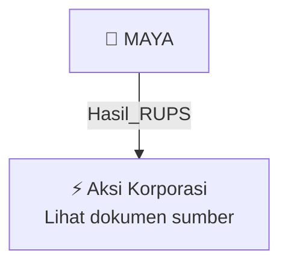

# 🏛️ Hasil & Keputusan RUPS / RUPSLB — [[MAYA]]

⬅️ [[knowledge-base/daily-digests/Daily_Digest_20260928|Kembali ke Daily Digest]] | 📅 **2026-09-28** | 🎛️ [[Dashboard|Ke Dashboard Utama]]

> [!IMPORTANT]
> Laporan ini disusun secara otomatis oleh **Corporate Action Intelligence Agent** pada **2026-09-28**.
> Sumber dokumen: `20260925_MAYA_20260925_MAYA_Ringkasan RisalahRisalah RUPS_32151081.pdf`

---

## 📌 1. Ringkasan Eksekutif & Tujuan Strategis

- **Kode & Nama Emiten**: `[[MAYA]]`
- **Kategori Aksi Korporasi**: `Hasil_RUPS`
- **Dokumen Sumber**: `20260925_MAYA_20260925_MAYA_Ringkasan RisalahRisalah RUPS_32151081.pdf`
- **Tanggal Laporan**: `2026-09-28`

[Analisis LLM tidak tersedia — isi manual]

---

## 📊 2. Fakta Material & Parameter Keuangan

| Parameter Utama | Nilai / Keterangan |
| :--- | :--- |
| **Uraian Kejadian** | `360/DIR/IX/2026 PT Bank Mayapada Internasional Tbk MAYA 2 Ringkasan Risalah Rapat Umum Para Pemegang Saham Luar Biasa Merujuk pada surat Perseroan nomor 329/DIR/VIII/2026 tanggal 28 Agustus 2026, Perseroan menyampaikan hasil penyelenggaraan Rapat Umum Pemegang Saham yang dilaksanakan pada tanggal 24 September 2026, sebagai berikut: RUPS Luar Biasa Rapat Umum Pemegang Saham Telah memenuhi kuorum karena dihadiri oleh pemegang saham yang mewakili 23.684.224.252 saham atau 90,51% dari seluruh saham` |

---

## 👥 3. Struktur Kepemilikan, Pengendali & Pembeli Siaga

- **Emiten**: `MAYA` | Informasi kepemilikan mengacu pada dokumen resmi sumber.

---

## 🎯 4. Alokasi & Rencana Penggunaan Dana

- Informasi alokasi dana belum tersedia — lihat prospektus / dokumen resmi.

---

## 📅 5. Timeline & Jadwal Pelaksanaan

| Tahapan / Event | Tanggal |
| :--- | :---: |
| **Jadwal** | Lihat dokumen sumber. |

---

## 📈 6. Diagram Visual Flowchart (Mermaid)

---

## 💡 7. Rekomendasi Investor & Strategi Trading

[Analisis LLM tidak tersedia — isi manual]

---

## 🔗 8. Hubungan Note Terkait (Knowledge Graph)

- [[knowledge-base/daily-digests/Daily_Digest_20260928|📄 Daily Digest 2026-09-28]]
- [[knowledge-base/trading-signals/Trading_Signals_20260928|🎯 Sinyal Cuan 2026-09-28]]
- [[MAYA|🏬 Halaman Emiten MAYA]]
- [[Dashboard|🎛️ Kembali ke Dashboard Utama]]

---

*Laporan dibuat otomatis oleh Corporate Action Intelligence Agent · 2026-09-28*