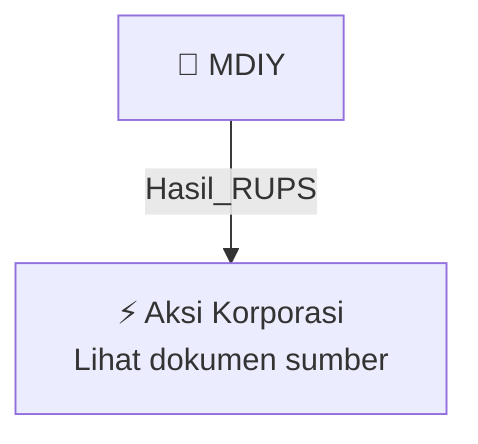

# 🏛️ Hasil & Keputusan RUPS / RUPSLB — [[MDIY]]

⬅️ [[knowledge-base/daily-digests/Daily_Digest_20261005|Kembali ke Daily Digest]] | 📅 **2026-10-05** | 🎛️ [[Dashboard|Ke Dashboard Utama]]

> [!IMPORTANT]
> Laporan ini disusun secara otomatis oleh **Corporate Action Intelligence Agent** pada **2026-10-05**.
> Sumber dokumen: `20261002_MDIY_20261001_MDIY_Laporan Hasil Pelaksanaan Konversi ESOP MSOP_32162521.pdf`

---

## 📌 1. Ringkasan Eksekutif & Tujuan Strategis

- **Kode & Nama Emiten**: `[[MDIY]]`
- **Kategori Aksi Korporasi**: `Hasil_RUPS`
- **Dokumen Sumber**: `20261002_MDIY_20261001_MDIY_Laporan Hasil Pelaksanaan Konversi ESOP MSOP_32162521.pdf`
- **Tanggal Laporan**: `2026-10-05`

[Analisis LLM tidak tersedia — isi manual]

---

## 📊 2. Fakta Material & Parameter Keuangan

| Parameter Utama | Nilai / Keterangan |
| :--- | :--- |
| **Jenis Tahapan** | `MESOP Tahap I` |
| **Jumlah yang telah dilaksanakan** | `0` |
| **Harga Pelaksanaan** | `1.650` |
| **Jumlah ESOP/MSOP yang belum dilaksanakan dan masih berlaku** | `80.923.000` |
| **Total Jumlah ESOP/MSOP** | `127.098.000` |
| **Tanggal Pelaksanaan** | `2026-08-18` |
| **Tanggal RUPS** | `2024-08-07` |
| **Batas waktu ESOP/MSOP** | `2029-08-06` |
| **Nama Pengirim** | `Janina Maia` |
| **Tanggal dan Waktu Laporan** | `2026-10-02 16:39` |
| **Lampiran** | `MDIY_Hasil MESOP Tahap I - Periode II 2026.pdf` |

---

## 👥 3. Struktur Kepemilikan, Pengendali & Pembeli Siaga

- **Emiten**: `MDIY` | Informasi kepemilikan mengacu pada dokumen resmi sumber.

---

## 🎯 4. Alokasi & Rencana Penggunaan Dana

- Informasi alokasi dana belum tersedia — lihat prospektus / dokumen resmi.

---

## 📅 5. Timeline & Jadwal Pelaksanaan

| Tahapan / Event | Tanggal |
| :--- | :---: |
| **Jadwal** | Lihat dokumen sumber. |

---

## 📈 6. Diagram Visual Flowchart (Mermaid)

---

## 💡 7. Rekomendasi Investor & Strategi Trading

[Analisis LLM tidak tersedia — isi manual]

---

## 🔗 8. Hubungan Note Terkait (Knowledge Graph)

- [[knowledge-base/daily-digests/Daily_Digest_20261005|📄 Daily Digest 2026-10-05]]
- [[knowledge-base/trading-signals/Trading_Signals_20261005|🎯 Sinyal Cuan 2026-10-05]]
- [[MDIY|🏬 Halaman Emiten MDIY]]
- [[Dashboard|🎛️ Kembali ke Dashboard Utama]]

---

*Laporan dibuat otomatis oleh Corporate Action Intelligence Agent · 2026-10-05*