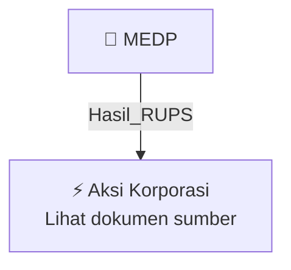

# 🏛️ Hasil & Keputusan RUPS / RUPSLB — [[MEDP]]

⬅️ [[knowledge-base/daily-digests/Daily_Digest_20261006|Kembali ke Daily Digest]] | 📅 **2026-10-06** | 🎛️ [[Dashboard|Ke Dashboard Utama]]

> [!IMPORTANT]
> Laporan ini disusun secara otomatis oleh **Corporate Action Intelligence Agent** pada **2026-10-06**.
> Sumber dokumen: `20261005_MEDP_20261005_MEDP_Laporan Informasi dan Fakta Material_32163135_lamp2.pdf`

---

## 📌 1. Ringkasan Eksekutif & Tujuan Strategis

- **Kode & Nama Emiten**: `[[MEDP]]`
- **Kategori Aksi Korporasi**: `Hasil_RUPS`
- **Dokumen Sumber**: `20261005_MEDP_20261005_MEDP_Laporan Informasi dan Fakta Material_32163135_lamp2.pdf`
- **Tanggal Laporan**: `2026-10-06`

[Analisis LLM tidak tersedia — isi manual]

---

## 📊 2. Fakta Material & Parameter Keuangan

| Parameter Utama | Nilai / Keterangan |
| :--- | :--- |
| **Nama Perseroan** | `PT Medco Power Indonesia` |
| **Jenis Dokumen** | `Pernyataan Keputusan Sirkuler Pemegang Saham Sebagai Pengganti Rapat Umum Pemegang Saham` |
| **Nomor Akta/Pernyataan** | `01` |
| **Tanggal Keputusan** | `2026-10-01` |
| **Hari** | `Kamis` |
| **Waktu** | `10.00 WIB` |
| **Notaris** | `Siti Rumondang Buian Lubis, SH., M.KN` |
| **Kedudukan Notaris** | `Kabupaten Tangerang` |
| **Pihak Hadir** | `Sabrina Rahmi Fala` |
| **Kapasitas Pihak Hadir** | `Bertindak atas kekuatan kuasa dari PT Medco Power Indonesia` |
| **Dasar Kuasa** | `Keputusan Sirkuler Pemegang Saham Sebagai Pengganti Rapat Umum Pemegang Saham tertanggal 01-10-2026` |
| **Kedudukan Perseroan** | `Jakarta Selatan` |
| **Referensi Regulasi** | `Undang-Undang Nomor 40 Tahun 2007 tentang Perseroan Terbatas` |
| **Akta Pendirian/Perubahan Awal** | `Akta tanggal 27-12-2007 Nomor 05` |
| **Persetujuan Menteri Hukum dan HAM** | `Surat Keputusan tertanggal 23-01-2008` |

---

## 👥 3. Struktur Kepemilikan, Pengendali & Pembeli Siaga

- **Emiten**: `MEDP` | Informasi kepemilikan mengacu pada dokumen resmi sumber.

---

## 🎯 4. Alokasi & Rencana Penggunaan Dana

- Informasi alokasi dana belum tersedia — lihat prospektus / dokumen resmi.

---

## 📅 5. Timeline & Jadwal Pelaksanaan

| Tahapan / Event | Tanggal |
| :--- | :---: |
| **Jadwal** | Lihat dokumen sumber. |

---

## 📈 6. Diagram Visual Flowchart (Mermaid)

---

## 💡 7. Rekomendasi Investor & Strategi Trading

[Analisis LLM tidak tersedia — isi manual]

---

## 🔗 8. Hubungan Note Terkait (Knowledge Graph)

- [[knowledge-base/daily-digests/Daily_Digest_20261006|📄 Daily Digest 2026-10-06]]
- [[knowledge-base/trading-signals/Trading_Signals_20261006|🎯 Sinyal Cuan 2026-10-06]]
- [[MEDP|🏬 Halaman Emiten MEDP]]
- [[Dashboard|🎛️ Kembali ke Dashboard Utama]]

---

*Laporan dibuat otomatis oleh Corporate Action Intelligence Agent · 2026-10-06*