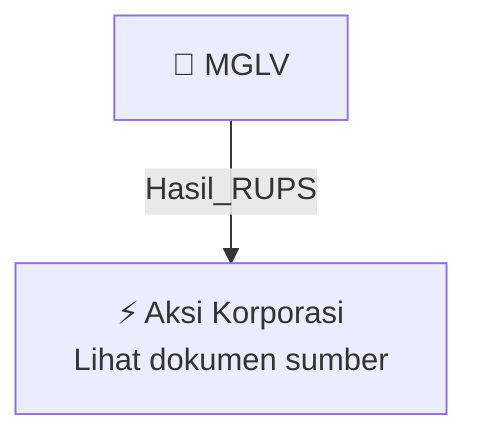

# 🏛️ Hasil & Keputusan RUPS / RUPSLB — [[MGLV]]

⬅️ [[knowledge-base/daily-digests/Daily_Digest_20260925|Kembali ke Daily Digest]] | 📅 **2026-09-25** | 🎛️ [[Dashboard|Ke Dashboard Utama]]

> [!IMPORTANT]
> Laporan ini disusun secara otomatis oleh **Corporate Action Intelligence Agent** pada **2026-09-25**.
> Sumber dokumen: `20260924_MGLV_20260924_MGLV_Transaksi Material Tanpa Persetujuan RUPS_32150745_lamp1.pdf`

---

## 📌 1. Ringkasan Eksekutif & Tujuan Strategis

- **Kode & Nama Emiten**: `[[MGLV]]`
- **Kategori Aksi Korporasi**: `Hasil_RUPS`
- **Dokumen Sumber**: `20260924_MGLV_20260924_MGLV_Transaksi Material Tanpa Persetujuan RUPS_32150745_lamp1.pdf`
- **Tanggal Laporan**: `2026-09-25`

[Analisis LLM tidak tersedia — isi manual]

---

## 📊 2. Fakta Material & Parameter Keuangan

| Parameter Utama | Nilai / Keterangan |
| :--- | :--- |
| **Uraian Kejadian** | `1 KETERBUKAAN INFORMASI KEPADA PEMEGANG SAHAM SEHUBUNGAN DENGAN TRANSAKSI MATERIAL DAN TRANSAKSI AFILIASI PT NEXAI DIGITAL INFRASTRUKTUR TBK (“PERSEROAN”) (“KETERBUKAAN INFORMASI”) INFORMASI SEBAGAIMANA TERCANTUM DALAM KETERBUKAAN INFORMASI INI PENTING DAN PERLU DIPERHATIKAN OLEH PEMEGANG SAHAM PERSEROAN SEHUBUNGAN DENGAN TRANSAKSI MATERIAL DAN TRANSAKSI AFILIASI YANG TELAH DILAKUKAN OLEH PERSEROAN DAN PERUSAHAAN ANAK. KETERBUKAAN INFORMASI KEPADA PARA PEMEGANG SAHAM INI DISAMPAIKAN OLEH PERSERO` |

---

## 👥 3. Struktur Kepemilikan, Pengendali & Pembeli Siaga

- **Emiten**: `MGLV` | Informasi kepemilikan mengacu pada dokumen resmi sumber.

---

## 🎯 4. Alokasi & Rencana Penggunaan Dana

- Informasi alokasi dana belum tersedia — lihat prospektus / dokumen resmi.

---

## 📅 5. Timeline & Jadwal Pelaksanaan

| Tahapan / Event | Tanggal |
| :--- | :---: |
| **Jadwal** | Lihat dokumen sumber. |

---

## 📈 6. Diagram Visual Flowchart (Mermaid)

---

## 💡 7. Rekomendasi Investor & Strategi Trading

[Analisis LLM tidak tersedia — isi manual]

---

## 🔗 8. Hubungan Note Terkait (Knowledge Graph)

- [[knowledge-base/daily-digests/Daily_Digest_20260925|📄 Daily Digest 2026-09-25]]
- [[knowledge-base/trading-signals/Trading_Signals_20260925|🎯 Sinyal Cuan 2026-09-25]]
- [[MGLV|🏬 Halaman Emiten MGLV]]
- [[Dashboard|🎛️ Kembali ke Dashboard Utama]]

---

*Laporan dibuat otomatis oleh Corporate Action Intelligence Agent · 2026-09-25*