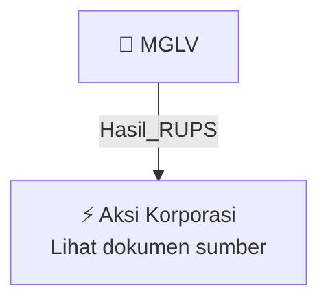

# 🏛️ Hasil & Keputusan RUPS / RUPSLB — [[MGLV]]

⬅️ [[knowledge-base/daily-digests/Daily_Digest_20261006|Kembali ke Daily Digest]] | 📅 **2026-10-06** | 🎛️ [[Dashboard|Ke Dashboard Utama]]

> [!IMPORTANT]
> Laporan ini disusun secara otomatis oleh **Corporate Action Intelligence Agent** pada **2026-10-06**.
> Sumber dokumen: `20261005_MGLV_20261005_MGLV_Transaksi Material Tanpa Persetujuan RUPS_32163444_lamp1.pdf`

---

## 📌 1. Ringkasan Eksekutif & Tujuan Strategis

- **Kode & Nama Emiten**: `[[MGLV]]`
- **Kategori Aksi Korporasi**: `Hasil_RUPS`
- **Dokumen Sumber**: `20261005_MGLV_20261005_MGLV_Transaksi Material Tanpa Persetujuan RUPS_32163444_lamp1.pdf`
- **Tanggal Laporan**: `2026-10-06`

[Analisis LLM tidak tersedia — isi manual]

---

## 📊 2. Fakta Material & Parameter Keuangan

| Parameter Utama | Nilai / Keterangan |
| :--- | :--- |
| **Nama Perseroan** | `PT NEXAI DIGITAL INFRASTRUKTUR TBK` |
| **Tanggal Keterbukaan Informasi** | `5 Oktober 2026` |
| **Dasar Regulasi** | `POJK No. 17/POJK.04/2020 tentang Transaksi Material dan Perubahan Kegiatan Usaha; POJK No. 42/POJK.04/2020 tentang Transaksi Afiliasi dan Transaksi Benturan Kepentingan` |
| **Jenis Transaksi** | `Transaksi Material dan Transaksi Afiliasi` |
| **Pihak dalam Perjanjian Pinjaman Pemegang Saham NAC** | `NAC sebagai debitur dan Perseroan sebagai kreditur` |
| **Tanggal Perjanjian Pinjaman Pemegang Saham NAC** | `2 Oktober 2026` |
| **Pihak dalam Perjanjian Pinjaman Pemegang Saham NGC** | `NGC sebagai debitur dan Perseroan sebagai kreditur` |
| **Tanggal Perjanjian Pinjaman Pemegang Saham NGC** | `2 Oktober 2026` |
| **Kepemilikan Perseroan atas NAC** | `99,9%` |
| **Kepemilikan Perseroan atas NGC** | `99,9%` |
| **Laporan Keuangan Perseroan yang Dirujuk** | `Laporan Keuangan Konsolidasian Auditan Perseroan dan Entitas Anak Tanggal 30 April 2026` |
| **Judul Dokumen** | `Transaksi Material Tanpa Persetujuan RUPS` |

---

## 👥 3. Struktur Kepemilikan, Pengendali & Pembeli Siaga

- **Emiten**: `MGLV` | Informasi kepemilikan mengacu pada dokumen resmi sumber.

---

## 🎯 4. Alokasi & Rencana Penggunaan Dana

- Informasi alokasi dana belum tersedia — lihat prospektus / dokumen resmi.

---

## 📅 5. Timeline & Jadwal Pelaksanaan

| Tahapan / Event | Tanggal |
| :--- | :---: |
| **Jadwal** | Lihat dokumen sumber. |

---

## 📈 6. Diagram Visual Flowchart (Mermaid)

---

## 💡 7. Rekomendasi Investor & Strategi Trading

[Analisis LLM tidak tersedia — isi manual]

---

## 🔗 8. Hubungan Note Terkait (Knowledge Graph)

- [[knowledge-base/daily-digests/Daily_Digest_20261006|📄 Daily Digest 2026-10-06]]
- [[knowledge-base/trading-signals/Trading_Signals_20261006|🎯 Sinyal Cuan 2026-10-06]]
- [[MGLV|🏬 Halaman Emiten MGLV]]
- [[Dashboard|🎛️ Kembali ke Dashboard Utama]]

---

*Laporan dibuat otomatis oleh Corporate Action Intelligence Agent · 2026-10-06*