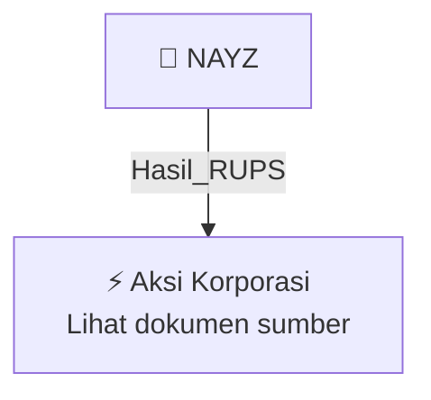

# 🏛️ Hasil & Keputusan RUPS / RUPSLB — [[NAYZ]]

⬅️ [[knowledge-base/daily-digests/Daily_Digest_20261006|Kembali ke Daily Digest]] | 📅 **2026-10-06** | 🎛️ [[Dashboard|Ke Dashboard Utama]]

> [!IMPORTANT]
> Laporan ini disusun secara otomatis oleh **Corporate Action Intelligence Agent** pada **2026-10-06**.
> Sumber dokumen: `20261005_NAYZ_20261005_NAYZ_Ringkasan RisalahRisalah RUPS_32163219.pdf`

---

## 📌 1. Ringkasan Eksekutif & Tujuan Strategis

- **Kode & Nama Emiten**: `[[NAYZ]]`
- **Kategori Aksi Korporasi**: `Hasil_RUPS`
- **Dokumen Sumber**: `20261005_NAYZ_20261005_NAYZ_Ringkasan RisalahRisalah RUPS_32163219.pdf`
- **Tanggal Laporan**: `2026-10-06`

[Analisis LLM tidak tersedia — isi manual]

---

## 📊 2. Fakta Material & Parameter Keuangan

| Parameter Utama | Nilai / Keterangan |
| :--- | :--- |
| **Jenis RUPS** | `Rapat Umum Pemegang Saham Luar Biasa` |
| **Tanggal penyelenggaraan RUPS** | `02 Oktober 2026` |
| **Tanggal pelaporan/surat** | `05 Oktober 2026` |
| **Kuorum kehadiran** | `1.479.291.806 saham atau 58,01% dari seluruh saham dengan hak suara sah` |
| **Agenda 1** | `Persetujuan perubahan susunan anggota Direksi dan Dewan Komisaris Perseroan` |
| **Hasil Agenda 1** | `Setuju` |
| **Agenda 2** | `Penegasan susunan pemegang saham Perseroan` |
| **Hasil Agenda 2** | `Setuju` |
| **Direktur Utama** | `Dody Arifianto, periode 05 Juni 2026 sampai 30 Juni 2027` |
| **Direktur** | `Eko Safrudin, periode 05 Juni 2026 sampai 30 Juni 2027` |
| **Direktur** | `Nusttanakit Sasiarnon, periode 02 Oktober 2026 sampai 30 Juni 2027` |
| **Komisaris Utama** | `Teuku Chairul Wisal, periode 05 Juni 2026 sampai 30 Juni 2027` |
| **Komisaris** | `Bambang Wijananto, periode 30 Mei 2024 sampai 30 Juni 2027` |
| **Komisaris** | `Sawin Laosethakul, periode 02 Oktober 2026 sampai 30 Juni 2027` |

---

## 👥 3. Struktur Kepemilikan, Pengendali & Pembeli Siaga

- **Emiten**: `NAYZ` | Informasi kepemilikan mengacu pada dokumen resmi sumber.

---

## 🎯 4. Alokasi & Rencana Penggunaan Dana

- Informasi alokasi dana belum tersedia — lihat prospektus / dokumen resmi.

---

## 📅 5. Timeline & Jadwal Pelaksanaan

| Tahapan / Event | Tanggal |
| :--- | :---: |
| **Jadwal** | Lihat dokumen sumber. |

---

## 📈 6. Diagram Visual Flowchart (Mermaid)

---

## 💡 7. Rekomendasi Investor & Strategi Trading

[Analisis LLM tidak tersedia — isi manual]

---

## 🔗 8. Hubungan Note Terkait (Knowledge Graph)

- [[knowledge-base/daily-digests/Daily_Digest_20261006|📄 Daily Digest 2026-10-06]]
- [[knowledge-base/trading-signals/Trading_Signals_20261006|🎯 Sinyal Cuan 2026-10-06]]
- [[NAYZ|🏬 Halaman Emiten NAYZ]]
- [[Dashboard|🎛️ Kembali ke Dashboard Utama]]

---

*Laporan dibuat otomatis oleh Corporate Action Intelligence Agent · 2026-10-06*