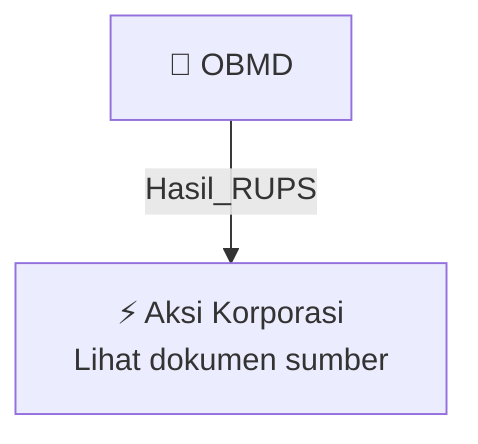

# 🏛️ Hasil & Keputusan RUPS / RUPSLB — [[OBMD]]

⬅️ [[knowledge-base/daily-digests/Daily_Digest_20261002|Kembali ke Daily Digest]] | 📅 **2026-10-02** | 🎛️ [[Dashboard|Ke Dashboard Utama]]

> [!IMPORTANT]
> Laporan ini disusun secara otomatis oleh **Corporate Action Intelligence Agent** pada **2026-10-02**.
> Sumber dokumen: `20261001_OBMD_20261001_OBMD_Ringkasan RisalahRisalah RUPS_32162353.pdf`

---

## 📌 1. Ringkasan Eksekutif & Tujuan Strategis

- **Kode & Nama Emiten**: `[[OBMD]]`
- **Kategori Aksi Korporasi**: `Hasil_RUPS`
- **Dokumen Sumber**: `20261001_OBMD_20261001_OBMD_Ringkasan RisalahRisalah RUPS_32162353.pdf`
- **Tanggal Laporan**: `2026-10-02`

[Analisis LLM tidak tersedia — isi manual]

---

## 📊 2. Fakta Material & Parameter Keuangan

| Parameter Utama | Nilai / Keterangan |
| :--- | :--- |
| **Jenis RUPS** | `Rapat Umum Pemegang Saham Luar Biasa` |
| **Tanggal RUPS** | `29 September 2026` |
| **Nomor Surat Perseroan** | `056.CS/OBMD/X/2026` |
| **Referensi Surat Sebelumnya** | `050.CS/OBMD/IX/2026 tanggal 07 September 2026` |
| **Kuorum Kehadiran - Jumlah Saham** | `541.078.400 saham` |
| **Kuorum Kehadiran - Persentase** | `67,1319%` |
| **Agenda 1** | `Persetujuan Pengangkatan Kembali / Perubahan Susunan Direksi` |
| **Hasil Agenda 1** | `Setuju 100%; Tidak Setuju 0%; Abstain 0%` |
| **Agenda 2** | `Persetujuan Pengangkatan Kembali / Perubahan Susunan Dewan Komisaris` |
| **Hasil Agenda 2** | `Setuju 100%; Tidak Setuju 0%; Abstain 0%` |
| **Direktur Utama** | `Ryanto Husodo, periode 29 September 2026 sampai 30 Juni 2031` |
| **Wakil Direktur Utama** | `Ivan Alamsyah Siregar, periode 29 September 2026 sampai 30 Juni 2031` |
| **Direktur 1** | `Ayudyah Widyahening, periode 29 September 2026 sampai 30 Juni 2031` |
| **Direktur 2** | `Irvan Juliansah, periode 29 September 2026 sampai 30 Juni 2031` |
| **Komisaris Utama** | `Mohamad Asad, periode 29 September 2026 sampai 30 Juni 2031` |
| **Komisaris Independen** | `Darmaji Nasim, periode 29 September 2026 sampai 30 Juni 2031` |
| **Komisaris** | `Andang Bachtiar, periode 29 September 2026 sampai 30 Juni 2031` |
| **Masa Jabatan** | `5 tahun, berakhir 30 Juni 2031` |
| **Acquit et de charge** | `Diberikan dan berlaku efektif pada RUPST Tahun Buku 2026 sejauh tercermin dalam Laporan Tahunan dan Laporan Keuangan Tahunan yang akan disahkan` |

---

## 👥 3. Struktur Kepemilikan, Pengendali & Pembeli Siaga

- **Emiten**: `OBMD` | Informasi kepemilikan mengacu pada dokumen resmi sumber.

---

## 🎯 4. Alokasi & Rencana Penggunaan Dana

- Informasi alokasi dana belum tersedia — lihat prospektus / dokumen resmi.

---

## 📅 5. Timeline & Jadwal Pelaksanaan

| Tahapan / Event | Tanggal |
| :--- | :---: |
| **Jadwal** | Lihat dokumen sumber. |

---

## 📈 6. Diagram Visual Flowchart (Mermaid)

---

## 💡 7. Rekomendasi Investor & Strategi Trading

[Analisis LLM tidak tersedia — isi manual]

---

## 🔗 8. Hubungan Note Terkait (Knowledge Graph)

- [[knowledge-base/daily-digests/Daily_Digest_20261002|📄 Daily Digest 2026-10-02]]
- [[knowledge-base/trading-signals/Trading_Signals_20261002|🎯 Sinyal Cuan 2026-10-02]]
- [[OBMD|🏬 Halaman Emiten OBMD]]
- [[Dashboard|🎛️ Kembali ke Dashboard Utama]]

---

*Laporan dibuat otomatis oleh Corporate Action Intelligence Agent · 2026-10-02*