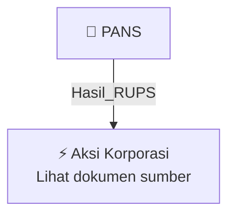

# 🏛️ Hasil & Keputusan RUPS / RUPSLB — [[PANS]]

⬅️ [[knowledge-base/daily-digests/Daily_Digest_20261009|Kembali ke Daily Digest]] | 📅 **2026-10-09** | 🎛️ [[Dashboard|Ke Dashboard Utama]]

> [!IMPORTANT]
> Laporan ini disusun secara otomatis oleh **Corporate Action Intelligence Agent** pada **2026-10-09**.
> Sumber dokumen: `20261007_PANS_20261007_PANS_Laporan Informasi dan Fakta Material_32164379.pdf`

---

## 📌 1. Ringkasan Eksekutif & Tujuan Strategis

- **Kode & Nama Emiten**: `[[PANS]]`
- **Kategori Aksi Korporasi**: `Hasil_RUPS`
- **Dokumen Sumber**: `20261007_PANS_20261007_PANS_Laporan Informasi dan Fakta Material_32164379.pdf`
- **Tanggal Laporan**: `2026-10-09`

[Analisis LLM tidak tersedia — isi manual]

---

## 📊 2. Fakta Material & Parameter Keuangan

| Parameter Utama | Nilai / Keterangan |
| :--- | :--- |
| **Nama Emiten atau Perusahaan Publik** | `Panin Sekuritas Tbk` |
| **Kode Emiten** | `PANS` |
| **Bidang Usaha** | `Securities Company` |
| **Tanggal Kejadian** | `30 September 2026` |
| **Jenis Informasi atau Fakta Material** | `Susunan Dewan Komisaris PT Panin Sekuritas Tbk` |
| **Pihak yang Mengundurkan Diri** | `Bapak Mumin Ali Gunawan` |
| **Jabatan Semula** | `Presiden Komisaris Panin Sekuritas` |
| **Surat Panin Sekuritas Terkait Pengunduran Diri** | `Nomor 172/DIR-PS/VI/2026 tanggal 30 Juni 2026` |
| **Surat OJK** | `Nomor S-485/PM.11/2026 tanggal 30 September 2026` |
| **Isi Pokok Surat OJK** | `Tidak terdapat hal-hal yang dapat menunda pengunduran diri Bapak Mumin Ali Gunawan sebagai Presiden Komisaris Panin Sekuritas` |
| **Kewajiban RUPS** | `Menyelenggarakan RUPS untuk mengagendakan perubahan susunan Dewan Komisaris paling lambat 90 hari setelah diperoleh Surat OJK No. S-485/PM.11/2026` |
| **Dasar Hukum** | `Pasal 27 Peraturan OJK Nomor 33/POJK.04/2014 tentang Direksi dan Dewan Komisaris Emiten atau Perusahaan Publik` |
| **Nama Pengirim** | `Prama Nugraha` |
| **Jabatan Pengirim** | `Panin Sekuritas Tbk` |
| **Tanggal dan Waktu Pelaporan** | `07-10-2026 17:43` |
| **Lampiran** | `PANS - KI Perubahan Susunan Dekom.pdf` |

---

## 👥 3. Struktur Kepemilikan, Pengendali & Pembeli Siaga

- **Emiten**: `PANS` | Informasi kepemilikan mengacu pada dokumen resmi sumber.

---

## 🎯 4. Alokasi & Rencana Penggunaan Dana

- Informasi alokasi dana belum tersedia — lihat prospektus / dokumen resmi.

---

## 📅 5. Timeline & Jadwal Pelaksanaan

| Tahapan / Event | Tanggal |
| :--- | :---: |
| **Jadwal** | Lihat dokumen sumber. |

---

## 📈 6. Diagram Visual Flowchart (Mermaid)

---

## 💡 7. Rekomendasi Investor & Strategi Trading

[Analisis LLM tidak tersedia — isi manual]

---

## 🔗 8. Hubungan Note Terkait (Knowledge Graph)

- [[knowledge-base/daily-digests/Daily_Digest_20261009|📄 Daily Digest 2026-10-09]]
- [[knowledge-base/trading-signals/Trading_Signals_20261009|🎯 Sinyal Cuan 2026-10-09]]
- [[PANS|🏬 Halaman Emiten PANS]]
- [[Dashboard|🎛️ Kembali ke Dashboard Utama]]

---

*Laporan dibuat otomatis oleh Corporate Action Intelligence Agent · 2026-10-09*