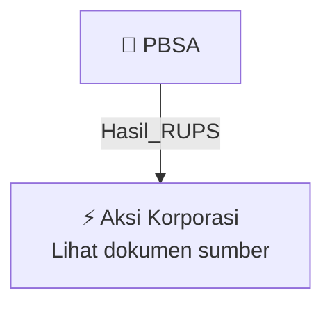

# 🏛️ Hasil & Keputusan RUPS / RUPSLB — [[PBSA]]

⬅️ [[knowledge-base/daily-digests/Daily_Digest_20260923|Kembali ke Daily Digest]] | 📅 **2026-09-23** | 🎛️ [[Dashboard|Ke Dashboard Utama]]

> [!IMPORTANT]
> Laporan ini disusun secara otomatis oleh **Corporate Action Intelligence Agent** pada **2026-09-23**.
> Sumber dokumen: `20260922_PBSA_20260922_PBSA_Ringkasan RisalahRisalah RUPS_32150234_lamp2.pdf`

---

## 📌 1. Ringkasan Eksekutif & Tujuan Strategis

- **Kode & Nama Emiten**: `[[PBSA]]`
- **Kategori Aksi Korporasi**: `Hasil_RUPS`
- **Dokumen Sumber**: `20260922_PBSA_20260922_PBSA_Ringkasan RisalahRisalah RUPS_32150234_lamp2.pdf`
- **Tanggal Laporan**: `2026-09-23`

[Analisis LLM tidak tersedia — isi manual]

---

## 📊 2. Fakta Material & Parameter Keuangan

| Parameter Utama | Nilai / Keterangan |
| :--- | :--- |
| **Uraian Kejadian** | `PENGUMUMAN RINGKASAN RISALAH RAPAT UMUM PEMEGANG SAHAM LUAR BIASA PT PARAMITA BANGUN SARANA TBK Pada hari Jumat, 18 September 2026 di Shanghai Meeting Room Lantai 6, Merlynn Park Hotel Jakarta. Jl. KH. Hasyim Ashari No. 29-31, RT.7/RW.7, Petojo Utara, Gambir, Jakarta Pusat, 10130, telah diselenggarakan Rapat Umum Pemegang Saham Luar Biasa (”RUPSLB”) PT Paramita Bangun Sarana Tbk (”Perseroan”) dan Ringkasan Risalahnya adalah sebagai berikut: I. Kehadiran Direksi dan Dewan Komisaris Perseroan RUPS` |

---

## 👥 3. Struktur Kepemilikan, Pengendali & Pembeli Siaga

- **Emiten**: `PBSA` | Informasi kepemilikan mengacu pada dokumen resmi sumber.

---

## 🎯 4. Alokasi & Rencana Penggunaan Dana

- Informasi alokasi dana belum tersedia — lihat prospektus / dokumen resmi.

---

## 📅 5. Timeline & Jadwal Pelaksanaan

| Tahapan / Event | Tanggal |
| :--- | :---: |
| **Jadwal** | Lihat dokumen sumber. |

---

## 📈 6. Diagram Visual Flowchart (Mermaid)

---

## 💡 7. Rekomendasi Investor & Strategi Trading

[Analisis LLM tidak tersedia — isi manual]

---

## 🔗 8. Hubungan Note Terkait (Knowledge Graph)

- [[knowledge-base/daily-digests/Daily_Digest_20260923|📄 Daily Digest 2026-09-23]]
- [[knowledge-base/trading-signals/Trading_Signals_20260923|🎯 Sinyal Cuan 2026-09-23]]
- [[PBSA|🏬 Halaman Emiten PBSA]]
- [[Dashboard|🎛️ Kembali ke Dashboard Utama]]

---

*Laporan dibuat otomatis oleh Corporate Action Intelligence Agent · 2026-09-23*